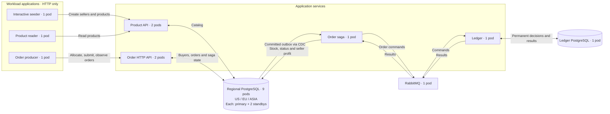
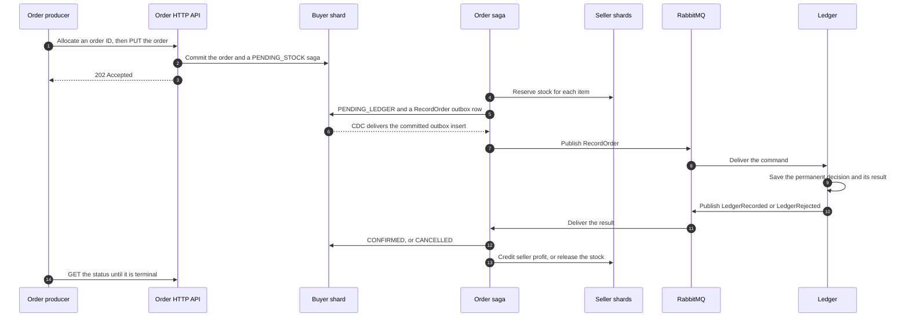
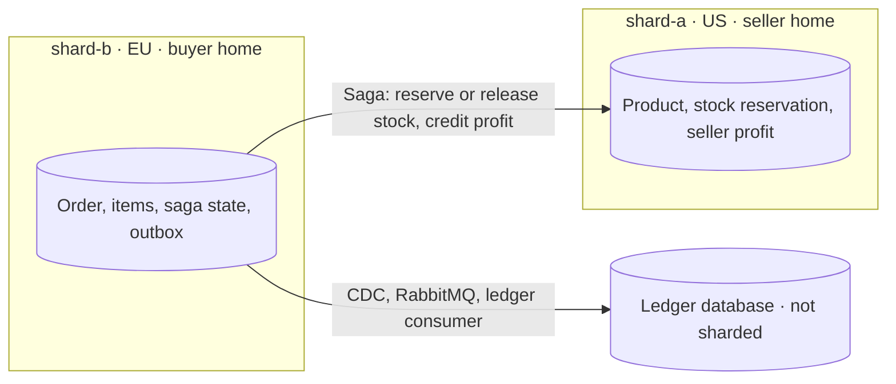

# ShardShop architecture

[README](README.md) · [Runbook](RUNBOOK.md) · [Implementation plan](PLAN.md) · [Version policy](VERSIONS.md) · [Dated evidence](CHANGELOG.md)

ShardShop is a local system-design lab. It runs a regional product catalog,
sharded orders and an asynchronous ledger on one kind cluster. This overview
describes the implemented architecture. Only the optional cloud target (milestone 7
in the [plan](PLAN.md)) is not implemented. The
[detailed documents](#detailed-design-documents) own each topic.

- **Shape:** six Quarkus applications, three regional PostgreSQL shards, one
  ledger database and one RabbitMQ broker.
- **Consistency:** each write is a local transaction. The order saga connects the
  shards and the ledger through CDC, RabbitMQ and compensation. There is no
  distributed transaction.
- **Qualified capacity on this lab:** 29.354 accepted orders/s and 995.111 product
  reads/s, measured separately ([section 4](#4-performance)).

## 1. System architecture



| Component | Responsibility |
|---|---|
| Product API | Creates sellers and products, serves catalog reads and the `/products/` page, and applies the seller currency policy. |
| Order HTTP API | Creates buyers, issues order IDs, accepts orders atomically and serves the `/orders/` page. |
| Order saga | Reserves stock, relays committed commands through CDC, applies ledger results, credits seller profit, replays overdue ledger commands within a durable retry budget and removes expired transport after CDC checkpointing. |
| Ledger | Keeps one permanent decision for each order, publishes its result and removes expired transport. |
| Workloads | Seed the catalog, read products and produce orders through the public APIs only. |
| PostgreSQL and RabbitMQ | Regional shards, the separate ledger store and the message transport. |

Kubernetes Services spread HTTP connections across the product and order API pods.
They are network resources and add no pods. Workloads have no database access. A
one-shot bootstrap seeder Job fills the catalog; reader and producer traffic waits
until the complete catalog resolves. The interactive seeder stays available.

### Main flows

- **Read:** the product API derives the shard from the seller ID and reads that
  regional primary. An optional strict replica profile reads standbys, accepts
  stale data and fails when no standby is available.
- **Write:** the order API issues an order ID, validates the buyer and products,
  then commits the order and its initial saga state on the buyer's shard. It
  answers `202 Accepted`; confirmation comes later.
- **Saga:** a separate order process reserves stock on the seller shards,
  publishes the committed command through CDC and RabbitMQ, and applies the ledger
  decision. Confirmation creates seller-profit work; rejection releases the stock.
  Retries use durable identities, thus stock, ledger and profit effects occur once.

The saga and ledger processes clean up expired inbox and published outbox rows
after a configurable retention window (24 hours by default). Permanent decisions,
replay identities and business state remain available for recovery. Order outbox
cleanup also waits for a durable CDC checkpoint. These workers add no pods.
An operator can reset an exhausted retry budget for a selected pending saga;
terminal decisions remain unchanged.

Application metrics report pending work, exhausted retries, quarantine, database
pool pressure and CDC recovery state. RabbitMQ and PostgreSQL expose their queue
and replication pressure through native monitoring. These endpoints add no pods;
the [monitoring guide](infra/README.md#monitoring) owns their operational details.



## 2. Runtime topology

The kind lab runs **36 steady pods** in all namespaces. The `shardshop` namespace
contains 20 of them.

| Group | Pods | Contents |
|---|---:|---|
| Application services | 6 | Product API 2, order HTTP API 2, order saga 1, ledger 1 |
| Workloads | 3 | Product reader, order producer and interactive seeder |
| Regional PostgreSQL | 9 | Three shards, each with one primary and two standbys |
| Ledger PostgreSQL | 1 | One primary without a standby |
| RabbitMQ | 1 | One broker |
| **`shardshop` namespace** | **20** | Applications, databases and broker |
| CloudNativePG operator | 1 | Database operator |
| Kubernetes system | 14 | kind control plane, DNS and networking |
| Storage | 1 | Local-path provisioner |
| **All namespaces** | **36** | |

The counts exclude transient Jobs (bootstrap seeder, Flyway migrations, DNS probes
and drills), retained completed Job pods and rollout surge pods. The four kind
node containers (one control plane and three workers) are hosts for these pods,
not more pods. The counts describe this lab, not a production size. The broker and
the ledger database have one pod each, thus the lab gives them no high availability.

The [infrastructure design](infra/ARCHITECTURE.md#runtime-topology) owns the process
roles and the counting scope. Its [README](infra/README.md#pod-inventory) shows
how to count the pods of a running lab.

## 3. Sharding

| Region | Shard | Owns |
|---|---|---|
| US | `shard-a` | US sellers and catalog, US buyers and orders |
| EU | `shard-b` | EU sellers and catalog, EU buyers and orders |
| ASIA | `shard-c` | ASIA sellers and catalog, ASIA buyers and orders |

**Routing.** Product and order route directly with a shared library; there is no
router service. Both hash a canonical seller or buyer ID into the fixed, ordered
shard inventory:

```text
shard(id) = inventory[unsignedBigEndian(SHA-256(UTF-8(id))) mod inventory.size]
```

At creation, the service generates an ID that routes to the requested home region.
The home region never changes. The Snowflake generator identity is independent of
database placement. A change of shard membership or order needs a data migration;
the retained lab refuses it.

**Ownership.** Each record lives on the home shard of its seller or its buyer:

| Data | Home | Key in each API call |
|---|---|---|
| Sellers, products, stock reservations, seller profit | Seller's shard | `sellerId` |
| Buyers, orders, items, saga state, order outbox and inbox | Buyer's shard | `buyerId` |
| Ledger decisions and entries | Separate ledger database | Not sharded |

A product ID or an order ID alone is not a routing key. API requests carry the
seller ID or the buyer ID.

**Cross-shard orders.** Buyers can buy from sellers in all regions. The order stays
on the buyer's shard, and stock and profit work runs on each seller's shard. Each
local transaction is atomic; the saga and its compensation connect them.



**Replication.** Each shard is its own group of one primary and two standbys.
Writes and default reads go to the primary. The synchronous profile waits for a
durable acknowledgement from one standby: writes continue with one standby absent
and block while both are absent. Replica reads can be stale. Replication copies
data inside a shard; it does not distribute rows between regions.

**Load skew.** Routing is not authorization. If many requests use the same sellers
or buyers, one shard gets more load than the others.

**Failover.** After a promotion, CloudNativePG moves each `-rw` Service to the new
primary. Open connections and transactions can still fail. See
[CloudNativePG architecture](https://cloudnative-pg.io/docs/1.30/architecture/).

See [routing](shardshop-core/sharding/README.md),
[ID generation](shardshop-core/idgen/README.md) and
[database consistency](database/ARCHITECTURE.md#consistency-and-failure-boundaries)
for the contracts. The [failover evidence](CHANGELOG.md#step-62), the
[backup and restore evidence](CHANGELOG.md#step-63) and the
[audit and repair evidence](CHANGELOG.md#step-64) are in the changelog.

### Implementation boundaries

- Keep an explicit shard handle from shard selection to commit. Do not use
  thread-local routing. Test concurrent requests for routing leakage.
- Before a release that needs a schema change, verify the version of each schema
  owner on every shard.

The [product](shardshop-product/ARCHITECTURE.md#product-api),
[order](shardshop-order/ARCHITECTURE.md#order-creation-and-ledger-saga) and
[infrastructure](infra/ARCHITECTURE.md#rabbitmq-and-delivery-reliability) designs
define the HTTP contracts, the validation order, the saga, reconciliation,
quarantine and message delivery. The repository [AGENTS.md](../../AGENTS.md)
defines the code layers.

## 4. Performance

These figures are **local-lab evidence, not a hardware-independent maximum**. One
host ran the complete lab: 12 Docker CPUs, 12.65 GiB Docker memory and 16 GB
physical memory.

**Writes.** The fixed 10/20/30 orders/s sequence passed. Accepted rates were
**10.006 / 19.949 / 29.354 orders/s**, with final rolling write p95
**38.466 / 62.206 / 85.702 ms** and saga p95 **1.533 / 1.788 / 2.228 s**. Concurrent
reads held near 200/s. There were no new errors, cancellations or recoveries, no
backpressure and no stock exhaustion, and bounded backlogs drained. Host paging
was a diagnostic only. See the
[load-test evidence](CHANGELOG.md#step-65).

**Reads.** The primary read profile delivered **994.565 / 991.000 / 999.769 reads/s**
in three eligible 30-second windows, all OK, with p95 **3 / 3 / 2 ms**. The
aggregate was **995.111 reads/s** over 89.999985248 s, with writes paused and
drained. The setup was two product pods, 16 reader workers and at most 16 HTTP
connections. Mean connection acquisition was 0.0078 ms, no sampled pool waiter
appeared and the product and reader pods had no additional CPU throttling. See the
[read evidence](CHANGELOG.md#step-67).
HTTP/2 through Envoy gave no gain, thus the lab keeps HTTP/1.1
([decision](DECISIONS.md#keep-http11)).

These are local operating points. They are not maximum capacity, and they are not a
simultaneous 1,000 reads/s and 30 orders/s. Write latency covers allocation through
PUT acceptance. Saga completion is separate.

Different kinds of figures answer different questions:

| Figure | Value | Meaning |
|---|---|---|
| Configured cap | Producer 30 new orders/s, reader 10,000 reads/s | Control limits, not measured capacity |
| Short burst | 829 allocation requests/s on one home shard, for less than one second | Allocation only, not the complete order workflow |
| Qualified operating points | 29.354 orders/s and 995.111 reads/s, measured separately | Pass the latency, error and backlog criteria |
| Saturation attempt | Target 40 orders/s (the producer at 30/s and a temporary producer at 10/s) gave 22.68 new orders/s, and the saga latency increased to approximately 15 s | Backpressure filled the combined 200-order bound; host contention and finite stock limit this result |
| Undersupplied read targets | 1,434/s at target 1,500 and 1,858/s at target 2,000, without errors, but below 95% of the target in some windows | The reader and the host did not supply the target; the read maximum is not established |

- **Write requests.** Each order needs two write API requests: allocation and
  submission. These are HTTP rates, not SQL writes or storage IOPS. Stock, saga,
  ledger and profit work add database writes on buyer and seller shards. The
  standard producer rotates the buyer regions equally, thus a buyer shard gets
  one third of the accepted rate.
- **Cancellations.** Finite stock can run out, and then the saga cancels orders.
  Thus the confirmed rate matters, not only the accepted rate.
- **Read skew.** The catalog has 50 US, 100 EU and 51 ASIA products, thus the read
  rates are unequal between shards.
- **Stock lanes.** A separate disposable PostgreSQL comparison observed
  40.60 -> 57.99 orders/s with one versus three stock lanes (+42.8% throughput,
  30.0% shorter drain). It excludes CDC, ledger, profit and replication. See the
  [evidence](CHANGELOG.md#step-65).
- **Profit lanes.** A separate prepared-intent comparison observed
  182.29 -> 299.16 intents/s with one versus three profit lanes (+64.1%
  throughput, 39.1% shorter drain). It uses independent sellers and the lab polling
  profile of 100 ms and 32 intents. See the
  [evidence](CHANGELOG.md#step-65). The gains of the
  two stages cannot be added.
- **No sum.** Peak reads and peak writes were measured separately. Do not add them
  as one simultaneous capacity.

The [measurement criteria](shardshop-testing/ARCHITECTURE.md#capacity-measurement)
define the protocol. The runtime defaults stay at 0.5 orders/s and 200 product reads/s.

## Detailed design documents

Each topic has one owning document. Runbooks keep the commands, and the
[changelog](CHANGELOG.md) keeps the dated evidence.

| Area | Document | Owns |
|---|---|---|
| Services | [Product](shardshop-product/ARCHITECTURE.md) | Catalog API, creation keys, currency policy, read profiles and stock storage |
| | [Order](shardshop-order/ARCHITECTURE.md) | Order acceptance, saga, stock reservation, CDC relay, reconciliation and restore requirements |
| | [Ledger](shardshop-ledger/ARCHITECTURE.md) | Permanent decisions, replay identities and result publication |
| Libraries | [Core](shardshop-core/README.md) | Module boundaries, dependency rules and wire contracts |
| | [Common](shardshop-core/common/README.md) | Shared validation, JSON, JDBC and RabbitMQ utilities |
| | [ID generation](shardshop-core/idgen/README.md) | Snowflake IDs and generator allocation |
| | [Shard routing](shardshop-core/sharding/README.md) | Routing rule, shard topology and data placement |
| | [Workload control](shardshop-core/workload-control/README.md) | Live rate, pause and status API of the workloads |
| Workloads | [Workloads](shardshop-workload/README.md) | Workload lifecycle and catalog gate |
| | [Datasets](shardshop-workload/shardshop-datasets/README.md) | ID-free seller, product and buyer definitions |
| | [Product seeder](shardshop-workload/shardshop-product-seeder/README.md) | Finite, idempotent catalog seeding |
| | [Product reader](shardshop-workload/shardshop-product-reader/README.md) | Read load and HTTP connection policy |
| | [Order producer](shardshop-workload/shardshop-order-producer/README.md) | Deterministic regional order stream |
| Platform | [Database](database/ARCHITECTURE.md) | Schemas, roles, migrations, replication and retention |
| | [Infrastructure](infra/ARCHITECTURE.md) | Lab lifecycle, deployment, pod topology and RabbitMQ delivery |
| Verification | [Testing](shardshop-testing/ARCHITECTURE.md) | Acceptance scenarios 1–11 and capacity measurement |
