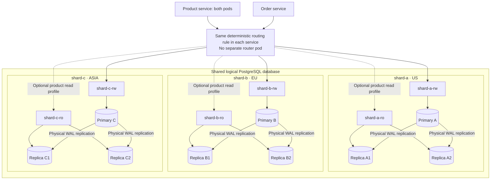

# Database architecture

[ShardShop](../ARCHITECTURE.md) › **Database** · [README](README.md) · [Runbook](RUNBOOK.md) · [Infrastructure lifecycle](../infra/ARCHITECTURE.md) · [Verification requirements](../shardshop-testing/ARCHITECTURE.md)

The database layer, not the services, owns every schema, role and migration of
ShardShop. The services only hold granted privileges, and each service connects
with its own login role.

- **Runs as:** three regional CloudNativePG clusters with three instances each,
  and one separate single-instance ledger cluster.
- **Status:** regional shards, synchronous replication configuration, schemas,
  role privileges and Flyway delivery are implemented. Step 5.2 implements the
  transport cleanup described below; step 5.3 adds the restricted operator reset.
  Coordinated backup/restore, restore audits and cloud/Argo CD delivery
  remain planned in [PLAN milestones 6–7](../PLAN.md).

## Sharding and replication

Product and order share one **logical database deployment**, implemented as three
independent PostgreSQL shards. They connect to the same `shardshop` database on
each shard and use separate schemas: `catalog` for sellers, products and stock,
and `ordering` for buyers, orders and sagas. The database layer owns both schemas; the
services only hold granted privileges. This is an intentional shared-database
boundary for the lab. The initial home-region mapping is immutable: `shard-a`
serves US, `shard-b` serves EU, and `shard-c` serves ASIA. Regions are business
placement labels, not separate physical locations in this single-machine kind
lab. The shared chart labels each shard Cluster and its inherited metadata with
`shardshop.javacraft/region`; the separate ledger has no home-region assignment.



Each shard has the same catalog/ordering schema definitions but different rows.
A replica copies its own primary; replication does not distribute rows between
A, B, and C. Use three CloudNativePG clusters with three instances each, one per
worker node. One cluster with nine instances is one shard with one primary and
eight standbys.

Each shard cluster is a replication quorum: a commit is acknowledged once any one
of its two standbys has durably flushed it (`ANY 1`), so a shard tolerates losing
one instance without losing acknowledged commits or blocking writes. Quorum-based
failover (`failoverQuorum`) promotes a standby only when the operator can confirm
it holds every synchronously committed transaction; otherwise the shard waits for
an operator decision. Primary and replica roles can change during failover. See
[CNPG synchronous replication](https://cloudnative-pg.io/docs/1.30/replication/)
and [quorum-based failover](https://cloudnative-pg.io/docs/1.30/failover/).

## Database change management

Changes are either declarative Kubernetes resources or versioned SQL migrations:
nothing is applied by hand, and no step needs a superuser session. The same
definitions therefore run on the kind lab and on EKS (PLAN milestone 7), where
Argo CD applies them.

| Layer | Contents | Defined in | Applied on kind / on EKS |
|---|---|---|---|
| Instances | CNPG `Cluster`s, parameters, storage, database-wide hardening | `infra/helm/shardshop/templates/clusters.yaml` | `cluster-create.sh` / Argo CD |
| Identities | Group roles, login roles, memberships | CNPG `DatabaseRole`s in `infra/helm/shardshop/templates/databases.yaml` for each inventory entry and `ledger-database.yaml` for ledger; one password Secret per login role, with shard credentials shared across shards and ledger credentials separate | `cluster-create.sh`, which generates the Secrets / Argo CD, with Secrets synced from AWS Secrets Manager |
| Containers | Databases, schemas and their owners, CDC publications | CNPG `Database` and `Publication` resources in the per-shard template; `ledger-db-ledger` Database and schema in `ledger-database.yaml` | `cluster-create.sh` / Argo CD |
| Contents | Tables, constraints, indexes, grants, data | Flyway streams under `database/`, run by Helm hooks from `infra/helm/shardshop/templates/migrations.yaml` and `_migrations.tpl` | `up.sh` / Argo CD `PreSync` hook Jobs |

### Flyway streams and the migration image

`database/` holds one Flyway stream per schema. Each stream is a folder with its
SQL files and a `flyway.toml` that fixes the schema, the history table
`<schema>.flyway_schema_history`, the location, retries, and session timeouts.

The migration Jobs run Flyway OSS 13.8.1 on the pinned Canonical OpenJDK 25 JRE
as the stream's migrator. The applications use the same runtime.
`infra/images/flyway/Dockerfile` assembles this image without an application JAR
or Maven build and invokes Flyway's main class directly because the JRE image has
no shell. It copies only the libraries, drivers, configuration and licenses of the
pinned upstream Flyway image, not its Temurin runtime. The image and Jobs select
UID/GID 10001. `up.sh` builds and scans the image before cluster mutation, then
loads it into the prepared kind cluster and verifies its manifest digest on every
node before SQL or a new application release, as the
[migration runbook](RUNBOOK.md#database-schemas-and-migrations) describes.
This is the local ARM64 delivery path; a future cloud deployment must publish and
qualify the same final image for its target architecture.

### Inventory and rendering

The single ordered inventory `infra/shards.yaml` drives the shared chart's
infrastructure, migration, and routing renders. Shared values carry image pins,
resource budgets and database defaults; environment values carry storage and
placement. Scripts snapshot the inventory, enumerate its entries, and never keep
another shard list.

- Native `helm template` previews select `render=migration`,
  `migrationShard=SHARD` and `migrationStream=catalog` or `ordering`. The shared
  template uses stream-specific Job, SQL ConfigMap and migrator Secret names; both
  streams receive the same `shardRegion`, `shardIndex`, and `shardCount`
  placeholders.
- `migrationShard=ledger-db` with `migrationStream=ledger` selects the ledger
  stream, without shard placeholders or region labels. The chart rejects
  mismatched ledger/shard targets.
- Shard names are limited to 44 characters. Helm migration hook names use a
  bounded release prefix plus stream, inventory index and revision. The non-hook
  migration preview retains its shard/stream names. The template names the
  endpoint and CA Secret directly; no prefix replacement transformers are needed.
  Infrastructure rendering excludes Jobs and routing publication.

### Migration delivery

`up.sh` runs catalog on every shard, then ordering on every shard, then
`database/ledger/ledger` once, and stops on the first failure. The readiness gates
require the clusters and Databases' current applied generations before SQL.
Routing publication also waits for each current-generation CNPG outbox Publication
to be applied. Existing database resource names, storage identities and allocator
state are retained.

Helm renders immutable content-addressed SQL ConfigMaps from the invocation's
`database/` snapshot. Migration hook names include the release revision, stream and
inventory index; hook weights run all catalog shards, all ordering shards and then
ledger. Each `helmfile sync` executes Flyway again, validating actual history and
performing a no-op when no work is pending. Repeatable changes, including an
A-to-B-to-A change, are reconciled through Flyway's recorded checksum.

### Interrupted and failed releases

Before new migration work, the Java idle guard rejects every nonterminal or
terminating `schema-migration` Job, including legacy Jobs and pending Jobs whose
active count is zero. After interruption, wait for hook Jobs to become terminal
and inspect Helm status/history. A killed Helm client may leave a pending release
operation; explicit release-bookkeeping recovery can be necessary before a new
sync. The idle guard alone does not clear that condition. Preserve deployed
resources and database/allocator state during recovery.

Helm observes hook completion and removes successful migration Jobs; failed hook
Jobs retain diagnostics until their default 24-hour TTL. Maven waits up to 180
seconds for exact current-generation applied outbox Publications before the
application release can publish routing. Failed releases retain already committed
SQL; there is no automatic SQL rollback, history repair or database reset.

The [lifecycle locking, retained shutdown and destructive reset contract](../infra/ARCHITECTURE.md#retained-lifecycle-safety)
applies to migrations as well as infrastructure.

### Schema versions

```text
database/
  shard/            # database `shardshop`, applied to every shard primary
    catalog/        # flyway.toml, V1–V6, R__catalog_grants.sql
    ordering/       # flyway.toml, V1–V8, R__ordering_grants.sql
  ledger/
    ledger/         # database `ledger`, applied once to ledger-db: flyway.toml, V1–V3, R__ledger_grants.sql
```

| Stream | Migration | Adds |
|---|---|---|
| catalog | `V1__catalog.sql` | Sellers, products with stock, per-order stock reservations and the regional placement checks |
| catalog | `V2__catalog_creation.sql` | `companyName`, product `description`/`unitCost`, creation-key mappings and service-owned profit storage; the deployed V1 checksums did not change |
| catalog | `V3__stock_coordination.sql` | Permanent `stock_reservation_guards` |
| catalog | `V4__profit_posting.sql` | Profit posting with the immutable credit identity in one seller-shard transaction |
| catalog | `V5__product_browser.sql` | An index for the per-product earnings of the product page |
| catalog | `V6__seller_country_currency_policy.sql` | Seller `country_code` and the read-only `currency_policy_legacy` report |
| ordering | `V1__ordering.sql` | Buyer, allocation, order, saga, transport and quarantine tables, and the CDC offsets table |
| ordering | `V2__buyer_profiles_and_item_cost.sql` | Buyer person/contact/address fields, durable creation keys and immutable unit-cost snapshots on accepted order items |
| ordering | `V3__stock_coordination.sql` | Stock ownership, retry time and failure count on sagas |
| ordering | `V4__cdc_reader_history.sql` | Permanent `cdc_reader_state` history |
| ordering | `V5__result_application_and_profit.sql` | Retained result envelopes and `profit_intents` |
| ordering | `V6__regional_order_listing.sql` | Date/ID and product/ID indexes for the order page |
| ordering | `V7__currency_policy_version.sql` | `currency_policy_version` on orders |
| ordering | `V8__transport_cleanup_indexes.sql` | Retention indexes for inbox receipt time and confirmed outbox publication time |
| ledger | `V1__ledger.sql` | Decisions, entries, result bindings, inbox, outbox and command quarantine |
| ledger | `V2__permanent_command_envelopes.sql` | Permanent `command_envelope` on `ledger_result_ids` |
| ledger | `V3__transport_cleanup_indexes.sql` | Retention indexes for inbox receipt time and confirmed outbox publication time |

## Roles

Object privileges belong to group roles that cannot log in; login roles inherit
those grants. The CDC login additionally has the powerful `REPLICATION` role
attribute described in the [CDC contract](../shardshop-order/ARCHITECTURE.md#cdc-from-shard-writes-to-the-ledger).
This is PostgreSQL's role-membership model: passwords rotate without touching
ownership, and adding a service means one login role and its memberships, with no
SQL. For the catalog:

| Role | Login | Member of | Rights |
|---|---|---|---|
| `catalog_owner` | no | none | Owns schema `catalog`, its objects, and its Flyway history |
| `catalog_migrator` | yes | `catalog_owner`, without inheriting it | Runs Flyway; `flyway.toml` starts each connection with the `role` option set to `catalog_owner`, so no object belongs to a login |
| `catalog_reader` | no | none | `SELECT` on sellers, products and seller profits |
| `catalog_writer` | no | none | `SELECT` and `INSERT` on sellers/products; reads profits and inserts only seller/currency keys at the zero default; `SELECT (product_id, currency, amount)` on profit credits for the regional product page |
| `catalog_reserver` | no | none | Reservation CRUD, permanent guard creation/closure, and product `stock` updates; immutable profit-credit reads/inserts and seller-profit key inserts/`amount` updates; no `TRUNCATE` |
| `product_app` | yes | `catalog_writer` | Product service |
| `order_app` | yes | `catalog_reader`, `catalog_reserver`, `ordering_writer` | Order service |

The ordering stream repeats the pattern with `ordering_owner`, a non-inheriting
`ordering_migrator`, `ordering_writer` and `ordering_cdc_reader`.
`ordering_operator` inherits only the separate `ordering_reconciler` group. That
group can read order IDs/status and saga IDs/order IDs/status/retry fields, and
update only `reconciliation_attempts` and `next_reconciliation_at`. It has no
payload, catalog, ledger, DDL, owner or replication privileges. The
`ordering-operator` Secret belongs only to human operations and is never mounted
in an application. The checked-in [reset SQL](operations/reset-reconciliation.sql)
uses the order advisory lock followed by the saga row lock and changes only a
selected pending pair; see the [procedure](../shardshop-order/RUNBOOK.md#manual-reconciliation-reset).
These are column privileges, not row policies: the protected reset operation owns
the pending-state check. The ledger uses
non-login `ledger_schema_owner` and `ledger_writer` groups. `ledger_migrator` has
non-inheriting membership in `ledger_schema_owner`; its Flyway connections select
that role explicitly, and `ledger_app` inherits only `ledger_writer`. Their
Secrets are `ledger-migrator` and `ledger-app`. The existing `ledger_owner`
bootstrap role continues to own only database `ledger`.

The CDC login is a `DatabaseRole` with the replication attribute and membership
only in a group with SQL `SELECT` on `ordering.order_outbox`; those grants do not
constrain WAL access. Its publication is a CNPG `Publication` resource. The
Debezium offsets table belongs to the ordering stream, with DML granted to the
order service's group. Its permanent `cdc_reader_state` history permits only
`SELECT` and `INSERT(reader_name)` for that group; initialization time comes from
the database.

- Grant only to group roles. Each stream's repeatable `R__<schema>_grants.sql`
  revokes everything from its groups and grants the complete matrix again, so one
  reviewed file is the privilege model; Flyway reapplies it whenever it changes.
- Runtime logins do not own objects or have SQL privileges for DDL or `SELECT`
  on Flyway histories, and no service login is a member of an owner role.
- Database-wide hardening runs once, when a cluster is created
  (`postInitApplicationSQL`): revoke `TEMPORARY` on the database and all access to
  schema `public` from `PUBLIC`. `CONNECT` stays with `PUBLIC`; on its own it
  grants nothing inside a schema.
- The CNPG bootstrap owner (`shardshop_owner`, `ledger_owner`) owns only its
  database. Each schema gets its own owner through the `Database` resource.

## Migrations

- Keep all Flyway SQL simple and declarative: tables, constraints, indexes,
  grants, and data changes only. Do not create SQL functions or triggers; business
  logic belongs in Java and deployment checks belong in scripts.
- A stream runs as its migrator with `createSchemas=false`: the `Database`
  resource creates each schema and its owner before any migration runs.
- A versioned migration is immutable once it is committed; fix forward with a new
  version for retained datasets. Never repair checksums automatically or bypass
  validation. Normal streams keep `clean` disabled. Repeatable migrations hold
  grants.
- Every session is bounded: 5-second connect, 30-second socket, 15-second statement
  and 5-second lock timeouts. Build large indexes with `CREATE INDEX CONCURRENTLY`
  in a migration marked `executeInTransaction=false`.
- Shards migrate one at a time, and a failure stops the rollout. Migrations are
  not atomic across shards, so each change follows expand/contract: add the new
  form, backfill, switch readers, and drop the old form in a later release, so
  running code keeps working while shards differ. Run the catalog stream before
  ordering, then migrate the separate ledger once. Schema changes reach shard
  standbys through physical replication.
- Applications never migrate at startup. Use bounded connection pools per
  service, pod, and endpoint; account for both product pods when budgeting
  PostgreSQL connections.

## Retention

Retain `ledger.ledger_operations` **permanently**, including rejected decisions,
logical IDs, request fingerprint, immutable snapshot, and result data sufficient
to regenerate the exact outcome. Ledger entries and `ledger.ledger_result_ids`
are also permanent: retain every command/result message binding, exact result
envelope, original timestamp, and publication-attempt counter after transport
cleanup. Retain order and saga terminal identities/states, durable
order-allocation mappings, reserved result identities with their accepted
envelopes, profit intents and immutable catalog profit credits, and unresolved
quarantine records; never recycle order IDs. An old rejected operation cannot
become recorded merely because the ledger's currency allowlist changed.

Retain catalog reservation history and closed `stock_reservation_guards` rows
permanently. Removing a closed guard could allow a delayed former worker to
reserve stock again for an already compensated order.

| Data | Rule |
|---|---|
| Transport inbox rows and confirmed-published outbox rows | May be cleaned after a configured operational window. For order outboxes, cleanup also requires a durable CDC checkpoint past the captured insert; publication time alone is insufficient |
| Unpublished outbox rows | Never removed |
| Unresolved `ordering.orphan_results`, `ordering.conflicting_results` and `ledger.conflicting_commands` | Never removed |
| Permanent business decisions | Never removed; backups and restores must preserve them |

Keep cleanup deletes out of the command stream. Reconciliation counters and
timestamps belong to `ordering.order_sagas` and are unaffected by that cleanup. A
manual reconciliation reset is safe also after transport cleanup, because
operation identity and outcome checks still apply.

**Implemented in step 5.2:** the existing order saga and ledger processes run
cleanup workers using their application roles. The default operational window is
24 hours, measured from inbox receipt or confirmed outbox publication, with bounded
batches of 1,000 rows. Only inboxes and outboxes are cleanup targets. Ordering V8
and ledger V3 add indexes for these queries without changing rows or privileges.

Order selects a batch of old published message IDs, then records a WAL position
after that selection. It keeps the batch in memory until the matching connector's
durable streaming checkpoint is strictly past that position. This proves the
checkpoint passed every selected insert without adding per-row LSN columns.
Missing, ambiguous, malformed or incomplete-snapshot offsets never authorize a
delete. Restart discards the batch and captures a new position; it cannot weaken
the check. The insert-only publication and relay filtering keep deletes out of
the command stream.

Both workers recheck publication and age in the DELETE. Ledger also rechecks the
selected publication attempt and timestamp, preserving results rearmed by a
concurrent duplicate command. Configuration, failure logs and inspection belong
to the [order](../shardshop-order/RUNBOOK.md#transport-cleanup) and
[ledger](../shardshop-ledger/RUNBOOK.md#transport-cleanup) runbooks.

## Consistency and failure boundaries

Sharding distributes data; replication provides two standbys for each shard. The
product service's two pods scale HTTP handling independently of these database
roles. The catalog read and reservation contracts couple product/order schema
changes, while the ledger has independent storage and eventual consistency with
orders.

Asynchronous PostgreSQL replication may lose acknowledged commits on failover,
so an accepted order can disappear; outbox/idempotency logic does not repair that
loss. Because CDC waits for WAL the standbys have flushed, such an order's command
never reached the ledger. A shard restored from an older backup, however, can lack
orders whose ledger commands were already delivered. Use the optional asynchronous
profile only for explicit loss demonstrations.

The default saga durability profile requires a durable acknowledgement from any
one of the shard's two standbys and promotes only a standby confirmed to hold every
such commit. One lost instance neither blocks writes nor loses acknowledged
commits; writes block only while both standbys are unavailable. See
[PostgreSQL replication tradeoffs](https://www.postgresql.org/docs/current/warm-standby.html).

The initial single-instance ledger database and one-broker RabbitMQ deployment
are availability limits. Durable quorum queues with one member cannot tolerate
loss of that member's storage. Persistent volumes and backups remain necessary;
broker high availability needs three brokers and three-member quorum queues, and
ledger high availability requires its own replication design.

The broker and ledger availability limits are present today. The optional
asynchronous-loss demonstration, complete promotion drills, isolated restores and
operator audit are planned acceptance work; see [scenarios 3, 6 and 8](../shardshop-testing/ARCHITECTURE.md#scenario-3)
and [PLAN milestone 6](../PLAN.md#milestone-6-read-profiles-failover-restore-and-operation).
