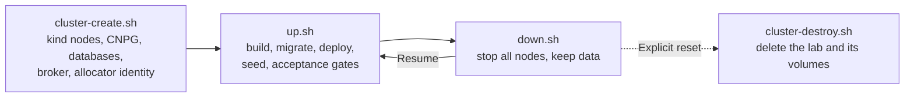
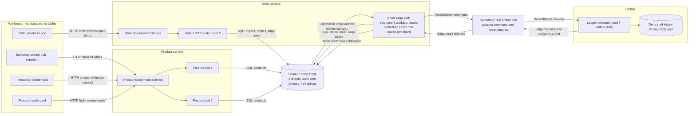

# Infrastructure architecture

[ShardShop](../ARCHITECTURE.md) › **Infrastructure** · [README](README.md) · [Runbook](RUNBOOK.md) · [Database architecture](../database/ARCHITECTURE.md) · [Verification requirements](../shardshop-testing/ARCHITECTURE.md)

The infrastructure layer creates, deploys, verifies, stops and destroys the local
kind lab. It also defines the runtime topology and the RabbitMQ delivery policy.

- **Status:** the local lifecycle, topology and delivery policies are implemented,
  together with durable reconciliation, transport cleanup, manual retry reset
  and qualified retry/capacity recovery, crash recovery and observability in
  [PLAN steps 5.1–5.5](../PLAN.md).
  Failover/restore and optional AWS delivery checks remain planned
  in milestones 6–7. Requirements below retain
  those target guarantees; they do not claim every acceptance scenario already
  passes.

## Platform and versions

The primary target is a local kind lab on one machine: every contract, drill, and
acceptance scenario in this document must run and pass there. A later AWS target
(EKS provisioned with Terraform, PLAN milestone 7) is optional. It reuses the same
shared Helm templates through environment values and the same verified operator
Helm charts and values, delivers the database layer and the applications through
Argo CD GitOps, and may add cloud-only durability such as S3 backups with WAL
archiving and a three-broker RabbitMQ. No local behavior or check may depend on a
cloud service.

All runtimes, libraries, build plugins, and images follow [VERSIONS.md](../VERSIONS.md):
LTS where available, otherwise maintained stable GA releases with explicit upgrade
deadlines, plus the named support-policy exception for the requested
`de.mkammerer.snowflake-id:snowflake-id` library and the three exact Quarkus
plugin XML dependencies documented in the version policy. The version gate also
includes repository-inherited dependency overrides.

Build and test with JDK 25 or newer (bytecode targets release 25), and run the
applications on OpenJDK 25. The Maven toolchain uses the installation selected by
`JAVA_HOME`, without a vendor or exact-patch restriction; preview features remain
disabled. Container bases are the verified Canonical OpenJDK 25 JDK/JRE images on
Ubuntu 26.04 in the version lock. The JRE is shell-free; product and order reserve
their generator IDs with Java code in their own JVM. Configure a non-root container
user explicitly. Final application images retain the deployment qualification gates
in the version policy.

## Tool ownership

| Tool | Owns |
|---|---|
| Bash: the four lifecycle scripts | Local bootstrap, snapshots/locks, Maven/Scout invocation, native kind/Docker lifecycle and image delivery |
| Skaffold | Image build recipes and artifact tags |
| Helmfile | The order of the real Helm releases and their Maven phase hooks |
| Helm | Infrastructure, routing and application resources and Flyway/seeder hook Jobs; it also renders DNS probes and bootstrap identity manifests |
| Kubernetes and CloudNativePG | Reconciliation of the resources |
| Maven: opt-in kind Cucumber scenarios | Invariants and readiness, with the same invocation snapshot |

Namespace, credential Secrets and allocator registry/identity remain outside
release ownership. The lifecycle uses Helmfile 1.8.0 and Skaffold 2.25.0 from
`PATH`, with their shared configuration retained in the repository.

Manual saga reconciliation uses native `psql` and database-owned SQL, through the
restricted `ordering_operator` login. `cluster-create.sh` creates its missing
Secret and CNPG reconciles its group/login roles; the ordinary Flyway ordering
stream grants its column permissions. No application receives that Secret, and
no lifecycle command performs a reset. See the
[operator procedure](../shardshop-order/RUNBOOK.md#manual-reconciliation-reset).

## Lab lifecycle



| Entry point | Does | Never does |
|---|---|---|
| `cluster-create.sh` | Cluster creation, infrastructure reconciliation and fresh database/allocator preparation. On an existing cluster it resumes stopped nodes and reconciles supported infrastructure changes after retained-state guards pass | Deploy applications, build application images or run migrations |
| `up.sh` | Application startup, retained-node resumption, readiness checks, migration and deployment | Recreate a missing cluster, or provision namespaces, credentials or infrastructure releases |
| `down.sh` | Retained shutdown: stops every node and keeps all data | Delete a node, volume, Secret or allocator identity |
| `cluster-destroy.sh` | Explicit reset: removes the lab, its attached volumes and `kind-shardshop` kubeconfig entries | Touch repository configuration or shared Docker networks/images |

The four maintained entry points are `cluster-create.sh`, `up.sh`, `down.sh` and
`cluster-destroy.sh`; manifest previews use native `helm template` with the shared
chart and values. `cluster-create.sh` and `up.sh` source `scripts/lib/lifecycle.sh`
for locks, traps, snapshots, rendering, verifiers, readiness and retained-node
resumption; this helper is not an entry point. `down.sh` and `cluster-destroy.sh`
source it for target selection, the lock and traps, then call `docker stop` and
`kind delete cluster`. After any node start, the lifecycle restarts kindnet.

### Owned qualification labs

The lifecycle helper also provides an opt-in target for disposable test
orchestration: paired `SHARDSHOP_TEST_CLUSTER` and `SHARDSHOP_TEST_KUBECONFIG`.
Only the `shardshop-test-` DNS-label namespace is accepted, with a mandatory
absolute single kubeconfig in a private directory outside the user's default
kubeconfig directory. Validation precedes every lifecycle mutation, including
deletion. The immutable invocation copy changes only the kind cluster name;
application namespace, releases and manifests retain their existing contracts.
The selected context and kubeconfig propagate through native CLIs, Helmfile
release hooks, Maven observers and their local HTTP proxies.

The invoking test owner establishes a fresh unique name and registers cleanup
before creation. Production lifecycle traps still own only transient invocation
files/probes and the lock; they never turn a failed retained bootstrap into an
automatic reset. See the [test-lab procedure](RUNBOOK.md#disposable-test-clusters)
for the environment contract, cleanup boundary and shared host resources.

### Accepted changes

`up.sh` snapshots the inventory, environment values, database migration files,
kind configuration, operator chart and operator values once per invocation. It
accepts only the fixed kind topology of one control plane and three workers and
reviewed image/port settings; changes requiring cluster recreation, storage or
placement changes, bootstrap changes, PostgreSQL major version changes, or a
different replica shape are rejected. Supported resource, PostgreSQL configuration
and reviewed operator changes are reconciled in place; failures stop with recovery
guidance and retained data.

For Helm-owned databases, retained protected declarations come from the pinned
current release manifest, while live values are checked for drift. This separates
API defaults from intended storage/placement/bootstrap changes; the legacy kubectl
annotation remains the baseline only for resources outside Helm ownership.

### Cluster creation

1. `cluster-create.sh` first caches repository and microservices parent POM
   metadata using non-recursive `install:install-file` calls, without building
   their reactors.
2. It builds, verifies and installs only `shardshop-testing` and its shared common
   test-helper dependencies with
   `-pl shardshop-testing -am -Dshardshop.infrastructureOnly=true clean install -DinstallAtEnd=true`.
   This invocation disables application reactor-order dependencies, and its direct
   Failsafe gates use the same property; creation does not build applications or
   require installed application POMs. Default builds retain those dependencies.
3. It syncs `cnpg` and `shardshop-infrastructure` through Helmfile, then
   initializes allocator identity only for a cluster demonstrably created by that
   invocation. Partial allocator initialization requires explicit recovery and
   never authorizes a counter reset.
4. It also provisions a retained single-broker RabbitMQ StatefulSet, public
   topology ConfigMap and runtime-generated credential Secret. Broker configuration
   imports public topology and private users through a clean temporary directory,
   excluding Kubernetes projection metadata. The broker runs with configured
   non-root UID/GID 10001 and a read-only root filesystem; its PVC is writable
   through fsGroup 10001. This meets Kubernetes Restricted; admission-assigned
   OpenShift UID/group ranges and retained-volume permissions remain unqualified.
5. The infrastructure gate verifies the broker's persistent storage, readiness,
   stream feature flag, exact quorum queue arguments, bindings and effective
   delivery policies. Creation verifies database and broker readiness and returns
   without migrations or application deployment or application image builds.

### Deployment pipeline

`up.sh` requires valid retained allocator state, observes prepared infrastructure
readiness and never provisions namespaces, credentials or infrastructure releases.

1. **Snapshot.** Take the invocation snapshot and reject unsupported changes, as
   [accepted changes](#accepted-changes) defines. Each guard runs before the
   mutation, migration or routing publication that it protects.
2. **Build.** The initial ShardShop-only Maven build,
   `clean install -DinstallAtEnd=true`, includes `verify` and installs verified
   reactor artifacts in Maven's local cache after the reactor succeeds; subsequent
   Failsafe gates resolve these packages without another build. This is local
   artifact caching, without tool installation or remote publication.
3. **Image delivery.** Skaffold builds current Maven outputs; its standalone build
   has no deployer and does not load kind images. Native image delivery verifies
   the qualified build's config ID and a consistent manifest digest on every node
   before migrations or a new application release.
4. **Migrations.** After readiness/image delivery, Helmfile syncs
   `shardshop-migrations` and `shardshop-application` in dependency order. Each
   revision runs ordered Flyway hooks and idempotent seeding. Flyway's actual
   history is authoritative; no completed Job cache suppresses validation. The
   [database layer](../database/ARCHITECTURE.md#migration-delivery) defines the
   stream order.
5. **Application release.** The application release's `presync` hook also runs
   `kind-drills-idle`: a retained drill lock stops the release. Every `up.sh`
   deployment changes a shared restart annotation on all application Deployment
   templates through Helm, triggering replacement followed by the seeding and
   acceptance gates even for unchanged code.
6. **Acceptance.** The application release's native Helmfile `postsync` hook
   invokes the final Maven acceptance with `kind-release | kind-deployment` after
   the application resources and seeder hook Job succeed. `kind-release` checks
   the snapshot images, rendered desired configuration, current deployed Helm
   revision and Deployment generations, pod ownership and runtime digests, the
   current successful seeder, and ready product and order EndpointSlices;
   `kind-deployment` checks product traffic, reader load and the saga effects of
   the gate's own orders.

After the deployment gates succeed, `up.sh` releases its deployment lock and
exits.

- Each new product or order JVM consumes a fresh, non-reusable generator slot; a
  normal rollout of two product replicas, two order HTTP replicas and one saga
  replica uses at least five slots.
- Product's pod checksum is SHA-256 of the full rendered `application.properties`,
  sharing the mounted file's named template and static defaults.
  Image/resource/workload settings are direct template inputs.
- Seeder revision identity is recorded on reader and order-producer Deployment
  metadata, outside its pod template. Successful seeder Jobs retain 24-hour
  verification logs; after TTL cleanup, standalone workload checks require a fresh
  `up.sh` run.

### Release failures

The release hook failure is fatal to Helmfile and `up.sh`, although Helm may still
report the release as deployed. The observer does not repair resources, retry the
release or roll it back; Kubernetes continues its normal reconciliation.
Diagnostics remain bounded and contain no secrets. The reader and order producer
remain running and disruptive drills are still explicitly selected. A new
`kind-release` run requires `images.json` in the snapshot; standalone legacy
`kind-deployment` runs do not. Step 3.20 qualified the normal lifecycle and
separate destructive reset command (see [evidence](../CHANGELOG.md#step-320)),
without extra wrappers, embedded Python, downloaded tool binaries or a Java
lifecycle controller.

### Helm ownership and adoption

Retained resources created by the earlier apply workflow require an explicit
one-time ownership transfer after safety checks and resource/UID inspection,
including existing immutable SQL ConfigMaps matching the current snapshot.
Metadata-only patches test UID/resourceVersion and preserve specifications/data.
Normal startup never adopts another Helm release. Namespace, credentials and
allocator state are excluded from transfer.

ShardShop releases use Helm's three-way merge for previously apply-managed
resources; `cnpg` retains server-side updates. Helm owns hook completion and
bounded rollout waits; Maven retains topology/allocator/readiness and
current-generation Publication checks. Helm's client-side three-way merge keeps an
environment variable or a node selector that a drill added out of band, thus an
unrecovered drill change would otherwise stay in the new release; the
`kind-drills-idle` gate prevents that.

### Verification gates and drills

Opt-in Maven kind Cucumber scenarios verify invariants and readiness using the
same invocation snapshot: guards run before protected mutations, and readiness
checks observe DNS from a pod on every node, current-generation database
resources, actual SQL connectivity and configuration, and both streaming quorum
standbys of every shard. DNS probes allow 15 minutes for cold image startup in
addition to their 120-second execution limit; every probe must succeed. Native
bounded waits are used where their status proves the requirement; cross-resource
and SQL assertions stay in Java tests. These tests do not replace reconciliation
with a Java controller.

| Profile | Selection | Checks |
|---|---|---|
| `kind-deployment` | Default of the `kind` profile through `shardshop.kind.tags` | Deployed routing, independent replication and persistent-volume identity (`kind-topology`), product workload (`kind-workload`), saga effects (`kind-saga`) and recovery/pressure metrics (`kind-observability`) |
| `kind-database-drill` | Explicit `kind-drill` | Standby replacement, quorum availability/blocking and WAL retention on the first inventory shard, or `shardshop.kind.drillShard` |
| `kind-workload-drill` | Explicit `kind-drill` | Repeated temporary seeder Jobs, identical saved IDs and the replacement of one product pod |
| `kind-saga-drill` | Explicit `kind-drill` | Duplicate delivery, policy-change replay, two orders for the same stock, cross-worker saga replacement and continuous writes during HTTP replacement with unchanged saga/CDC ownership |
| `kind-retry-drill` | Explicit `kind-drill` | Shard outage beyond broker retries, reconciliation, and unbound/full DLQ pressure on both application publishers; see the [retry runbook](../shardshop-testing/RUNBOOK.md#retry-and-dlq-capacity-drills) |

**Default profile.** `kind-workload` checks credential restrictions, the saved
151 seller/201 product IDs of `catalog-v2` (only the retained 150/300 `catalog-v1`
rows and the saga gate fixtures may also exist), matching seeder/reader digests,
traffic through both Ready product pods within 120 seconds, and a fresh all-OK
reader interval at 180 requests/s or more. These checks require an
already-migrated, deployed lab with two Ready product pods and one running reader;
they preserve reader replicas. Reader interval reports repeat the resolved catalog
digest so bounded recent logs retain verification evidence after startup-log
rotation. Workload settings are restricted to documented literal HTTP
configuration; generic JVM and command overrides are rejected.

**Saga gate.** Normal deployment acceptance does not examine producer orders. It
creates one USD and one EUR order for its own buyer, sellers and products, and
checks their durable saga effects. The normal seven-currency ledger policy must
confirm both orders; the gate changes no deployment or workload setting. These
gate entities use fixed `kind-saga-gate-v2.*` creation keys, thus later runs
recover the same IDs.

**Drills.** In the workload drill, the replaced product pod's fresh generator ID
must exceed the pre-replacement registry `highWaterMark`; traffic and an all-OK
reader interval are checked again after recovery. The three saga-drill scenarios
also cover HTTP rollout preserving the saga pod/CDC active PIDs and saga restart
while writes continue; step 4.2 tests competing stock coordinators.

- All drill families share the `shardshop-kind-drill` ConfigMap lock, register
  recovery before mutation, and restore temporary changes in reverse order on
  completion, failure or ordinary JVM termination. Failed recovery retains the
  lock and reports required operator action. While the lock exists, the
  `kind-drills-idle` gate stops the application release before Helm changes it.
- Fence mutations atomically test Cluster identity and resource version to
  preserve concurrent operator changes. Allocator state is never rewound.

**Snapshots.** Every standalone suite consumes an explicit `shardshop.kind.snapshot`
containing `chart/`, `environment.yaml`, `inventory.yaml`, `inventory.json`,
`kind.json` and `infrastructure.yaml`; DNS gates additionally use
`dns-probes.yaml`. Existing infrastructure safety gates remain individually
selectable. Tests observe native reconciliation, create the scoped orders of the
saga gate, or make only the explicitly selected temporary drill changes;
production migration and deployment run through `up.sh`.

### Local web access

Both `up.sh` and `webpages.sh` accept no arguments. The separate `webpages.sh`
serves local access through five owned `kubectl port-forward` processes, all bound
to localhost:

| Port | Page |
|---:|---|
| 18080 | Product page, `http://127.0.0.1:18080/products/` |
| 18081 | Order page, `http://127.0.0.1:18081/orders/` |
| 18082 | Order producer [control page](../shardshop-core/workload-control/ARCHITECTURE.md#pages-and-api) |
| 18083 | Product reader control page |
| 18084 | Interactive seeder control page |

- Exiting or interrupting the script closes all its tunnels without stopping
  workloads; a failed tunnel ends the access session and reports the failure.
  Cluster shutdown remains the responsibility of `down.sh`.
- `webpages.sh` uses `lsof` to find processes listening on ports 18080–18084 and
  stops them before opening tunnels: TERM, a five-second grace period, then KILL
  for remaining listeners. It requires the ports to be released within two further
  seconds. A second inspection before opening tunnels catches newly occupied ports
  and reports an access failure.
- `webpages.sh` clears the ports and runs only the supervised access session
  against the existing deployment, without the deployment lock, build, rollout or
  acceptance gates. It permits access recovery without consuming more generator
  slots in an unnecessary rollout.

## Runtime topology



After seeding, nine application pods run: one reader, one order producer, two
product pods, two order HTTP pods, one order saga pod, one ledger consumer pod and
one interactive seeder pod. The completed bootstrap seeder Job is separate.
The nine shared PostgreSQL pods, one ledger PostgreSQL pod, one RabbitMQ broker
pod and operator/system pods are additional. CDC offsets live in each shard database.
The ledger's result-outbox relay polls its own database.

### Process roles

- Both order Deployments use one image. `shardshop.order.process` selects `http`
  (default) or `saga`. HTTP uses `RollingUpdate` with two replicas; saga uses one
  replica and `Recreate`. Only saga owns stock/profit workers, the CDC relay and
  result consumption. Every JVM reserves its own generator slot. The
  [order architecture](../shardshop-order/ARCHITECTURE.md#processes) describes the
  split.
- The lab has one saga replica with one stock worker thread, thus it reserves
  stock in sequence.
- The lab's serial profit worker polls every 100 ms with at most 32 intents per
  buyer shard. The standalone defaults remain 250 ms and eight intents. Capacity
  checks include unapplied profit intents as well as non-terminal orders and
  unpublished commands: confirmation can precede seller-profit posting, so a flat
  order backlog alone does not establish sustainable throughput.
- The producer's configured run name stays independent of Helm revisions and
  startup restart tokens.
- Both product pods are stateless and interchangeable. They use the same shard
  mapping and database constraints; pod-local state must not determine
  correctness. Clients connect through Kubernetes Services, and applications
  connect through database role Services rather than pod addresses.

### Pod counting scope

Counts describe the steady kind deployment after successful seeding and rollout,
with the default inventory and values. They count pods, not containers, Kubernetes
Services, logical modules or kind node containers. During a rollout, replacement
and terminating pods can temporarily exceed these numbers.

| Category | Role breakdown | Steady pods |
|---|---|---:|
| Applications | Product 2; order HTTP 2; order saga 1; ledger 1; reader 1; order producer 1; interactive seeder 1 | 9 |
| Shared PostgreSQL | Three primaries and six standbys; three CNPG Clusters × three instances | 9 |
| Dedicated ledger PostgreSQL | One primary with no standby | 1 |
| RabbitMQ | One retained broker | 1 |
| Application/database/broker subtotal | Excludes operator, system and Job pods | **20** |
| CloudNativePG operator | Vendored chart default `replicaCount: 1`, unchanged by operator values | 1 |
| Subtotal including operator | Excludes Kubernetes system and Job pods | **21** |
| Kubernetes system | Control-plane static pods, DNS, kindnet, kube-proxy, storage provisioner and any extra installed components | Observe separately |
| Transient Jobs | Bootstrap seeder, Flyway hooks, DNS probes and temporary drill Jobs | Excluded |

Sources: [inventory](shards.yaml), [shared defaults](helm/shardshop/values.yaml),
[kind overrides](helm/shardshop/kind-values.yaml),
[application templates](helm/shardshop/templates/applications.yaml),
[order/ledger/producer templates](helm/shardshop/templates/saga-applications.yaml),
[database instances](helm/shardshop/templates/clusters.yaml),
[broker template](helm/shardshop/templates/rabbitmq.yaml), and the vendored
[CNPG chart](helm/cnpg/cloudnative-pg-0.29.1.tgz) with
[operator values](helm/cnpg/values.yaml). The kind configuration defines one
control-plane node and three worker nodes; these four node containers are not
four pods. The repository does not contain every rendered kind system manifest,
so it cannot establish the exact system-pod subtotal by itself. Record it from an
already-running lab using the [inventory procedure](README.md#pod-inventory);
never start a stopped lab merely to fill that number. The 2026-10-23 inventory
recorded 14 `kube-system` pods and one local-path provisioner, for
[36 pods in total](../ARCHITECTURE.md#2-runtime-topology).

## RabbitMQ and delivery reliability

### Topology

| Message | Route / destination queue | Consumer |
|---|---|---|
| `RecordOrder` | `ledger.commands` exchange, `ledger.record-order` queue | Ledger module |
| `LedgerRecorded`, `LedgerRejected` | `order.saga-results` exchange, `order.ledger-results` queue | Order module |

Declare `ledger.commands` as a durable direct exchange and bind
`ledger.record-order` with the routing key `ledger.record-order` before CDC starts.

### Message envelope

Messages carry `messageId`, logical `commandId`, `sagaId`, `orderId`, `buyerId`,
`type`, `schemaVersion`, `requestFingerprint`, `occurredAt`, and immutable business
data. Commands also carry `resultMessageId`, reserved by order for ledger to copy
into the result's `messageId`. Results retain command/saga correlation, including
the buyer ID, and the stored outcome. All ID fields use the same canonical
decimal-string Snowflake contract and originate in order; ledger never generates
them. The buyer ID routes results to the order's shard. Order checks that a result
uses one of the result IDs it reserved for that saga's command envelopes.

### Broker version

The reviewed community baseline is RabbitMQ **4.3.6**, with a pinned image digest
and the compatible bundled **Erlang/OTP 27.3.4.19** runtime, for native quorum delayed
retry. This is a rolling-support component, not a multi-year LTS release. Recheck
the maintained GA release and runtime matrix under [VERSIONS.md](../VERSIONS.md)
before pinning; earlier broker versions need a separately specified retry design. See
[RabbitMQ release information](https://www.rabbitmq.com/release-information).
VERSIONS.md and the lock record the support end date of 4.3.x and the date to
qualify a successor. The successor must also have native delayed retry (4.3 or
later). Before the cutover, verify its upgrade path and policies, and run
[scenarios 6 and 7](../shardshop-testing/ARCHITECTURE.md#scenario-6) again when their
complete drills exist. 4.3.6 is a dated lab baseline, not an indefinite deployment
target.

### Queue policies

Declare both processing queues as durable quorum queues. Install one complete
policy per source queue so each has its own dead-letter routing key; do not rely
on merging overlapping regular policies. The following provisioning specification
uses delays in milliseconds and local capacity budgets of 1,000 messages or
16 MiB of message bodies per queue, whichever admission limit is reached first.
Enable the `stream_queue` feature flag required for at-least-once dead-lettering
and verify the effective policies and queue arguments at startup:

```yaml
policies:
  - name: ledger-command-delivery
    pattern: '^ledger\.record-order$'
    apply-to: queues
    definition:
      delivery-limit: 5
      delayed-retry-type: failed
      delayed-retry-min: 1000
      delayed-retry-max: 5000
      dead-letter-strategy: at-least-once
      overflow: reject-publish
      max-length: 1000
      max-length-bytes: 16777216
      dead-letter-exchange: shardshop.dlx
      dead-letter-routing-key: ledger.record-order.dlq
  - name: order-result-delivery
    pattern: '^order\.ledger-results$'
    apply-to: queues
    definition:
      delivery-limit: 5
      delayed-retry-type: failed
      delayed-retry-min: 1000
      delayed-retry-max: 5000
      dead-letter-strategy: at-least-once
      overflow: reject-publish
      max-length: 1000
      max-length-bytes: 16777216
      dead-letter-exchange: shardshop.dlx
      dead-letter-routing-key: order.ledger-results.dlq
  - name: parking-capacity
    pattern: '^(ledger\.record-order|order\.ledger-results)\.dlq$'
    apply-to: queues
    definition:
      overflow: reject-publish
      max-length: 1000
      max-length-bytes: 16777216
```

Bind each durable quorum parking queue to the durable direct exchange
`shardshop.dlx` using its own name as routing key: `ledger.record-order.dlq` or
`order.ledger-results.dlq`. Declare parking queues with `x-delivery-limit=-1`, no
TTL/expiry, no automatic consumer, and no onward DLX. Their capacity policy above
rejects new arrivals when full, so the source retains unconfirmed dead letters.
Parked messages are diagnostic copies, and an operator removes them after
inspection. Processing queues keep the bounded delivery limit above. Declare
`x-quorum-initial-group-size=1` explicitly for this one-broker lab and use a PVC;
quorum queue type alone does not give a single broker high availability.

### Retry budget

The retry formula is `min(delayed-retry-min * delivery_count,
delayed-retry-max)`: counts 1–5 imply delays of 1–5 seconds, approximately 15
seconds of delay plus processing time. The pinned RabbitMQ 4.3.6/OTP 27.3.4.19
measurement confirms five delayed redeliveries and parking on the sixth rejection:
15.176 seconds for commands and 15.185 seconds for results, including client/broker
IO. The [dated evidence](../CHANGELOG.md#step-54) records each delay;
the [retry runbook](../shardshop-testing/RUNBOOK.md#retry-and-dlq-capacity-drills)
provides the repeatable check. Application processing during an outage adds time
to this broker delay budget.

This is a short transient-retry budget. Longer outages, including primary
failover and a synchronous wait while both standbys are down, are expected to
park messages in a DLQ. Pending-saga reconciliation then regenerates commands and
stored results after recovery, subject to its durable five-attempt budget; after
exhaustion, recovery requires a manual reconciliation reset. Old parked deliveries
remain until an operator inspects and removes them. Retry exhaustion never cancels
an order.

### Delivery rules

- **Outbox and publisher.** Store outgoing messages in an outbox in the same
  transaction as their business change. Use durable exchanges/queues, persistent
  messages, publisher confirms, and mandatory routing; returned or unconfirmed
  messages remain unpublished. The order CDC adapter must handle mandatory returns
  before marking a source record processed: a confirm alone can acknowledge an
  unroutable message. This is an explicit adapter requirement, not an assumed
  guarantee of the Debezium Server sink's default settings.
- **Acknowledgement.** Acknowledge consumed messages only after the local
  transaction commits. A publisher confirm means broker acceptance, not completed
  ledger processing. See [RabbitMQ acknowledgements and confirms](https://www.rabbitmq.com/docs/confirms).
- **Duplicates.** Expect at-least-once delivery. Persist inbox deduplication by
  `messageId` and business uniqueness by `orderId`. Serialize each ledger
  operation. An identical duplicate must regenerate its stored result through the
  outbox, even on an inbox hit; it never adds a ledger row or silently drops the
  result. A crash after publish but before marking an outbox row or checkpointing
  the CDC offset can produce another delivery.
- **Transient failures.** For a transient processing failure, use
  `basic.reject(requeue=true)` so the quorum queue increments its failure count and
  delays redelivery in that same queue. RabbitMQ 4.3 `basic.nack` does not
  increment that count. Do not cycle messages through TTL retry queues or
  republish them to reset the delivery limit. A malformed message uses
  `basic.reject(requeue=false)` for immediate dead-lettering.
- **Dead letters.** On delivery-limit exhaustion, at-least-once dead-lettering
  retains the source message until its DLQ accepts it. A missing/unavailable
  destination causes retention; retained dead letters consume the source's
  capacity. Once its finite limits are reached, negative publisher confirms make
  relays retain their database outbox rows as unpublished and back off; order CDC
  offsets must not advance past those failed publishes. Provision/bind the DLQs
  first and monitor capacity; never downgrade to drop-head or classic
  dead-lettering. See [quorum retry and dead-letter semantics](https://www.rabbitmq.com/docs/quorum-queues).
- **Parked messages.** Never publish parked messages again. The
  [reconciliation contract](../shardshop-order/ARCHITECTURE.md#reconciliation-and-replayed-outcomes)
  creates their commands and results again from saga state and permanent ledger
  decisions. After the last automatic attempt, only a manual reconciliation reset
  or a restore continues the saga.

### Monitoring and limits

Order and ledger use the same pinned Micrometer Prometheus extension as product.
Their custom application pools expose in-memory pressure gauges. The saga and
ledger sample durable backlog and quarantine in bounded background database
phases, with explicit freshness/failure gauges; metric scrapes perform no SQL.
Only saga processes sample order business/CDC state. Internal saga and ledger
Services expose port 8080 without adding pods. The read-only `kind-observability`
deployment gate checks these gauges, native RabbitMQ queue capacity counters,
CloudNativePG's port 9187 metrics and physical replication backlog. Endpoint and
signal semantics belong to the [monitoring guide](README.md#saga-and-database-pressure).

Resume the CDC readers for all order shards and the ledger result relay after
restart. Monitor CDC lag, reader restarts, offset checkpoints, replication-slot
retained WAL, outbox age, queue depth, dead letters, pending saga age, and
conflicting results. Broker outages can retain WAL as well as outbox rows; set
disk/lag alerts and a finite WAL retention budget. If that budget invalidates a
slot, require the [explicit CDC recovery procedure](../shardshop-order/ARCHITECTURE.md#cdc-from-shard-writes-to-the-ledger)
rather than skipping missing changes.

Use bounded consumer prefetch and database timeouts. The queue delivery limit
bounds one transport message's attempts; the coordinator's separate persisted
limit bounds automatic logical-command reconciliation. Only a manual
reconciliation reset gives a saga a new budget.

Queue admission limits are not exact process-memory or disk ceilings: in-flight
publishes can overshoot quorum limits, and byte limits exclude broker overhead.
Bound consumer prefetch and publisher concurrency, monitor broker resource alarms
and database outbox growth, and size the lab limits with headroom. Scenario 7
must demonstrate queue-level rejection while broker-wide alarms remain clear.
See [RabbitMQ queue length limits](https://www.rabbitmq.com/docs/maxlength).

## Retained lifecycle safety

- **Lock.** `cluster-create.sh`, `up.sh`, `down.sh` and `cluster-destroy.sh`
  serialize local invocations with `${TMPDIR:-/tmp}/shardshop-up.lock`; a
  concurrent invocation fails before mutation. Use the same `TMPDIR` for lifecycle
  calls. Ordinary failure and INT/TERM release the lock after the active command
  ends. Inspect retained Jobs and confirm no invocation remains active before
  removing a stale lock after SIGKILL or host failure.
- **Shutdown.** `down.sh` turns off kind's `on-failure:1` restart policy with
  `docker update`, then stops all nodes with one `docker stop --timeout 10` call and
  retains every node container, volume, Secret and allocator identity. Without the
  policy change, the next Docker daemon start restarts nodes that a SIGKILL
  stopped. Docker does not change a node that is already stopped. Resuming sets
  `on-failure:1` again.
- **Destruction.** The explicit destroy command runs `kind delete cluster`, which
  deletes that retained state, including databases, Kubernetes/Helm configuration
  and allocator history. Docker keeps a volume that another container uses.
  Repository configuration and shared Docker networks/images are outside cluster
  ownership.
