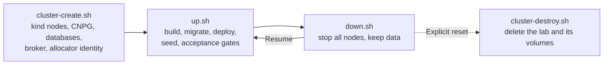
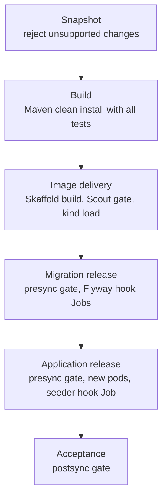
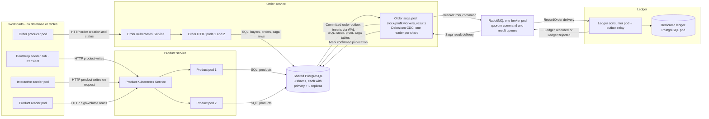
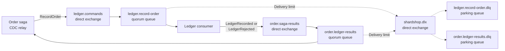
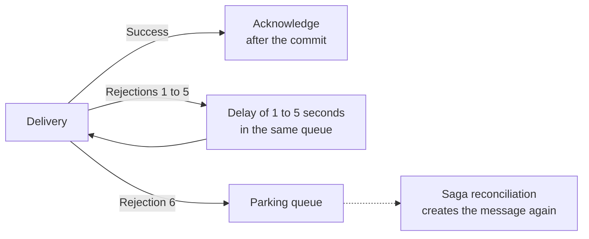

# Infrastructure architecture

[ShardShop](../ARCHITECTURE.md) › **Infrastructure** · [README](README.md) · [Runbook](RUNBOOK.md) · [Database architecture](../database/ARCHITECTURE.md) · [Verification requirements](../shardshop-testing/ARCHITECTURE.md) · [Container images](images/README.md)

This document explains the design of the infrastructure: the platform rules, the
lifecycle of the local deployment, the runtime topology and the RabbitMQ delivery
policy. The [runbook](RUNBOOK.md) has the procedures, and the
[AWS foundation](terraform/README.md) describes the AWS deployment.

## Contents
1. [Platform and versions](#1-platform-and-versions)
2. [Local infrastructure rules](#2-local-infrastructure-rules)
3. [Tool ownership](#3-tool-ownership)
4. [Lab lifecycle](#4-lab-lifecycle)
5. [Runtime topology](#5-runtime-topology)
6. [RabbitMQ and delivery reliability](#6-rabbitmq-and-delivery-reliability)
7. [Retained lifecycle safety](#7-retained-lifecycle-safety)

## 1. Platform and versions
<sub>[Back to Contents](#contents)</sub>

| Topic | Rule |
|---|---|
| Deployments | The local deployment runs on a kind cluster on one computer. Each contract, drill and acceptance scenario of this document must pass there. The [AWS deployment](terraform/README.md) uses the same chart and the same vendored operator charts on EKS. It adds S3 backups with WAL archiving, three brokers and runtime secrets from AWS Secrets Manager, and Argo CD delivers it with the Maven gates as hook Jobs. No local behavior or check depends on a cloud service. |
| Versions | [VERSIONS.md](../VERSIONS.md) sets the rules: an LTS release when one exists, else a maintained stable GA release with an upgrade deadline. The named exceptions are the `de.mkammerer.snowflake-id:snowflake-id` library and three exact Quarkus plugin XML dependencies. The version gate also checks the dependency overrides that ShardShop inherits from the repository. |
| Java | Build and test with JDK 25 or newer, with bytecode release 25. The applications run on OpenJDK 25. The Maven toolchain uses the JDK of `JAVA_HOME`, from any vendor and patch. Preview features stay off. |
| Images | The [container images](images/README.md) use the verified Canonical OpenJDK 25 images on Ubuntu 26.04 from the version lock. The JRE has no shell, and each image declares a non-root user. Product and order reserve their generator IDs with Java code in their own JVM. The images pass the qualification gates of the version policy. |

## 2. Local infrastructure rules
<sub>[Back to Contents](#contents)</sub>

The runbooks describe the [cluster](RUNBOOK.md#1-kind-topology), the
[storage and database sizes](../database/RUNBOOK.md#shard-clusters) and the
[generator registry](../shardshop-core/idgen/README.md#generator-allocation-at-jvm-startup).
These rules apply to each change:

- **Target.** Use the namespace `shardshop` and the context `kind-shardshop`. The
  scripts give the context to each command. The operator version stays explicit.
- **Credentials.** Make the secrets at runtime, from environment input or as
  generated passwords. Commit only references to them. Keep the permissions of the
  migrations, the applications and CDC separate. The workload applications get HTTP
  settings, never SQL credentials.
- **Network.** The applications run in Kubernetes, thus the Service DNS names work
  normally. The database and broker endpoints stay inside the cluster. Use a port
  forward to reach the APIs.
- **Start order.** First the infrastructure and the services start, then the
  idempotent product seeder Job, then the workload Deployments. Each workload decides
  in Java when it sends load. The reader and the order producer send load only after
  they find the complete seeded dataset through product. After a limited wait, they
  stop with an error. The default workload writes no product after the seeding.
- **Docker VM.** The Docker Desktop VM needs 12 GB of memory. It reports
  approximately 11.7 GiB, and `up.sh` does not start with less than 11.5 GiB.

All the local nodes share one computer. Thus the lab shows how the system recovers
from failures of pods and processes, but not from a failure of the computer or its
disk.

### Portability beyond kind

These rules keep each cluster-specific setting in the cluster bootstrap and in the
environment values. Thus the same manifests run on kind and on EKS, and can move to
another distribution, for example OpenShift. [Section 5 of the overview](../ARCHITECTURE.md#5-local-deployment-and-aws-deployment)
shows the shared parts and the differences.

1. **kind settings.** Keep each kind-specific setting in `infra/kind.yaml` and in the
   bootstrap. All other manifests are plain Kubernetes.
2. **One inventory and one chart.** Keep one ordered shard inventory, with the names
   and the immutable regions, in `infra/shards.yaml`. Keep the shared Helm templates in
   `infra/helm/shardshop/`. The environment values (`kind-values.yaml`,
   `eks-values.yaml`) set only what is different between clusters, for example the
   storage class and the anti-affinity. Helmfile applies the chart on kind, and Argo CD
   applies it on EKS. The bootstrap resources outside the releases stay ordinary
   Kubernetes manifests. Never add a directory or a copied manifest for another shard.
3. **Restricted pods.** Each application, database and broker pod meets the
   Kubernetes `restricted` Pod Security Standard: non-root, no privilege escalation,
   all capabilities dropped and the `RuntimeDefault` seccomp profile. Label the
   namespace `shardshop` with `pod-security.kubernetes.io/enforce: restricted`, and
   leave the CNPG `podSecurityContext` unset. Prefer the IDs that the admission
   assigns. The Flyway Jobs and the RabbitMQ StatefulSet use the UID and GID 10001
   explicitly, and RabbitMQ also uses `fsGroup` 10001.
   - Fixed nonzero IDs meet Kubernetes Restricted, but possibly not the OpenShift
     restricted SCC, because OpenShift can assign a different ID range to each
     namespace.
   - An OpenShift port must adapt these settings and qualify the image and volume
     permissions. It must not change the owner of retained volumes without a check.
   - See [Kubernetes Restricted](https://kubernetes.io/docs/concepts/security/pod-security-standards/#restricted)
     and the [OpenShift SCC rules](https://docs.redhat.com/en/documentation/openshift_container_platform/4.20/html/authentication_and_authorization/managing-pod-security-policies).
4. **Drills.** Drills cause failures through the Kubernetes API, for example a forced
   pod deletion or a cordoned or drained node. A drill that stops a whole node is a
   kind-only extra, separate from the portable drills.
5. **Open verification.** A different admission-assigned identity for RabbitMQ and the
   OpenShift SCC behavior need their own verification before the lab claims
   portability.
6. **Vendored operators.** Install third-party operators from their vendored,
   verified Helm charts, with shared values in `infra/helm/`. Each cluster then runs
   the same chart version and image pins. A setting for one cluster goes into the
   values file of that cluster.

A move to OpenShift also needs a decision about the PostgreSQL operator. Community
CloudNativePG does not support OpenShift. The certified EDB operator (API group
`postgresql.k8s.enterprisedb.io`) is a commercial product, outside the
community-only policy of [VERSIONS.md](../VERSIONS.md).

## 3. Tool ownership
<sub>[Back to Contents](#contents)</sub>

| Tool | Owns |
|---|---|
| Bash: the four lifecycle scripts | The local bootstrap, the snapshots and locks, the Maven and Scout calls, the kind and Docker lifecycle and the image delivery to kind |
| Skaffold | The image build recipes and the artifact tags |
| Helmfile | The order of the Helm releases and their Maven gate hooks |
| Helm | The infrastructure, routing and application resources, and the Flyway and seeder hook Jobs. It also renders the DNS probes and the bootstrap identity manifests |
| Kubernetes and CloudNativePG | The reconciliation of the resources |
| Maven: the opt-in `kind` scenarios | The invariants and the readiness checks, with the same invocation snapshot |
| Terraform and Argo CD, AWS deployment only | The AWS foundation, and on EKS the order of the layers and the gate hook Jobs ([AWS foundation](terraform/README.md)) |

These resources stay outside the Helm releases: the namespace, the credential Secrets,
and the generator registry with its identity. The lifecycle uses Helmfile and Skaffold
from `PATH`, and their shared configuration is in the repository.

The manual saga reconciliation uses `psql` and SQL that the database owns, with the
restricted `ordering_operator` login. `cluster-create.sh` creates its Secret when the
Secret is missing, CNPG reconciles its roles, and the Flyway ordering stream grants
its column permissions. No application gets this Secret, and no lifecycle command
does a reset. See the [operator procedure](../shardshop-order/RUNBOOK.md#manual-reconciliation-reset).

## 4. Lab lifecycle
<sub>[Back to Contents](#contents)</sub>



| Entry point | Does | Never does |
|---|---|---|
| `cluster-create.sh` | Creates the cluster, reconciles the infrastructure and prepares new databases and the allocator. On an existing cluster, it resumes stopped nodes and reconciles supported infrastructure changes after the retained-state guards pass | Deploy applications, build application images or run migrations |
| `up.sh` | Starts the applications: resumes retained nodes, checks the readiness, migrates and deploys | Create a missing cluster, or make namespaces, credentials or infrastructure releases |
| `down.sh` | Stops each node and keeps all data | Delete a node, volume, Secret or allocator identity |
| `cluster-destroy.sh` | Explicit reset: removes the lab, its attached volumes and the `kind-shardshop` kubeconfig entries | Touch the repository configuration or the shared Docker networks and images |

- These four scripts are the only entry points. For a manifest preview, use
  `helm template` with the shared chart and values.
- `cluster-create.sh` and `up.sh` use the helper `scripts/lib/lifecycle.sh` for the
  lock, the traps, the snapshot, the Helm renders, the gates, the readiness checks and
  the resumption of stopped nodes. `down.sh` and `cluster-destroy.sh` use it only for
  the target, the lock and the traps, then call `docker stop` or
  `kind delete cluster`. The helper is not an entry point.
- After each node start, the lifecycle restarts kindnet, because a node can get a new
  address.

### Owned qualification labs

A test orchestration can select its own disposable lab with the variables
`SHARDSHOP_TEST_CLUSTER` and `SHARDSHOP_TEST_KUBECONFIG`. The invocation copy then
changes only the kind cluster name, and all the tools use the selected context and
kubeconfig. The test owner registers the cleanup before the creation. The lifecycle
traps remove only the files, probes and lock of the invocation, and never change a
failed retained bootstrap into an automatic reset. The
[test-lab procedure](RUNBOOK.md#7-disposable-test-clusters) gives the rules of the
variables, the cleanup and the shared host resources.

### Accepted changes

`up.sh` takes a snapshot of its inputs one time for each invocation: the inventory,
the environment values, the migration files, the kind configuration, the operator
chart and the operator values. Then it accepts or rejects each change:

| Change | Result |
|---|---|
| Resources, PostgreSQL configuration, reviewed operator changes | Reconciled in place |
| A kind configuration other than one control plane, three workers and the reviewed node image and port settings | Rejected |
| A change that needs a new cluster, a change of storage, placement or bootstrap settings, a new PostgreSQL major version, a different replica shape | Rejected |

A failure stops with recovery instructions and keeps the data. For a Helm-owned
database, the protected declarations come from the pinned current release manifest,
and the check compares the live values with them. Thus a default that the API adds is
not a requested change. A missing or wrong Helm ownership or history, a pending
revision, or a revision that changes during the check stops the script. A failed
revision stays retryable when its protected settings agree. Only resources outside
Helm ownership use the earlier kubectl annotation as their baseline.

### Cluster creation

1. `cluster-create.sh` caches the metadata of the repository and microservices parent
   POMs with non-recursive `install:install-file` calls. It builds no reactor of these
   parents.
2. It builds, verifies and installs only `shardshop-testing` and its shared test
   helpers, with
   `-pl shardshop-testing -am -Dshardshop.infrastructureOnly=true clean install -DinstallAtEnd=true`.
   This property removes the build-order dependencies on the applications, and the
   Failsafe gates of the script use it too. Thus the creation builds no application
   and needs no installed application POM. The default build keeps these
   dependencies.
3. It syncs `cnpg` and `shardshop-infrastructure` through Helmfile. Then it makes the
   generator identity, but only for a cluster that this invocation created. A partial
   identity needs an explicit recovery and never permits a counter reset.
4. The infrastructure release makes the retained single-broker RabbitMQ StatefulSet
   and its public topology ConfigMap. The script makes the broker credential Secret at
   runtime.
   - The broker imports the public topology and the private users through a clean
     temporary directory, without the Kubernetes projection metadata.
   - It runs as UID and GID 10001 with a read-only root filesystem, and `fsGroup`
     10001 makes its volume writable. This meets Kubernetes Restricted. The OpenShift
     ID ranges and the permissions of retained volumes are not qualified.
5. The infrastructure gate checks the persistent storage and the readiness of the
   broker, the stream feature flag, the exact quorum queue arguments, the bindings and
   the effective delivery policies. The creation also checks the database readiness.
   It runs no migration, deploys no application and builds no application image.

### Deployment pipeline

`up.sh` needs a valid retained generator registry and prepared infrastructure. It
never makes namespaces, credentials or infrastructure releases.



1. **Snapshot.** Each guard of the [accepted changes](#accepted-changes) runs before
   the change, migration or routing publication that it protects.
2. **Build.** The ShardShop-only build `clean install -DinstallAtEnd=true` includes
   `verify`, and installs the verified artifacts in the local Maven cache after the
   reactor succeeds. The later Failsafe gates use them without a second build. Nothing
   goes to a remote repository.
3. **Image delivery.** Skaffold has no deployer and loads nothing into kind. The script
   loads the images and checks the configuration ID and one manifest digest on all
   nodes.
4. **Migrations.** Each revision runs the ordered Flyway hooks and the idempotent
   seeding. The real Flyway history is authoritative, and no cache of completed Jobs
   skips its validation. The [database layer](../database/ARCHITECTURE.md#migration-delivery)
   defines the stream order.
5. **Application release.** Each `up.sh` changes one shared restart annotation on all
   application Deployments. Thus Kubernetes replaces all their pods, also for
   unchanged code.
6. **Acceptance.** The `postsync` hook runs after the application resources and the
   seeder Job succeed.

The Helmfile hooks run these gates:

| Release | Hook | Gate tags | Checks |
|---|---|---|---|
| `shardshop-migrations` | presync | `kind-allocator`, `kind-infrastructure`, `kind-migration-reservation`, `kind-migrations-idle` | The allocator, the databases and the broker, the topology reservation, no active migration |
| `shardshop-application` | presync | `kind-publications`, `kind-migration-reservation`, `kind-drills-idle` | The CDC publications, the reservation, no drill lock |
| `shardshop-application` | postsync | `kind-release`, `kind-deployment` | The release and the workload, as below |

- `kind-release` checks the snapshot images, the rendered configuration, the deployed
  Helm revision, the Deployment generations, the pod owners and runtime digests, the
  current successful seeder, and the ready product and order EndpointSlices. When kind
  reports an archive-index digest, the check reads its single platform descriptor
  through containerd and requires the qualified manifest.
- `kind-deployment` checks the product traffic, the reader load and the saga effects
  of the gate's own orders.
- A retained drill lock stops the application release in its presync gate.

After the gates pass, `up.sh` releases its lock and stops. Each deployment also has
these effects:

- Each new product or order JVM takes a new generator slot that it never gives back.
  A normal rollout of two product, two order HTTP and one saga replica uses at least
  five slots.
- The product pod checksum is the SHA-256 of the complete rendered
  `application.properties`. The checksum and the mounted file use the same named
  template and static defaults. The image, resource and workload settings are direct
  template inputs.
- The reader and order-producer Deployments record the identity of the seeder
  revision in their metadata, outside the pod template. A successful seeder Job keeps
  its verification logs for 24 hours. After that, a standalone workload check needs a
  new `up.sh` run.

### Release failures

- A failed release hook stops Helmfile and `up.sh`. Helm can still report the release
  as deployed.
- The observer does not repair resources, repeat the release or roll it back.
  Kubernetes continues its normal reconciliation.
- The diagnostics are bounded and contain no secrets.
- The reader and the order producer continue to run, and the disruptive drills stay
  opt-in.
- A new `kind-release` run needs `images.json` in the snapshot, with the `images` and
  the deployed `restartToken`. A standalone `kind-deployment` run does not need it.
- The lifecycle uses no extra wrappers, embedded Python, downloaded tool binaries or
  Java lifecycle controller.

### Helm ownership and adoption

- Retained resources from the earlier apply workflow need an explicit one-time
  transfer of ownership, after safety checks and an inspection of each resource and
  its UID. This includes the existing immutable SQL ConfigMaps that agree with the
  current snapshot. The metadata-only patches test the UID and the `resourceVersion`,
  and keep the specifications and the data.
- A normal startup never adopts a different Helm release. The namespace, the
  credentials and the allocator state are never transferred.
- The ShardShop releases use the three-way merge of Helm for the resources that the
  earlier workflow applied. `cnpg` keeps server-side updates.
- Helm owns the hook completion and the bounded rollout waits. Maven keeps the
  topology, allocator, readiness and current-generation Publication checks.
- The client-side three-way merge of Helm keeps an environment variable or a node
  selector that a drill added out of band. Thus an unrecovered drill change would
  stay in the new release. The `kind-drills-idle` gate prevents this.

### Verification gates and drills

The opt-in Maven `kind` scenarios check the invariants and the readiness with the
same invocation snapshot. Each guard runs before the change that it protects. The
readiness checks observe:

- DNS from a pod on each node. A DNS probe gets 15 minutes for a cold image start and
  120 seconds for its run, and each probe must succeed.
- The current generation of the database resources, real SQL connections and the
  database configuration.
- Both streaming quorum standbys of each shard.

Native bounded waits are used where their status proves the requirement.
Cross-resource and SQL assertions stay in Java tests. These tests do not replace the
reconciliation with a Java controller.

| Profile | Selection | Checks |
|---|---|---|
| `kind-deployment` | Default of the `kind` profile through `shardshop.kind.tags` | Deployed routing, independent replication and persistent-volume identity (`kind-topology`), product workload (`kind-workload`), saga effects (`kind-saga`) and recovery and pressure metrics (`kind-observability`) |
| `kind-database-drill` | Explicit `kind-drill` | Standby replacement, quorum availability, blocked commits and WAL retention on the first inventory shard, or on `shardshop.kind.drillShard` |
| `kind-workload-drill` | Explicit `kind-drill` | Repeated temporary seeder Jobs, identical saved IDs and the replacement of one product pod |
| `kind-saga-drill` | Explicit `kind-drill` | Duplicate delivery, replay after a policy change, two orders for the same stock, saga replacement between workers, and continuous writes while the HTTP pods change, with unchanged saga and CDC ownership |
| `kind-retry-drill` | Explicit `kind-drill` | A shard outage longer than the broker retries, reconciliation, and pressure from an unbound or full DLQ on both application publishers. See the [retry runbook](../shardshop-testing/RUNBOOK.md#retry-and-dlq-capacity-drills) |

**Default profile.** `kind-workload` checks these items:

- The credential restrictions.
- The saved 151 seller and 201 product IDs of `catalog-v2`. Only the retained 150/300
  `catalog-v1` rows and the saga gate fixtures can also exist.
- The same digests in the seeder and the reader.
- Traffic through both ready product pods within 120 seconds.
- A new reader interval at 180 requests/s or more, with only correct results.

These checks need a lab that is already migrated and deployed, with two ready product
pods and one reader that runs. They keep the reader replicas. Each reader interval
report repeats the resolved catalog digest, thus the recent logs keep the evidence
after the startup logs rotate. The workload settings accept only the documented
literal HTTP configuration. The checks reject generic JVM and command overrides.

**Saga gate.** The normal deployment acceptance does not examine producer orders. It
makes one USD and one EUR order for its own buyer, sellers and products, and checks
their durable saga effects. The normal seven-currency ledger policy must confirm both
orders. The gate changes no deployment or workload setting. Its entities use the fixed
creation keys `kind-saga-gate-v2.*`, thus later runs recover the same IDs.

**Drills.**

- In the workload drill, the new generator ID of the replaced product pod must be
  higher than the `highWaterMark` of the registry before the replacement. The traffic
  and a new correct reader interval are checked again after the recovery.
- The three saga-drill scenarios also cover an HTTP rollout that keeps the active PIDs
  of the saga pod and CDC, and a saga restart while writes continue. A separate
  scenario tests stock coordinators that compete.
- All drill families share the `shardshop-kind-drill` ConfigMap lock. They register
  each recovery before the change, and restore the temporary changes in reverse order
  at completion, after a failure or at an ordinary JVM end. A failed recovery keeps the
  lock and reports the necessary operator action. While the lock exists, the
  `kind-drills-idle` gate stops the application release before Helm changes it.
- Fence changes test the Cluster identity and the resource version atomically, thus
  they keep concurrent operator changes. The allocator state never moves back.

**Snapshots.** Each standalone suite reads an explicit `shardshop.kind.snapshot`
directory with `chart/`, `environment.yaml`, `inventory.yaml`, `inventory.json`,
`kind.json` and `infrastructure.yaml`. The DNS gates also use `dns-probes.yaml`. Each
infrastructure safety gate stays selectable alone. The tests observe the native
reconciliation, make the scoped orders of the saga gate, or make only the explicitly
selected temporary drill changes. The production migration and deployment run only
through `up.sh`.

### Local web access

`up.sh` and `webpages.sh` accept no arguments. `webpages.sh` opens local access through
five `kubectl port-forward` processes that it owns, all on localhost:

| Port | Page |
|---:|---|
| 18080 | Product page, `http://127.0.0.1:18080/products/` |
| 18081 | Order page, `http://127.0.0.1:18081/orders/` |
| 18082 | Order producer [control page](../shardshop-core/workload-control/README.md#pages-and-api) |
| 18083 | Product reader control page |
| 18084 | Interactive seeder control page |

- When the script ends or you interrupt it, it closes all its tunnels and keeps the
  workloads. A failed tunnel ends the access session with a report. Only `down.sh`
  stops the cluster.
- Before it opens the tunnels, the script uses `lsof` to find the processes on ports
  18080–18084 and stops them: TERM, five seconds for a clean stop, then KILL. The
  ports must be free within two more seconds. A second check just before the tunnels
  open finds newly used ports and reports an access failure.
- The script uses only the existing deployment. It takes no deployment lock, and does
  no build, rollout or acceptance gate. Thus it recovers the access without a rollout
  that uses more generator slots.

## 5. Runtime topology
<sub>[Back to Contents](#contents)</sub>



After the seeding, nine application pods run: one reader, one order producer, two
product pods, two order HTTP pods, one order saga pod, one ledger consumer pod and one
interactive seeder pod. The completed bootstrap seeder Job is separate. The nine
shared PostgreSQL pods, the ledger PostgreSQL pod, the broker pod and the operator and
system pods come in addition. The CDC offsets are in each shard database. The result
outbox relay of the ledger polls its own database.

### Process roles

- **Order processes.** Both order Deployments use one image, and
  `shardshop.order.process` selects `http` (the default) or `saga`. HTTP uses
  `RollingUpdate` with two replicas. The saga uses one replica and `Recreate`. Only the
  saga owns the stock and profit workers, the CDC relay and the result consumer. Each
  JVM reserves its own generator slot. The
  [order architecture](../shardshop-order/ARCHITECTURE.md#processes) describes the
  split.
- **Stock worker.** The saga runs one stock scan at a time for each buyer shard, and
  at most three shard scans at the same time by default. The sagas in the batch of one
  shard stay sequential. `shardshop.order.stock.shard-concurrency=1` gives back the
  original serial global scan.
- **Profit worker.** In the lab, the profit worker polls each 100 ms with at most 32
  intents for each buyer shard. A separate bounded pool permits three buyer-shard
  scans at the same time by default, with one scan at a time for each shard and
  sequential intents in each scan. `shardshop.order.profit.shard-concurrency=1` gives
  back the original serial global scan. Without the lab values, the worker polls each
  250 ms with eight intents. Stock and profit share the database pools of each shard.
- **Capacity.** The capacity checks include the profit intents that are not applied,
  the orders that are not final and the commands that are not published. A
  confirmation can come before the seller profit, thus a flat order backlog alone does
  not prove a sustainable throughput.
- **Producer.** The configured run name of the producer stays independent of the Helm
  revisions and the restart tokens.
- **Product.** Both product pods are stateless and interchangeable. They use the same
  shard mapping and database constraints, and no pod-local state decides correctness.
  Clients connect through Kubernetes Services, and applications connect through the
  database role Services, not to pod addresses.

### Scope of the pod counts

The counts describe the steady kind deployment after the seeding and the rollout,
with the default inventory and values. They count pods, not containers, Services,
logical modules or kind node containers. During a rollout, the new pods and the pods in
the `Terminating` state can be more than these numbers for a short time.

| Category | Role breakdown | Steady pods |
|---|---|---:|
| Applications | Product 2, order HTTP 2, order saga 1, ledger 1, reader 1, order producer 1, interactive seeder 1 | 9 |
| Shared PostgreSQL | Three primaries and six standbys: three CNPG Clusters × three instances | 9 |
| Dedicated ledger PostgreSQL | One primary with no standby | 1 |
| RabbitMQ | One retained broker | 1 |
| Application, database and broker subtotal | Without operator, system and Job pods | **20** |
| CloudNativePG operator | Vendored chart default `replicaCount: 1`, unchanged by the operator values | 1 |
| Subtotal with the operator | Without Kubernetes system and Job pods | **21** |
| Kubernetes system | Control-plane static pods, DNS, kindnet, kube-proxy, storage provisioner and any extra installed components | Observe separately |
| Transient Jobs | Bootstrap seeder, Flyway hooks, DNS probes and temporary drill Jobs | Not counted |

The sources of these counts are the [inventory](shards.yaml), the
[shared defaults](helm/shardshop/values.yaml), the
[kind overrides](helm/shardshop/kind-values.yaml), the
[application templates](helm/shardshop/templates/applications.yaml), the
[order, ledger and producer templates](helm/shardshop/templates/saga-applications.yaml),
the [database instances](helm/shardshop/templates/clusters.yaml), the
[broker template](helm/shardshop/templates/rabbitmq.yaml), and the vendored
[CNPG chart](helm/cnpg/cloudnative-pg-0.29.1.tgz) with its
[operator values](helm/cnpg/values.yaml).

The four kind nodes (one control plane and three workers) are containers, not pods.
The repository does not contain all the rendered kind system manifests, thus it
cannot give the exact number of system pods. Record it from a lab that runs, with the
[inventory procedure](README.md#pod-inventory), and never start a stopped lab only for
this number. A lab that runs has 14 `kube-system` pods and one local-path provisioner,
for [36 pods in total](../ARCHITECTURE.md#2-runtime-topology).

## 6. RabbitMQ and delivery reliability
<sub>[Back to Contents](#contents)</sub>

Order and ledger exchange commands and results through RabbitMQ. Each message goes
through a durable quorum queue with a short retry budget. After this budget, the
message goes to a parking queue, and the saga reconciliation creates the command or
the result again from the database state.

### Topology



| Message | Route and destination queue | Consumer |
|---|---|---|
| `RecordOrder` | `ledger.commands` exchange, `ledger.record-order` queue | Ledger module |
| `LedgerRecorded`, `LedgerRejected` | `order.saga-results` exchange, `order.ledger-results` queue | Order module |

Declare `ledger.commands` as a durable direct exchange, and bind `ledger.record-order`
with the routing key `ledger.record-order` before CDC starts.

### Message envelope

Each message carries `messageId`, the logical `commandId`, `sagaId`, `orderId`,
`buyerId`, `type`, `schemaVersion`, `requestFingerprint`, `occurredAt` and the
immutable business data.

- A command also carries `resultMessageId`. Order reserves this ID, and ledger copies
  it into the `messageId` of its result.
- A result keeps the command and saga correlation, with the buyer ID, and the stored
  outcome. The buyer ID routes the result to the shard of the order.
- All ID fields use the same canonical decimal-string Snowflake contract. Order makes
  all of them, and ledger never makes one.
- Order checks that a result uses one of the result IDs that it reserved for the
  command envelopes of that saga.

### Broker version

- The community RabbitMQ baseline and its bundled Erlang/OTP runtime use a pinned
  image digest.
- The design needs the native delayed retry of quorum queues, which RabbitMQ 4.3 and
  later give. An earlier broker needs a separately specified retry design.
- RabbitMQ has no multi-year LTS release, and its community support moves to each
  new release series.
  [VERSIONS.md](../VERSIONS.md) and the lock record the pinned versions, the support end
  and the date to qualify a successor.
- The successor must also have native delayed retry. Before the change, verify its
  upgrade path and policies, and run
  [scenarios 6 and 7](../shardshop-testing/ARCHITECTURE.md#scenario-6) again. See the
  [RabbitMQ release information](https://www.rabbitmq.com/release-information).

### Queue policies

Declare both processing queues as durable quorum queues. Give each source queue one
complete policy, thus each queue has its own dead-letter routing key. Do not rely on a
merge of regular policies that overlap. The delays are in milliseconds. Each queue
accepts at most 1,000 messages or 16 MiB of message bodies, the limit that comes
first. Turn on the `stream_queue` feature flag, which at-least-once dead-lettering
needs, and verify the effective policies and queue arguments at startup:

```yaml
policies:
  - name: ledger-command-delivery
    pattern: '^ledger\.record-order$'
    apply-to: queues
    definition:
      delivery-limit: 5
      delayed-retry-type: failed
      delayed-retry-min: 1000
      delayed-retry-max: 5000
      dead-letter-strategy: at-least-once
      overflow: reject-publish
      max-length: 1000
      max-length-bytes: 16777216
      dead-letter-exchange: shardshop.dlx
      dead-letter-routing-key: ledger.record-order.dlq
  - name: order-result-delivery
    pattern: '^order\.ledger-results$'
    apply-to: queues
    definition:
      delivery-limit: 5
      delayed-retry-type: failed
      delayed-retry-min: 1000
      delayed-retry-max: 5000
      dead-letter-strategy: at-least-once
      overflow: reject-publish
      max-length: 1000
      max-length-bytes: 16777216
      dead-letter-exchange: shardshop.dlx
      dead-letter-routing-key: order.ledger-results.dlq
  - name: parking-capacity
    pattern: '^(ledger\.record-order|order\.ledger-results)\.dlq$'
    apply-to: queues
    definition:
      overflow: reject-publish
      max-length: 1000
      max-length-bytes: 16777216
```

The parking queues have these rules:

- Bind each durable quorum parking queue to the durable direct exchange
  `shardshop.dlx`, with its own name as the routing key: `ledger.record-order.dlq` or
  `order.ledger-results.dlq`.
- Declare the parking queues with `x-delivery-limit=-1`, no TTL or expiry, no
  automatic consumer and no next DLX.
- When a parking queue is full, its capacity policy rejects new arrivals, thus the
  source queue keeps the unconfirmed dead letters.
- Parked messages are diagnostic copies. An operator removes them after an
  inspection.
- The processing queues keep the bounded delivery limit above.
- Declare `x-quorum-initial-group-size=1` explicitly for the one-broker lab, and use a
  PVC. A quorum queue on a single broker is not highly available.

### Retry budget



The delay is `min(delayed-retry-min * delivery_count, delayed-retry-max)`. The
counts 1–5 give delays of 1–5 seconds, approximately 15 seconds of delay plus the
processing time. A measurement on the pinned broker confirmed five delayed
redeliveries and the move to the parking queue at the sixth rejection: 15.176 seconds for commands and
15.185 seconds for results, with the client and broker IO. The
[changelog](../CHANGELOG.md#step-54) records each delay, and the
[retry runbook](../shardshop-testing/RUNBOOK.md#retry-and-dlq-capacity-drills) gives
the repeatable check. The application processing during an outage adds time to this
budget.

This budget is only for short transient failures. Longer outages park the messages,
for example a primary failover or a synchronous wait while both standbys are down.
After the recovery, the pending-saga reconciliation creates the commands and the
stored results again, within its durable budget of five attempts. After that budget,
only a manual reconciliation reset continues. An operator inspects and removes the
old parked deliveries. A retry exhaustion never cancels an order.

### Delivery rules

- **Outbox and publisher.** Store each outgoing message in an outbox, in the same
  transaction as its business change. Use durable exchanges and queues, persistent
  messages, publisher confirms and mandatory routing. A returned or unconfirmed
  message stays unpublished. The order CDC adapter must handle a mandatory return
  before it marks the source record as processed, because a confirm alone can
  acknowledge an unroutable message. This is an explicit requirement of the adapter,
  not a default of the Debezium Server sink.
- **Acknowledgement.** Acknowledge a consumed message only after the local
  transaction commits. A publisher confirm means that the broker accepted the
  message, not that the ledger processed it. See
  [RabbitMQ acknowledgements and confirms](https://www.rabbitmq.com/docs/confirms).
- **Duplicates.** Expect at-least-once delivery. Persist the inbox deduplication by
  `messageId` and the business uniqueness by `orderId`. Serialize each ledger
  operation. An identical duplicate must send its stored result again through the
  outbox, also on an inbox hit. It never adds a ledger row and never drops the result.
  A crash after the publish, but before the outbox row or the CDC offset is saved, can
  cause one more delivery.
- **Transient failures.** For a transient processing failure, use
  `basic.reject(requeue=true)`. Then the quorum queue increments the failure count and
  delays the redelivery in the same queue. RabbitMQ 4.3 `basic.nack` does not
  increment this count. Do not send messages through TTL retry queues, and do not
  publish them again to reset the delivery limit. A malformed message uses
  `basic.reject(requeue=false)` and goes to the parking queue immediately.
- **Dead letters.** When the delivery limit ends, at-least-once dead-lettering keeps
  the source message until its DLQ accepts it. A missing or unavailable destination
  keeps the message in the source queue, and these dead letters use the capacity of
  the source. At the finite limits, negative publisher confirms make the relays keep
  their outbox rows unpublished and wait before they try again. The order CDC offsets
  must not move past these failed publishes. Make and bind the DLQs first, and monitor
  their capacity. Never change to drop-head or classic dead-lettering. See the
  [quorum retry and dead-letter semantics](https://www.rabbitmq.com/docs/quorum-queues).
- **Parked messages.** Never publish parked messages again. The
  [reconciliation contract](../shardshop-order/ARCHITECTURE.md#reconciliation-and-replayed-outcomes)
  creates their commands and results again from the saga state and the permanent
  ledger decisions. After the last automatic attempt, only a manual reconciliation
  reset or a restore continues the saga.

### Metrics, alerts and limits

- **Metrics.** Order and ledger use the same pinned Micrometer Prometheus extension as
  product. Their custom application pools give in-memory pressure gauges.
- **Database samples.** The saga and the ledger sample the durable backlog and the
  quarantine in bounded background database phases, with explicit freshness and
  failure gauges. A metrics scrape runs no SQL. Only saga processes sample the order
  business and CDC state.
- **Endpoints.** Internal saga and ledger Services expose port 8080, without more
  pods. The read-only `kind-observability` gate checks these gauges, the native
  RabbitMQ queue capacity counters, the CloudNativePG metrics on port 9187 and the
  physical replication backlog. The [monitoring guide](README.md#saga-and-database-pressure)
  explains each endpoint and signal.
- **Restart.** After a restart, resume the CDC readers of all order shards and the
  ledger result relay.
- **Alerts.** Monitor the CDC lag, the reader restarts, the offset checkpoints, the
  WAL that a replication slot keeps, the outbox age, the queue depth, the dead letters,
  the age of pending sagas and the result conflicts. A broker outage can keep WAL
  as well as outbox rows, thus set disk and lag alerts and a finite WAL retention
  budget. If this budget invalidates a slot, use the
  [explicit CDC recovery procedure](../shardshop-order/ARCHITECTURE.md#cdc-from-shard-writes-to-the-ledger).
  Never skip the missing changes.
- **Bounds.** Use a bounded consumer prefetch and database timeouts. The queue
  delivery limit bounds the attempts of one transport message. The persisted limit of
  the coordinator bounds the automatic reconciliation of a logical command. Only a
  manual reconciliation reset gives a saga a new budget.
- **Queue limits.** The admission limits of a queue are not exact memory or disk
  limits. In-flight publishes can go above the quorum limits, and the byte limits do
  not include the broker overhead. Bound the consumer prefetch and the publisher
  concurrency, monitor the broker resource alarms and the outbox growth, and size the
  lab limits with a margin. Scenario 7 must show the queue-level rejection while the
  broker-wide alarms stay clear. See the
  [RabbitMQ queue length limits](https://www.rabbitmq.com/docs/maxlength).

## 7. Retained lifecycle safety
<sub>[Back to Contents](#contents)</sub>

- **Lock.** The four lifecycle scripts share one local lock, thus only one of them
  runs at a time, and a second call fails before it changes anything. See the
  [lifecycle lock](RUNBOOK.md#9-lifecycle-lock).
- **Shutdown.** `down.sh` keeps each node container, volume, Secret and allocator
  identity. It first turns off the `on-failure:1` restart policy of kind, because the
  next Docker daemon start would restart the nodes that a SIGKILL stopped. Docker does
  not change a node that is already stopped, and the resumption sets the policy again.
  See [stop and resume](RUNBOOK.md#5-stop-and-resume-the-cluster).
- **Destruction.** Only the explicit `cluster-destroy.sh` deletes the retained state:
  the databases, the Kubernetes and Helm configuration and the allocator history.
  Docker keeps a volume that another container uses. The repository configuration and
  the shared Docker networks and images are outside the cluster. See
  [destroy the cluster](RUNBOOK.md#6-permanently-destroy-the-cluster).
