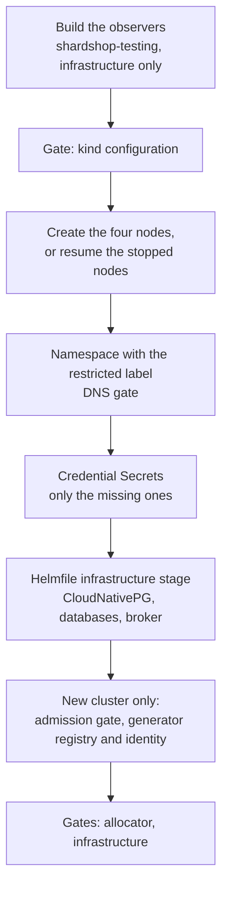
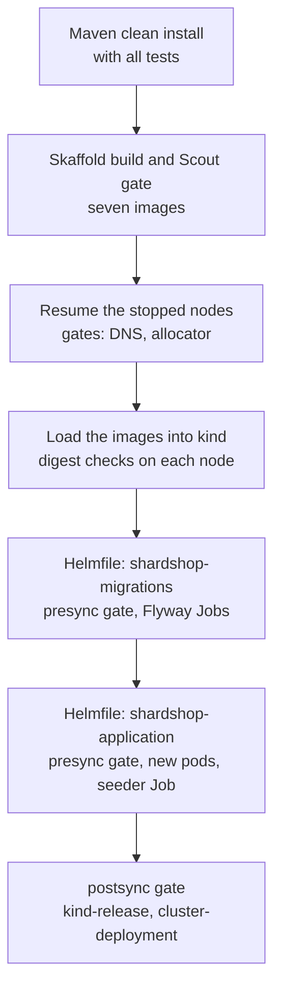
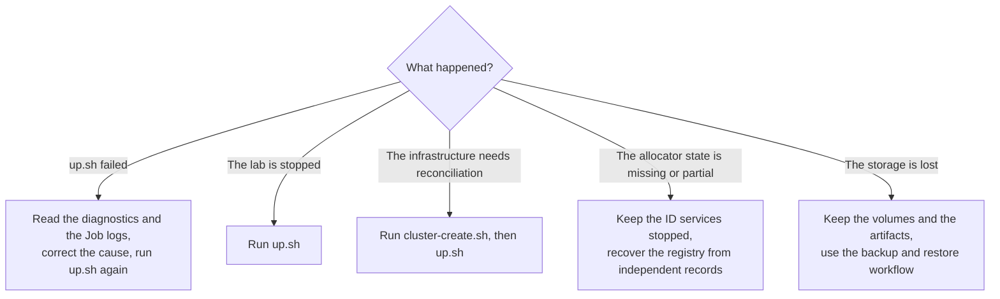

# Infrastructure runbook

[ShardShop](../README.md) › [Infrastructure](README.md) › **Runbook** · [Architecture](ARCHITECTURE.md) · [Container images](images/README.md) · [AWS foundation](terraform/README.md)

This runbook has the procedures of the local deployment: the creation of the lab, the
deployment, the broker, the stop, the destruction and the recovery. The
[README](README.md) shows how to start and monitor the lab, and the
[architecture](ARCHITECTURE.md) explains the design.

## Contents
1. [Kind topology](#1-kind-topology)
2. [Cluster creation](#2-cluster-creation)
3. [Deploy with up.sh](#3-deploy-with-upsh)
4. [RabbitMQ broker](#4-rabbitmq-broker)
5. [Stop and resume the cluster](#5-stop-and-resume-the-cluster)
6. [Permanently destroy the cluster](#6-permanently-destroy-the-cluster)
7. [Disposable test clusters](#7-disposable-test-clusters)
8. [Recover retained data or failed startup](#8-recover-retained-data-or-failed-startup)
9. [Lifecycle lock](#9-lifecycle-lock)
10. [Node networking](#10-node-networking)
11. [CloudNativePG operator](#11-cloudnativepg-operator)
12. [One-time procedures](#12-one-time-procedures)

## 1. Kind topology
<sub>[Back to Contents](#contents)</sub>

[`infra/kind.yaml`](kind.yaml) defines one control plane and three workers. Each
worker holds one instance of each three-instance shard.

- The nodes use the digest-pinned Kubernetes node image, and the API server listens
  on 127.0.0.1.
- kind cannot add nodes. Delete a cluster with fewer workers and create it again, one
  time.
- Before it starts stopped containers, `up.sh` compares the retained node names,
  roles, image pins and API port binding. It rejects other changes of the kind
  creation settings, for example of the network, the mounts or the ports. It never
  recreates retained nodes.
- The manifests obey the [portability rules](ARCHITECTURE.md#portability-beyond-kind):
  one shared chart in `infra/helm/shardshop/`, with the kind settings in
  `kind-values.yaml`.

## 2. Cluster creation
<sub>[Back to Contents](#contents)</sub>

```bash
bash microservices/shardshop/scripts/cluster-create.sh
```

`cluster-create.sh` creates the foundation, or resumes and reconciles a retained one,
in these phases:



- The script builds no application image, runs no Flyway migration and deploys no
  application. The [cluster creation design](ARCHITECTURE.md#cluster-creation) explains
  why.
- On an existing cluster, the allocator gate also runs before the namespace phase. The
  script never initializes the retained allocator history again.
- The [tool ownership](ARCHITECTURE.md#3-tool-ownership) table gives the owner of each
  phase.

**Wait times and checks.**

- Helm waits up to 600 seconds for each release of the infrastructure stage of
  [`infra/helmfile.yaml.gotmpl`](helmfile.yaml.gotmpl).
- Each database cluster must be Ready within 300 seconds, and each database pod must
  use the requested PostgreSQL image, operator image and resources. Kubernetes uses
  the limit as the request when the request is not given, and an explicit request
  still has priority.
- The checks also cover each `-rw` Service, each configured PostgreSQL setting on each
  instance (also pending restarts) and exactly two streaming quorum standbys for each
  shard.
- CNPG applies the `DatabaseRole` and `Database` resources for catalog, ordering and
  ledger. The script waits for the roles at their current generation, then up to 180
  seconds for each `Database` to reach its current generation and the `applied`
  status. The Flyway Jobs of `up.sh` then make the tables
  ([migrations](../database/RUNBOOK.md#database-schemas-and-migrations)).

**Database clusters.** The infrastructure release makes these clusters and the
persistent [broker](#4-rabbitmq-broker):

| Cluster | Region | Instances |
|---|---|---:|
| `shard-a` | US | 3 |
| `shard-b` | EU | 3 |
| `shard-c` | ASIA | 3 |
| `ledger-db` | No region: the separate ledger | 1 |

**Credentials.** The script makes a random password Secret only when the Secret is
missing:

| Secret | Used by |
|---|---|
| `catalog-migrator`, `ordering-migrator`, `product-app`, `order-app`, `ordering-cdc`, `ordering-operator` | All the shards |
| `ledger-migrator`, `ledger-app` | The ledger database |
| `shardshop-rabbitmq` | The [broker](#4-rabbitmq-broker) |

**Changes to a retained cluster.** Resource budgets, PostgreSQL settings, reviewed
operator updates and same-major PostgreSQL updates converge in place. Changes of
storage, placement, bootstrap settings, replica count or PostgreSQL major version fail
before the apply. The local storage class cannot expand a volume. Both scripts take a
snapshot of their inputs one time for each invocation (`up.sh` also of the Skaffold
configuration). After the API is ready, they reject a changed published or reserved
topology and an invalid retained allocator state, before each protected change. The
[accepted changes](ARCHITECTURE.md#accepted-changes) give all the rules.

**Generator registry.** Only the creation of a new cluster initializes the generator
registry. `up.sh` never creates a cluster, and never initializes or replaces the
allocator history.

- If the creation fails after the nodes exist, examine the failed phase. When both
  allocator objects exist, `cluster-create.sh` can validate the retained state and
  reconcile the foundation.
- A missing or partial allocator state stops the creation. Recover the independent
  backups of retained data. Or, if a failed bootstrap demonstrably has no data,
  destroy it and create it again explicitly.
- Never use an existing cluster as a new one to skip this guard.

**Maven.** Both scripts run the safety scenarios at their phase boundaries with the
same private snapshot. The creation builds only the observers, with
`mvn -B -ntp -f microservices/shardshop/pom.xml -pl shardshop-testing -am -Dshardshop.infrastructureOnly=true clean install -DinstallAtEnd=true`.

## 3. Deploy with up.sh
<sub>[Back to Contents](#contents)</sub>

```bash
bash microservices/shardshop/scripts/up.sh
```

`up.sh` takes no arguments. It needs the prepared cluster, and it gives the creation
command when the cluster is missing. It never makes namespaces or credentials, and
never syncs the infrastructure releases. It runs these phases:



The [deployment pipeline](ARCHITECTURE.md#deployment-pipeline) explains each phase
and lists the checks of each gate.

**Each run replaces the pods.** Helm sets a new restart annotation on all the
application Deployments. Thus each run replaces all the application pods, also when
the code and the configuration did not change. The seeder Job and the acceptance gate
check the new pods. Each new product or order JVM takes a new generator ID. The lab
has 1,023 IDs that it never reuses, and a normal rollout uses at least five. Changed
code goes through the same command.

**The build.** `up.sh` finds the ShardShop POM from its own location and runs
`mvn -B -ntp -f microservices/shardshop/pom.xml clean install -DinstallAtEnd=true`.
The build runs all the tests, and installs the verified artifacts for the later kind
checks. You can start `up.sh` with its absolute path from any directory.

- The POM sets `project.build.outputTimestamp`, thus the same sources give the same
  packages.
- Docker then uses its cached image layers again, and an unchanged build keeps its
  image IDs.
- Thus `kind load` skips the nodes, and the digests stay the same.

**A failed acceptance.** A failed hook fails Helmfile and `up.sh`, but Helm can still
show the release as deployed. The release is not rolled back. Correct the cause and
run `up.sh` again. The [release failures](ARCHITECTURE.md#release-failures) give the
details.

**Generator registry.** `up.sh` only checks the existing allocator state, which
`cluster-create.sh` made. A missing, partial, malformed or mismatched state stops the
startup and needs an independent
[allocator recovery](#8-recover-retained-data-or-failed-startup). `up.sh` never resets
it.

**Context.** On each run, kind refreshes the `kind-shardshop` context and selects it in
the `KUBECONFIG` files of the caller, or in `~/.kube/config` when the variable is not
set. The context stays available to later `kubectl` commands and standalone Maven
checks. The script gives the context to each command, and never deletes a cluster,
namespace or volume.

### Application images

The [container images](images/README.md) page describes the recipes of the six
application images and of the migration image.

`up.sh` builds and qualifies `flyway`, `product`, `product-seeder`, `product-reader`,
`order`, `ledger` and `order-producer`. It builds and scans all seven images before it
loads one into kind:

1. **Build.** [`skaffold.yaml`](../skaffold.yaml) builds the seven ARM64 images from
   the current Maven outputs and the reviewed Dockerfiles. Skaffold owns the artifact
   list, the recipes and the SHA-256 tag policy. It builds with Docker BuildKit,
   without provenance and SBOM data, and writes a private build-result file. A new
   empty artifact cache for each invocation forces new builds. Docker still reuses its
   layers, and Skaffold does not prune the rebuilt images in the background.
2. **Inventory.** The script prints the OS package inventory (`docker scout sbom`) and
   all the advisories (`docker scout cves`). Docker Scout does not index six Ubuntu
   packages of the JRE base, for example glibc, thus the inventory and the gate do not
   include them. [VERSIONS.md](../VERSIONS.md#os-packages-without-an-advisory-check)
   records this gap.
3. **Scan gate.** The script stops if Docker Scout finds a critical or high advisory
   without a reviewed statement in `infra/images/application/vex/`. A failed gate
   prevents the load of the image. Docker Scout needs a network connection, and
   [VERSIONS.md](../VERSIONS.md#docker-scout-gate) records the reviewed statements.
4. **Load.** When the nodes are ready, the script loads each qualified image into the
   kind nodes, one node at a time, and requires the same loaded platform manifest on
   each node. Then it registers that digest under the image name.
   - `kind load` skips a node that already has the same image ID. Then the check uses
     the manifest digest of the earlier import on that node.
   - For `flyway`, the loaded manifest must also be the pinned digest. If it is not,
     the script stops before the registration, and the image pin needs a review.
   - The script also tags the image `sha256-<digest>` on each node. kind names each
     import `import-<date>@<digest>`, without a registry. Without the extra tag, the
     container runtime uses that name after the original tag moves, does not find the
     earlier image, and new containers of the deployed release fail with
     `CreateContainerError`.

Skaffold only builds the images: it has no deployer and loads nothing into kind. The
small `kind load` step of `up.sh` delivers the images and compares each loaded
configuration ID with the qualified build, and Helmfile owns the deployment. The
script records the loaded manifest digests on each node before the migrations and the
new release. A failure during the load can leave a partial load, but it prevents the
new release.

### Application release

The application Helm release deploys two product pods, two order HTTP pods and one
pod each for the order saga, the ledger, the reader, the order producer and the
interactive seeder, plus the bootstrap seeder Job.

- **Order.** The HTTP Deployment uses `RollingUpdate`. `shardshop-order-saga` has one
  replica and uses `Recreate`, thus its three embedded CDC readers never overlap in a
  rollout. Both use the same image, and `shardshop.order.process=http|saga` selects the
  process (default `http`). Only the saga runs the stock and profit workers, the CDC
  and the result consumer. Each JVM reserves its own generator slot.
- **CDC state.** The CDC offsets and the reader history stay in the shard databases.
  No pod volume holds CDC progress.
- **Ledger.** The ledger consumes commands and publishes saved results with its
  separate database. Its internal HTTP Service exposes `/q/metrics` on port 8080, and
  the commands and results still use RabbitMQ.
- **Services.** The saga has its own internal metrics Service. The order API Service
  selects only the HTTP pods.

| Process | Mounts | Credentials |
|---|---|---|
| Order, HTTP and saga | The routing snapshot, the shard CA certificates and the generated configuration | The `order-app` and `ordering-cdc` passwords and its RabbitMQ credential, from `secretKeyRef` environment variables. The `shardshop-order` service account reserves its generator ID |
| Ledger | Its database CA certificate and the generated configuration | Its database and RabbitMQ passwords, from `secretKeyRef` environment variables |
| Order producer | Nothing | None: only HTTP settings, with no service-account token, database credential or persistent volume |

Order and ledger load the generated configuration from
`/app/config/application.properties`. The CA projections expose `ca.crt`, never
`ca.key`.

## 4. RabbitMQ broker
<sub>[Back to Contents](#contents)</sub>

`cluster-create.sh` provisions one persistent RabbitMQ broker through the
infrastructure Helm release. `shardshop-rabbitmq.shardshop.svc:5672` serves AMQP, and
port 15672 serves the management UI inside the cluster. The vhost `shardshop` has the
durable direct exchanges `ledger.commands`, `order.saga-results` and `shardshop.dlx`,
and these single-member quorum queues:

| Queue | Complete policy | Dead-letter destination |
|---|---|---|
| `ledger.record-order` | `ledger-command-delivery` | `ledger.record-order.dlq` |
| `order.ledger-results` | `order-result-delivery` | `order.ledger-results.dlq` |
| Both `.dlq` queues | `parking-capacity` | None |

The [delivery design](ARCHITECTURE.md#6-rabbitmq-and-delivery-reliability) explains the
topology, the policies and the retry budget.

| Setting | Value |
|---|---|
| Retry of the source queues | Retry after a failed delivery, delays from 1000 to 5000 ms, `delivery-limit=5`, at-least-once dead-lettering |
| Queue limits | Reject-publish at 1000 messages or 16 MiB. The quorum admission can go above these limits for a short time |
| Parking queues | `x-delivery-limit=-1`, no TTL, no expiry and no automatic consumer |
| A full parking queue | The source queue keeps the dead letter until the next internal confirmation retry of the broker, after 180 seconds by default |
| Message size | At most 1 MiB |
| Memory | A memory watermark of 512 MiB and a container limit of 1 GiB |
| Disk | A free-disk threshold of 100 MB |
| Feature flags | `stream_queue` is on through the stable defaults of the broker, and the acceptance tests check it |

**Storage and security.**

- The StatefulSet keeps its 2 GiB PVC after restarts and deletion. A stable node name
  keeps the same broker database.
- `rabbitmq.runAsUser` can be any positive UID. `fsGroup` makes the storage writable,
  and the cookie, plugin and runtime files are in `/tmp`.
- The root filesystem is read-only, and all Linux capabilities are dropped.
- At startup, the broker copies only the two named definition files out of the
  projected volumes, without their metadata directories. A ConfigMap checksum restarts
  the broker when its public configuration changes.
- One broker keeps the data, but it is not available while the broker or its node is
  down.

**Credentials.** The creation makes the Secret `shardshop-rabbitmq` one time and keeps
its keys on each later run:

| Key | Content |
|---|---|
| `users.json` | The broker users |
| `admin-password` | The password of `shardshop-admin`, which owns the topology |
| `order-password` | The password of `shardshop-order`, which publishes commands and reads results |
| `ledger-password` | The password of `shardshop-ledger`, which reads commands and publishes results |
| `erlang-cookie` | The Erlang cookie |

- The service users cannot configure resources or use the management UI.
- Back up this Secret with the broker data.
- If the Secret is missing while the StatefulSet or the PVC stays, the creation stops.
  Restore the original Secret, then try again. A partial Secret also stops the
  creation, without credentials in the output.
- A credential rotation needs a coordinated broker restart and consumer update. The
  normal startup does not rotate credentials.

**Checks.** `cluster-create.sh` provisions the broker and runs the read-only readiness
and topology gate, and `up.sh` runs the same gate before the migrations. To check the
chart, the lifecycle preservation, the non-image UID, the permissions, the native retry
boundary, the persistent message recovery and the full-queue backpressure in isolated
containers, run:

```bash
mvn -B -ntp -f microservices/shardshop/pom.xml -pl shardshop-testing -am \
  -Dshardshop.infrastructureOnly=true -Pintegration \
  -Dcucumber.filter.tags=@rabbitmq verify
```

These scenarios publish persistent mandatory messages and require publisher confirms.
They verify that `basic.nack(requeue=true)` keeps the failure budget, that
`basic.reject(requeue=true)` uses it, and that a rejected malformed message goes to the
parking queue immediately. The test containers and their volumes are removed at the
end. The [retry and DLQ capacity drills](../shardshop-testing/RUNBOOK.md#4-retry-and-dlq-capacity-drills)
test the recovery after a shard outage and the real outbox backpressure under an
unbound or full DLQ. The shared drill guard restores the temporary settings.

## 5. Stop and resume the cluster
<sub>[Back to Contents](#contents)</sub>

```bash
bash microservices/shardshop/scripts/down.sh
bash microservices/shardshop/scripts/up.sh
```

`down.sh` stops the lab and keeps all its data:

1. It turns off the restart policy of each ShardShop kind node with one
   `docker update --restart=no` call. kind creates its nodes with `on-failure:1`, and a
   node that Docker kills at the stop timeout exits with a failure code. Without this
   step, the next Docker daemon start restarts the stopped nodes, for example when
   Docker Desktop Resource Saver starts its VM again for a later Docker command.
2. It stops all the nodes with one `docker stop --timeout 10` call. Docker stops the
   nodes in parallel, and kills a node process that does not stop within ten seconds.
3. It keeps the node containers, the volumes, the databases, the PVCs, the Secrets and
   the allocator identity and history.

If a stop fails, `down.sh` returns nonzero and releases the lifecycle lock. Examine the
nodes and run `down.sh` again. If Docker Desktop does not respond, `down.sh` waits until
you stop it with Ctrl+C.

`up.sh` resumes the lab:

1. Before it starts the nodes, it builds, tests and scans the images again, thus it
   needs network access for Docker Scout.
2. It sets the `on-failure:1` policy of kind again and starts the same containers.
   `cluster-create.sh` also sets the policy again when it resumes a cluster.
3. It waits for the API server and for each `-rw` Service, because the stored Ready
   statuses are from before the restart.
4. It checks the prepared infrastructure and deploys the applications again. Each
   restarted product or order JVM reserves a new generator ID.

Only `kind delete cluster --name shardshop` deletes the data of the lab.

## 6. Permanently destroy the cluster
<sub>[Back to Contents](#contents)</sub>

CAUTION: Make a copy of the data that you want to keep before you do this step. This
command deletes the lab with all its data, and you cannot recover the data. Use
`down.sh` to stop the lab and keep the data.

```bash
bash microservices/shardshop/scripts/cluster-destroy.sh
```

| Deleted | Kept |
|---|---|
| The fixed `shardshop` kind cluster, also when it is stopped | The repository |
| All the databases, PVC data, Secrets, Helm releases and Kubernetes configuration | Docker Desktop and the other containers |
| The generator history | The shared images, the build caches and the shared kind network |
| The `kind-shardshop` context, cluster and user entries in the selected `KUBECONFIG` | Exported kubeconfig copies and external backups |

- The script takes the lifecycle lock and runs `kind delete cluster --name shardshop`
  with the Docker provider of kind. kind removes the node containers with
  `docker rm -f -v`, which also removes their anonymous `/var` volumes.
- The lab keeps its data only in the Docker node volumes, because `infra/kind.yaml`
  adds no host mounts.
- If the cluster is already missing, the command does nothing, thus you can repeat it
  safely.
- If Docker cannot remove a node volume, `docker volume ls` still shows it. Remove it
  with `docker volume rm`.
- To make a new lab, run `cluster-create.sh` and then `up.sh`. The earlier entity IDs
  and the allocator history cannot be recovered.

## 7. Disposable test clusters
<sub>[Back to Contents](#contents)</sub>

The ordinary calls use the fixed `shardshop` cluster, the `kind-shardshop` context and
the normal kubeconfig selection. A test orchestration can direct the same entry points
to its own test lab with both of these environment variables:

| Variable | Contract |
|---|---|
| `SHARDSHOP_TEST_CLUSTER` | A unique `shardshop-test-` name: a lowercase DNS-label suffix that ends with a letter or digit, at most 63 characters in total |
| `SHARDSHOP_TEST_KUBECONFIG` | One absolute path in an existing mode-700 directory outside `~/.kube`. The file is absent, or a regular mode-600 file, with no symlink, colon or line break |

- The helper validates both variables before any CLI call or lifecycle lock. It makes
  an absent kubeconfig with mode 600 in a scoped subshell, and uses only that file
  instead of the inherited `KUBECONFIG`. It keeps the build umask of the caller.
- The kind configuration of the invocation uses the selected name. The kind creation,
  export and deletion, the image load, kubectl, the Helmfile and Helm hooks, the Maven
  gates and the Java HTTP tunnels all select the same lab. The namespace, the release
  names and the resources inside the lab stay `shardshop`.
- Give both variables to each call, also to the stop and the destruction. Only one
  variable, a retained cluster name or an unsafe path fails before the script touches a
  cluster.

**Before the creation.** The test orchestration owns the cleanup.

1. Make sure that its random name does not exist.
2. Register the cleanup before the creation, because a failed `kind create` can already
   have made nodes.
3. Record the prior state of the retained lab, and stop it before you create a
   disposable four-node lab. Restore that state after the owned cleanup.
4. Make sure that the Docker disk has at least 20 GiB free, on a disk of 80 GiB.
   Stopped retained volumes still use disk space, and a database image rollout can fill
   a small Docker filesystem. Count both sets of volumes, the old and new images and the
   build cache, and check the free space before upgrades. More capacity keeps the data,
   but a smaller Docker disk can delete it. See the
   [Docker disk settings](https://docs.docker.com/desktop/troubleshoot-and-support/faqs/macfaqs/).

For example, run this subshell from the repository root, after these preconditions and
the normal lifecycle prerequisites:

```bash
(
    set -euo pipefail
    test_state=$(mktemp -d)
    export SHARDSHOP_TEST_CLUSTER="shardshop-test-$(openssl rand -hex 8)"
    export SHARDSHOP_TEST_KUBECONFIG="$test_state/config"
    export KUBECONFIG="$SHARDSHOP_TEST_KUBECONFIG" KIND_EXPERIMENTAL_PROVIDER=docker
    if [[ -n "$(kind get nodes --name "$SHARDSHOP_TEST_CLUSTER")" ]]; then
        rmdir "$test_state"
        echo 'Test cluster name already exists; no ownership was acquired.' >&2
        exit 1
    fi
    cleanup_owned_lab() {
        status=$?
        trap - EXIT
        if bash microservices/shardshop/scripts/cluster-destroy.sh; then
            rm -rf -- "$test_state"
        else
            echo "Test cleanup failed; keep $test_state and retry destruction with the same variables." >&2
            exit 1
        fi
        exit "$status"
    }
    trap cleanup_owned_lab EXIT
    trap 'exit 130' INT
    trap 'exit 143' TERM
    bash microservices/shardshop/scripts/cluster-create.sh
    bash microservices/shardshop/scripts/up.sh
    # Run the scoped qualification against this lab here.
)
```

**After the run.**

- The scripts do not destroy a failed lab automatically, and the ordinary recovery of
  retained data does not change.
- The cleanup covers success, a command failure, INT and TERM. After SIGKILL, a host
  failure or a failed Docker deletion, clean up explicitly with the saved name and
  kubeconfig.
- The shared lifecycle lock still lets only one call run at a time.
- The test labs share the Docker images, the build caches, the Maven outputs and the
  host page ports with the normal lab. Thus concurrent builds or page sessions are not
  independent, also with separate clusters.

**Standalone observers.** The standalone Maven observers accept
`-Dshardshop.cluster.name` and `-Dshardshop.cluster.kubeconfig` (or the two test
environment variables), with the normal invocation snapshot. Its `kind.json` must
contain the selected name. For an independent snapshot, use the snapshot inputs of the
lifecycle and change the name in the copied `kind.yaml` before you render the
manifests. The
private kubeconfig rules also apply to the observer subprocesses and tunnels.

## 8. Recover retained data or failed startup
<sub>[Back to Contents](#contents)</sub>



**A failed `up.sh`.** A failed run can leave completed migrations and a partly updated
release.

1. Read the bounded diagnostics and the retained logs of the migration and seeder Jobs.
2. Correct the source configuration, or add a forward migration for the failed one.
3. Run `bash microservices/shardshop/scripts/up.sh` again. Flyway validates the real
   schema history on each run. The seeder sends the same durable keys and payloads
   again, thus the existing entity IDs stay.

Do not edit an applied versioned migration, clear the Flyway history or delete the
topology guards to force a retry.

**A stopped lab or changed infrastructure.** Run `up.sh` to resume the retained nodes.
If the prepared infrastructure needs reconciliation, run `cluster-create.sh` first. It
validates the retained topology and allocator state and never resets their history.
Neither command makes deleted rows or lost storage again. Do not destroy the cluster as
a recovery step when the data must survive.

**A missing or partial allocator state.**

- The recovery needs an independent record of the original registry identity and of
  the latest high-water mark. Keep the services that make IDs stopped until you have
  these facts. An older database dump is not evidence for the allocator recovery.
- The admission guard pins the original registry UID. Thus a new ConfigMap or an old
  snapshot cannot safely repair the registry.
- No automatic allocator reconstruction and no generic restore command exist. Obey the
  [allocator recovery constraints](../shardshop-core/idgen/README.md#generator-allocation-at-jvm-startup),
  and keep the latest mark without a rollback.

**Lost storage.** The lifecycle commands make no backups.

- Use the [verification workflow](../shardshop-testing/RUNBOOK.md#8-coordinated-backup-and-isolated-restore)
  for a coordinated backup, an isolated restore and an
  [audit of older backups](../shardshop-testing/RUNBOOK.md#9-older-backup-audit-and-selected-repair).
- If storage is lost, keep the remaining volumes and the independent recovery
  artifacts before you try a restore.
- The [backup policy](../database/ARCHITECTURE.md#replication-and-backup-policy)
  requires external dumps with routing and schema identities, and a separate latest
  allocator history. The [restore audit](../shardshop-order/ARCHITECTURE.md#orders-lost-by-asynchronous-failover-or-restore)
  defines the reconciliation of later order and ledger state.
- Without usable recovery artifacts, the deleted history cannot be recovered.

**A new lab on purpose.** First retire all earlier emitters, data and replay inputs.
Then run `cluster-destroy.sh`, `cluster-create.sh` and `up.sh`, in this order. The new
lab starts a new identity history and does not recover the old one.

## 9. Lifecycle lock
<sub>[Back to Contents](#contents)</sub>

- `cluster-create.sh`, `up.sh`, `down.sh` and `cluster-destroy.sh` share the local
  exclusive directory lock `${TMPDIR:-/tmp}/shardshop-up.lock`. Use the same `TMPDIR`
  for all four.
- A concurrent call fails before it changes the lab. Try it again after the first call
  ends.
- After a successful deployment, `up.sh` releases the lock and its temporary snapshot,
  and stops.
- `webpages.sh` takes no argument and no lock. It replaces the local page listeners and
  supervises its tunnels on the deployed lab, without a rebuild or an application
  restart. See [Open the webpages](../README.md#3-open-the-webpages) for the access and
  the recovery from port conflicts.
- An ordinary failure, INT or TERM releases the lock after the active command ends.
  After SIGKILL or a machine failure, make sure that no invocation is active and
  inspect the retained Jobs, then remove the stale lock directory.

## 10. Node networking
<sub>[Back to Contents](#contents)</sub>

A node start can give the nodes new IP addresses. Thus `up.sh` restarts kindnet after
it starts a stopped node, then checks DNS from all four nodes and both streaming
standbys of each shard. If the automatic repair or the wait for the database
parameters fails, `up.sh` stops with recovery instructions. The retained data and the
allocator state do not change.

CoreDNS runs on the control plane. Thus a missing route prevents the Service name
resolution and can stop the replication stream, with an error such as
`<cluster>-rw does not accept connections from <pod>`. Each node must have a route to
the pod network (`CIDR`) of each other node.

1. Show the node addresses and pod networks, and the routes of a node:

   ```bash
   kubectl --context kind-shardshop get nodes -o 'custom-columns=NAME:.metadata.name,IP:.status.addresses[0].address,CIDR:.spec.podCIDR'
   docker exec shardshop-control-plane ip route
   ```

2. If the automatic kindnet repair did not restore the route, examine the reported node
   and correct the condition before you run `up.sh` again.
3. To refresh a stale kindnet process on a node that runs, replace only the kindnet pod
   of that node:

   ```bash
   kubectl --context kind-shardshop -n kube-system delete pod -l app=kindnet --field-selector spec.nodeName=shardshop-control-plane
   ```

Do not delete the allocator state or the database volumes as a workaround.

## 11. CloudNativePG operator
<sub>[Back to Contents](#contents)</sub>

- [`infra/helm/cnpg/`](helm/cnpg) holds the official CloudNativePG chart, verified
  against the SHA-256 of the lock and its cosign signature, and `values.yaml`, which
  pins the operator by tag and digest.
- The chart uses this one reference for the operator image and for
  `OPERATOR_IMAGE_NAME`.
- The chart keeps its CRDs if the release is uninstalled, thus the database clusters
  stay.
- The operator installs before the shared database resources, thus its APIs and
  webhooks are ready for them.
- To upgrade, examine the support deadline in the lock. Then vendor and verify the new
  chart, and update `values.yaml` and the lock together. The AWS deployment installs
  the same chart and values.

## 12. One-time procedures
<sub>[Back to Contents](#contents)</sub>

### First upgrade from a v1-only ledger

For this one-time cutover of a retained lab, the ledger must accept v2 before new order
pods publish v2 commands.

1. Pause the rollout of the **order Deployment**, then run `up.sh`. The existing order
   pods continue to serve and to send v1:

   ```bash
   kubectl --context kind-shardshop -n shardshop rollout pause deployment/shardshop-order
   bash microservices/shardshop/scripts/up.sh
   ```

2. While `up.sh` waits for the application readiness, use another terminal. Make sure
   that the ledger Deployment and its ready pod use the **new ledger image digest that
   this invocation printed**, that the new generation is observed and that no old
   ledger pod remains.
3. Complete the order rollout:

   ```bash
   kubectl --context kind-shardshop -n shardshop rollout status deployment/shardshop-ledger --timeout=120s
   kubectl --context kind-shardshop -n shardshop rollout resume deployment/shardshop-order
   ```

- A successful rollout status for the old digest is not sufficient.
- If the build or the deployment fails, resume the order rollout before you leave the
  cutover.
- If an operator paused the rollout before, keep that paused state, and do not take it
  over.

After this upgrade, both services understand v2, and the next deployments use the
ordinary `up.sh`. No stored message or ledger decision changes during the transition.
