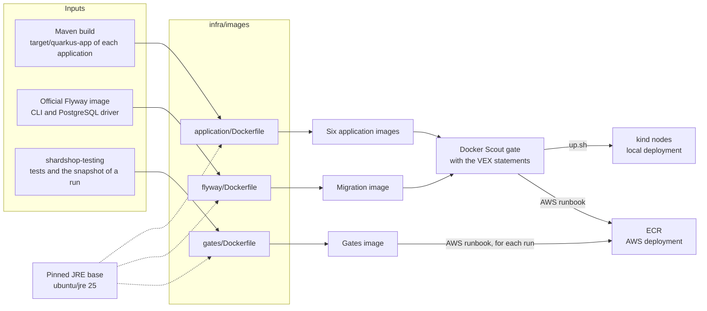

# Container images

[ShardShop](../../README.md) › [Infrastructure](../README.md) › **Container images** · [Infrastructure runbook](../RUNBOOK.md#application-images) · [AWS foundation](../terraform/README.md#deliver-shardshop-with-argo-cd) · [Versions](../../VERSIONS.md#canonical-jre-images)

This folder has the recipes of the ShardShop container images. The local deployment
and the AWS deployment use the same recipes. The runbooks own the build commands,
and [VERSIONS.md](../../VERSIONS.md) owns the pins and the scan results.

## Contents
1. [Overview](#1-overview)
2. [Application images](#2-application-images)
3. [Migration image](#3-migration-image)
4. [Gates image](#4-gates-image)
5. [Scan exceptions](#5-scan-exceptions)

## 1. Overview
[Back to Contents](#contents)

| Image | Recipe | Used by | Built by | Deployment |
|---|---|---|---|---|
| `shardshop-product`, `shardshop-product-seeder`, `shardshop-product-reader`, `shardshop-order`, `shardshop-ledger`, `shardshop-order-producer` | [`application/Dockerfile`](application/Dockerfile) | The application Deployments and the seeder Job | Skaffold, from `up.sh` or the AWS runbook | Local and AWS |
| `shardshop-flyway` | [`flyway/Dockerfile`](flyway/Dockerfile) | The migration Jobs | Skaffold, from `up.sh` or the AWS runbook | Local and AWS |
| `shardshop-gates` | [`gates/Dockerfile`](gates/Dockerfile) | The Argo CD gate Jobs | Docker Buildx, from the AWS runbook | AWS only |

All the images have these properties:

- The platform is `linux/arm64`, for Apple silicon and for the Graviton workers of EKS.
- The base is the pinned Canonical OpenJDK 25 JRE on Ubuntu 26.04
  (`ubuntu/jre:25-26.04_stable`). The base has no shell, thus each entrypoint starts
  `java` directly.
- The process runs as the user `10001:10001` with `HOME=/tmp`.

## 2. Application images
[Back to Contents](#contents)

One recipe builds the six application images. Its build context is the complete
`target/quarkus-app` directory of one application, which the Maven build makes.

- The image copies the directory to `/app` and starts `quarkus-run.jar`.
- Quarkus also reads `config/application.properties` in `/app`. The chart mounts the
  generated configuration there.
- The order image runs two processes, the HTTP API and the saga. The setting
  `shardshop.order.process` selects one.
- The seeder image runs the seeder Job and the interactive seeder.
- The images contain no kubectl. Product and order reserve their generator IDs with
  Java code, through the Kubernetes API.
- Maven writes the JAR files with a fixed time stamp, thus an unchanged build uses the
  cached image layers again ([decision](../../DECISIONS.md#reproducible-images-with-digest-tags)).

[`up.sh`](../RUNBOOK.md#application-images) builds, scans and loads the images into
kind. The [AWS runbook](../terraform/README.md#deliver-shardshop-with-argo-cd) builds
and scans them in the same way, then copies them to ECR.

## 3. Migration image
[Back to Contents](#contents)

The migration image runs the Flyway CLI for the
[schema migrations](../../database/RUNBOOK.md#3-database-schemas-and-migrations). The
image contains no SQL. Each migration Job gets the SQL files of `database/` from a
ConfigMap of the chart.

- The recipe copies only the Flyway core and PostgreSQL plugin libraries, the
  PostgreSQL JDBC driver and the licenses from the pinned official Flyway image. The
  Temurin runtime of the official image does not go into the final image.
- The entrypoint starts the main class of the Flyway CLI with `java`.
- The copied files get the time stamp zero, thus two builds give the same digest.
- The chart pins the reviewed build by digest. `up.sh` stops if the loaded build is a
  different one, and the AWS runbook compares the build with the lock.

## 4. Gates image
[Back to Contents](#contents)

The gates image runs the Maven gates of the local deployment as Argo CD hook Jobs on
EKS, and the [drills](../terraform/README.md#run-the-drills) as Jobs that the runbook
creates. It runs `ClusterIT` with the JUnit console launcher, not with Maven. The Job
gives the tag expression of its gate or drill, for example
`--include-tag=cluster-deployment`. A drill Job gives its other system properties in
`JDK_JAVA_OPTIONS`. The
[AWS runbook](../terraform/README.md#deliver-shardshop-with-argo-cd) builds the image
for each run, because the image contains the snapshot of the run.

| Path | Contents | Source |
|---|---|---|
| `/usr/local/bin/kubectl` | kubectl 1.37.2 for linux/arm64 | dl.k8s.io. The recipe checks its SHA-256 |
| `/usr/local/bin/helm` | Helm 4.3.1 for linux/arm64. The workload drill renders its temporary seeder Job with it | get.helm.sh. The recipe checks the SHA-256 of the archive. A build stage from the pinned Flyway image unpacks it |
| `/gates/lib` | The test classpath with the JUnit console launcher | Maven `dependency:copy-dependencies` with the `cluster` profile |
| `/gates/classes` | The compiled tests and the feature files | `shardshop-testing/target/test-classes` |
| `/gates/snapshot` | The invocation snapshot: inventory, infrastructure render and image references | The AWS runbook |
| `/gates/source` | The source files that the checks read, for example the golden routing vectors | The repository |
| `/gates/kube/config` | The kubeconfig for the API server of the cluster, with the token of the ServiceAccount of the Job: `shardshop-gates` or `shardshop-drills` | [`gates/kubeconfig`](gates/kubeconfig) |

- Only the user `10001` can read the files below `/gates`. The kubeconfig directory
  has the mode 700 and the file has the mode 600, because the `cluster` profile requires
  a private kubeconfig.
- The tests write their reports below `/tmp`, which the Job mounts as a writable
  volume. The drills write their temporary files to `/tmp/work`, because the snapshot
  is read-only.
- The local deployment does not use this image. There, Helmfile runs the same gates
  with Maven.

## 5. Scan exceptions
[Back to Contents](#contents)

[`application/vex/`](application/vex) holds the OpenVEX statements of the Docker Scout
gate. The JRE base keeps its unused `pebble` binary, and Scout reports the findings of
its Go standard library. Each statement marks one such finding as `not_affected` for
the named images and one exact package version. A new package version or a new
finding has no statement, thus the gate stops the build.
[VERSIONS.md](../../VERSIONS.md#docker-scout-gate) has the review rules.

The gates image has no statements. Its findings have a time-limited
[risk acceptance](../../VERSIONS.md#3-open-findings-and-risk-acceptance).
