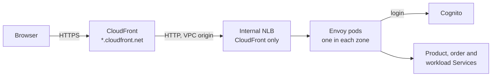

# AWS foundation

[ShardShop](../../README.md) › [Infrastructure](../README.md) › **AWS foundation** · [Container images](../images/README.md) · [Plan milestone 7](../../PLAN.md#4-milestone-7-aws-deployment)

Terraform creates the AWS foundation of milestone 7: a VPC, an EKS
cluster, ECR repositories, a backup bucket, the runtime secrets and the IAM roles of
the workloads. The [runbook](#deliver-shardshop-with-argo-cd) then delivers ShardShop
on EKS with Argo CD, [opens the webpages](#open-the-webpages) and runs the drills. The local deployment does not use
these resources. The versions are in [VERSIONS.md](../../VERSIONS.md#aws-foundation).

## Design

There are three Terraform root modules:

- [`state/`](state) creates the S3 bucket for the Terraform state, with versioning,
  encryption and blocked public access. This bucket must exist before the other
  module, thus `state/` keeps its own state in a local file.
- [`aws/`](aws) creates the foundation. Its state is in the S3 bucket, and the S3
  lock file (`use_lockfile`) prevents two runs at the same time.
- [`webpages/`](webpages) creates the CloudFront distribution, its VPC origin and the
  Cognito user pool of the [webpages](#open-the-webpages). Its state is in the same
  bucket. It needs the NLB that the AWS Load Balancer Controller creates, thus it comes
  after the delivery.

| Part | Design |
|---|---|
| Network | VPC `10.40.0.0/16` in the first three zones of `eu-west-2`. In each zone, a private `/20` subnet for the workers and a public `/24` subnet. One shared NAT gateway (`nat_gateway_per_zone = true` gives one in each zone). A free S3 gateway endpoint for backups and ECR image layers. |
| Cluster | EKS `shardshop` on Kubernetes 1.36, because CloudNativePG 1.30 supports 1.34–1.36. The upgrade policy `STANDARD` prevents paid extended support. The public API endpoint accepts only `api_allowed_cidrs`. Access entries only (`authentication_mode = "API"`), and the creator is a cluster administrator. Audit and authenticator logs stay 7 days. |
| Workers | One managed node group in each zone, because an EBS volume stays in its zone. Graviton `t4g.xlarge` with Amazon Linux 2023 arm64, because the images are linux/arm64. This size holds the database tier with the backup sidecars, three brokers, one restore cluster, Argo CD, the applications, the gates and the add-ons (`node_instance_type`). A `t4g.large` holds all of them except the applications, and a `t4g.medium` (4 GiB) does not hold the backup sidecars. IMDSv2 with a hop limit of 1. The cluster API can reach the pods on 8080 and 9187, because the gates read the application and CloudNativePG metrics through the API server proxy. |
| Storage | [`eks-values.yaml`](../helm/shardshop/eks-values.yaml) makes the shared chart create the StorageClass `shardshop-gp3`: encrypted gp3 volumes with the tag `Project=shardshop`, created in the zone of the scheduled pod and deleted with their claim. Each shard has one instance in each zone. |
| Add-ons | `vpc-cni`, `eks-pod-identity-agent`, `kube-proxy`, `coredns`, `aws-ebs-csi-driver`, the community add-on `cert-manager` for the backup plugin (its webhook port 10260 has its own node rule), and `aws-secrets-store-csi-driver-provider` with the Kubernetes Secret sync. Each one uses the newest add-on version for the cluster version at apply time. |
| Images | One ECR repository for each image in [`skaffold.yaml`](../../skaffold.yaml) and for the [gates image](../images/README.md#4-gates-image), with immutable tags and a scan on push. Four repositories below `shardshop-charts/` keep the OCI charts that Argo CD applies. |
| Delivery | A self-managed [Argo CD](../helm/argocd/values.yaml) applies ShardShop from the [delivery chart](../helm/delivery): one child Application for each layer, in sync waves, with pinned charts. The Maven gates of the local deployment run as hook Jobs. An admission policy denies a sync that skips the hooks. |
| Backups | Bucket `shardshop-backups-<account>-<region>` with SSE-S3 encryption, blocked public access and a TLS-only policy. The [Barman Cloud Plugin](../helm/barman-cloud/values.yaml) archives the WAL of each database cluster continuously below the prefix of the cluster, for example `shard-a/`. A base backup starts with the cluster and then runs each day. The plugin keeps 7 days. |
| Secrets | One AWS Secrets Manager secret for each login role of `runtimeSecrets` in `eks-values.yaml`, and `shardshop/rabbitmq` with the broker passwords, the Erlang cookie and the `users.json` of [`users.jq`](../helm/shardshop/files/rabbitmq/users.jq). The passwords are ephemeral and the values write-only, thus no password is in the Terraform state. A destroy deletes the secrets without a recovery window. The shared chart syncs them to the Kubernetes Secrets that kind creates with `cluster-create.sh`, through a holder pod that mounts them. |
| Broker | Three RabbitMQ brokers, one in each zone. Each quorum queue has a member on each broker. |
| Webpages | CloudFront serves the five webpages on its default `*.cloudfront.net` name, with its certificate and an HTTP-to-HTTPS redirect. A VPC origin connects CloudFront to an internal NLB, and the security group `shardshop-webpages` of the NLB accepts only the CloudFront origin-facing prefix list. The NLB sends the traffic to three Envoy pods of [Envoy Gateway](../helm/envoy-gateway/values.yaml), one in each zone. The [AWS Load Balancer Controller](../helm/aws-load-balancer-controller/values.yaml) creates the NLB with its EKS Pod Identity role. The private path from CloudFront to the NLB uses HTTP, because no trusted certificate can match the name of an internal NLB. Cognito gives the login, with the groups `viewer` and `operator` |
| IAM | The worker role has only the node, CNI and ECR pull policies. EKS Pod Identity gives roles to the EBS CSI driver and to each CloudNativePG cluster of [`shards.yaml`](../shards.yaml) and `ledger-db`. Only this cluster can use these roles. A backup role can write only below its own prefix, for example `shard-a/`. A restore role lets the cluster `<cluster>-pitr` read only the prefix of its source. The holder pod can read only the runtime secrets. |

`terraform destroy` removes everything that the modules create:

- ECR deletes the repositories with their images (`force_delete`).
- S3 deletes the buckets with their objects (`force_destroy`).
- The modules create no customer managed KMS key, because such a key stays for at
  least 7 days after its deletion. EKS encrypts the Kubernetes API data with an
  AWS owned key.

The Terraform state does not contain the EBS volumes of the database and broker
claims. Thus [remove ShardShop from the cluster](#remove-shardshop-from-the-cluster) before the
destroy, while the EBS CSI driver still runs.

[`operator-policy.json`](operator-policy.json) gives the permissions for these
modules to the IAM user that runs Terraform:

- All names must start with `shardshop`, and the region must be `eu-west-2`.
- The user can attach only the AWS managed EKS, ECR pull and EBS CSI policies, and
  can pass the roles only to EKS, EC2 and EKS Pod Identity.
- The user can get an ECR login token, and can delete only EBS volumes with the tag
  `Project=shardshop`.
- The user can manage only the Secrets Manager secrets below `shardshop/`.
- This policy is not a full privilege boundary. The user can write an inline
  policy for a `shardshop-*` role and give that role to a pod.

[`operator-policy-webpages.json`](operator-policy-webpages.json) gives the
permissions for the public webpages of the AWS deployment
([plan](../../PLAN.md#78-stable-aws-webpage-urls-and-access-control)). It is a
second policy, because one managed policy can have a maximum of 6,144 characters:

- The user can create CloudFront distributions, CloudFront VPC origins and Cognito
  user pools only with the tag `Project=shardshop`. Then the user can manage only
  the resources with this tag. The user pools must be in `eu-west-2`.
- The user can read each CloudFront distribution and VPC origin without the tag.
  After a deletion the tag is gone, and Terraform then reads the resource until AWS
  reports that it does not exist. With only the tag-based permission, AWS gives
  AccessDenied, and `terraform destroy` stops with an error.
- The user can let CloudFront create its service-linked role for VPC origins.
- The user can read the load balancers. The user can delete only load balancers,
  listeners and target groups with the tag `Project=shardshop`. Thus the AWS Load
  Balancer Controller must add this tag to its resources.
- The user can add the tag `Project=shardshop` to a different CloudFront
  distribution and then manage it. Tag-based permissions cannot prevent this.

### Costs

These are the on-demand prices in `eu-west-2`, without tax, from the AWS public
price list of 2026-10-29:

| Item | Price |
|---|---|
| EKS control plane, standard support | US$0.10 for each hour |
| NAT gateway | US$0.05 for each hour, and US$0.05 for each GB |
| Public IPv4 address of the NAT gateway | US$0.005 for each hour |
| Three `t4g.xlarge` workers | US$0.4512 for each hour (3 × US$0.1504, price list of 2026-11-01) |
| Three 20 GB gp3 root volumes | US$0.0076 for each hour (US$0.0928 for each GB-month) |
| Thirteen 2 GiB gp3 database and broker volumes of the database tier | US$0.0033 for each hour |
| Nine Secrets Manager secrets | US$0.40 for each secret-month (US$0.005 for each hour), and US$0.05 for each 10,000 API calls |
| Internal NLB of the webpages | US$0.02646 for each hour, and US$0.006 for each used NLB capacity unit-hour (price list of 2026-11-02) |
| Cognito Lite user pool | Free for the first 10,000 monthly active users, then US$0.0055 for each user (price list of 2026-10-20) |
| CloudFront | US$0.085 for each GB to viewers in Europe (price list of 2026-10-19) and approximately US$0.012 for each 10,000 HTTPS requests. No fee for each hour, and no fee for the VPC origin |
| Total while the foundation, ShardShop and the webpages run | Approximately US$0.66 for each hour, or US$480 for each month |
| EKS audit and authenticator logs | US$0.5985 for each GB |

S3, ECR and the S3 gateway endpoint cost almost nothing with the small backups of a
run. Destroy the foundation after each use.

## Operation

Run the commands from the repository root with the AWS profile of the operator
user. The examples use the operator user `NikitaDev`. Replace `<account-id>` with
the 12-digit AWS account ID, which this command shows:

```bash
aws sts get-caller-identity --query Account --output text
```

### Give the permissions to the operator user

An administrator of the AWS account does these steps one time. Do not use the root
user if an IAM administrator is available.

1. Sign in to the AWS console as the administrator.
2. Open **IAM**, then **Policies**, then select **Create policy**.
3. Select **JSON**. Remove the example text, and paste all the text of
   `microservices/shardshop/infra/terraform/operator-policy.json`.
4. Examine the findings of the policy editor below the JSON. If there is an error
   or a security warning, stop and report the finding text.
5. Select **Next**. Type the policy name `ShardShopTerraformOperator`.
6. Select **Create policy**.
7. Open **IAM**, then **Users**, then the user `NikitaDev`.
8. On the **Permissions** tab, select **Add permissions**, then **Add permissions**
   again.
9. Select **Attach policies directly**. Search for `ShardShopTerraformOperator`,
   and select its check box.
10. Select **Next**, then **Add permissions**.

Then do steps 2–10 again for the webpage permissions. In step 3, paste the text of
`operator-policy-webpages.json`. In steps 5 and 9, use the policy name
`ShardShopTerraformWebpages`.

An administrator with the AWS CLI can do the same with two commands for each
policy. Replace `<admin-profile>` with the AWS CLI profile of the administrator:

```bash
aws iam create-policy --profile <admin-profile> --policy-name ShardShopTerraformOperator --policy-document file://microservices/shardshop/infra/terraform/operator-policy.json
```

```bash
aws iam attach-user-policy --profile <admin-profile> --user-name NikitaDev --policy-arn arn:aws:iam::<account-id>:policy/ShardShopTerraformOperator
```

```bash
aws iam create-policy --profile <admin-profile> --policy-name ShardShopTerraformWebpages --policy-document file://microservices/shardshop/infra/terraform/operator-policy-webpages.json
```

```bash
aws iam attach-user-policy --profile <admin-profile> --user-name NikitaDev --policy-arn arn:aws:iam::<account-id>:policy/ShardShopTerraformWebpages
```

Then, as the operator user, make sure that the permissions work. The first command
must show `"clusters": []`, and the second command must show `"UserPools": []`:

```bash
aws eks list-clusters --region eu-west-2
```

```bash
aws cognito-idp list-user-pools --max-results 10 --region eu-west-2
```

If a policy file changes, the administrator replaces the text of its policy. In
the console, open the policy, select **Edit**, paste the new JSON and select
**Save changes**. With the AWS CLI:

```bash
aws iam create-policy-version --profile <admin-profile> --policy-arn arn:aws:iam::<account-id>:policy/ShardShopTerraformOperator --policy-document file://microservices/shardshop/infra/terraform/operator-policy.json --set-as-default
```

```bash
aws iam create-policy-version --profile <admin-profile> --policy-arn arn:aws:iam::<account-id>:policy/ShardShopTerraformWebpages --policy-document file://microservices/shardshop/infra/terraform/operator-policy-webpages.json --set-as-default
```

### Create the state bucket

```bash
terraform -chdir=microservices/shardshop/infra/terraform/state init
terraform -chdir=microservices/shardshop/infra/terraform/state apply
```

Keep `state/terraform.tfstate`. It is the only record of the state bucket, and Git
ignores it.

### Create the foundation

Give the public address of this computer to the API endpoint filter, then
initialize the backend with the state bucket:

```bash
export TF_VAR_api_allowed_cidrs="[\"$(curl -s https://checkip.amazonaws.com)/32\"]"
terraform -chdir=microservices/shardshop/infra/terraform/aws init -backend-config="bucket=$(terraform -chdir=microservices/shardshop/infra/terraform/state output -raw bucket)"
terraform -chdir=microservices/shardshop/infra/terraform/aws plan -out=foundation.tfplan
terraform -chdir=microservices/shardshop/infra/terraform/aws apply foundation.tfplan
```

The apply takes approximately 15 minutes. If the public address changes, set the
variable again and apply again.

A VPN or proxy can use a different exit address for each connection. Then one
`/32` block is not sufficient, and kubectl fails with `TLS handshake timeout`. In
this case, open the endpoint for the run with `["0.0.0.0/0"]`. Then IAM
authentication and the access entries are the only protection:

```bash
export TF_VAR_api_allowed_cidrs='["0.0.0.0/0"]'
```

### Check the foundation

The `kind` Maven profile of the checks on this computer uses the context
`kind-<cluster>` and a private kubeconfig outside `~/.kube`. Thus write the cluster credentials to a new
private directory, with the context `kind-shardshop-test-eks`. The kind contexts
stay unchanged. Use the same shell until the destroy, because `$run` keeps the
credentials of the run:

```bash
run=$(mktemp -d)
export KUBECONFIG="$run/kubeconfig"
aws eks update-kubeconfig --region eu-west-2 --name shardshop --alias kind-shardshop-test-eks --kubeconfig "$KUBECONFIG"
chmod 600 "$KUBECONFIG"
kubectl --context kind-shardshop-test-eks get nodes -L topology.kubernetes.io/zone -L kubernetes.io/arch
kubectl --context kind-shardshop-test-eks -n kube-system get pods
```

There must be three `Ready` arm64 nodes, one in each zone of the
`availability_zones` output, and all the `kube-system` pods must be `Running`.

### Deliver ShardShop with Argo CD

Argo CD applies ShardShop from OCI charts in ECR. The delivery chart
[`infra/helm/delivery`](../helm/delivery) makes one child Application for each layer,
in this sync-wave order:

| Wave | Application | Contents |
|---:|---|---|
| -1 | — | The admission policy `shardshop-full-sync` |
| 0 | `cnpg` | The vendored CloudNativePG chart and its values |
| 1 | `barman-cloud` | The vendored Barman Cloud Plugin chart and its values |
| 2 | `shardshop-namespace` | The namespace with the restricted Pod Security Standard |
| 3 | `shardshop-infrastructure` | Databases, backups, broker, runtime secrets and the identity of the gates. The ObjectStore comes before the clusters |
| 4 | `shardshop-migrations` | A PreSync gate, then the Flyway Jobs as PostSync hooks |
| 5 | `shardshop-routing` | The routing ConfigMap, only after successful migrations |
| 6 | `shardshop-applications` | A PreSync gate, the six applications with both order processes, then the seeder and a PostSync gate |
| 7 | `aws-load-balancer-controller` | The vendored controller chart, in `kube-system`. It creates only the NLB of the webpages |
| 8 | `envoy-gateway` | The vendored Envoy Gateway chart with the Gateway API CRDs |
| 9 | `shardshop-webpages` | The Gateway and its Envoy pods. After the [webpages module](#open-the-webpages), also the routes and the SecurityPolicy |

The root Application `shardshop` applies a wave only after the Applications of the
earlier waves have synced successfully and are healthy. Each Application has a digest
pin, except the two layers with generated hook Jobs: Argo CD 3.5 puts the first seven
characters of the revision into the name of each generated hook Job, and a digest
starts with `sha256:`. Thus these layers use the chart version, and ECR keeps it
immutable. Each sync creates new hook Jobs with `generateName`. Argo CD deletes only a
successful migration Job. A failed or interrupted Job, each gate and each seeder
attempt stay until their TTL of 24 hours ends. No Application prunes resources or
deletes them with the Application.

The gates are the Maven gates of the [Helmfile workflow](../helmfile.yaml.gotmpl), as
hook Jobs:

| Gate | Tags |
|---|---|
| PreSync of `shardshop-migrations` | `kind-allocator`, `kind-infrastructure`, `kind-migration-reservation`, `kind-migrations-idle` |
| PreSync of `shardshop-applications` | `kind-publications`, `kind-migration-reservation`, `kind-drills-idle` |
| PostSync of `shardshop-applications`, after the seeder | `eks-release`, `kind-deployment` |

The [gates image](../images/README.md#4-gates-image) runs `KindIT` with the
ServiceAccount `shardshop-gates`. `eks-release` replaces `kind-release`, because
`kind-release` reads the images on the kind nodes. A failed PreSync gate stops the
sync before Argo CD applies a resource.

Argo CD runs no hook in a selective sync or with the `apply` sync strategy. Thus the
admission policy `shardshop-full-sync` denies both for the ShardShop Applications.
Always sync all the resources of an Application.

1. Build and scan the images from the current sources, as `scripts/up.sh` does. The
   build runs all the tests. A scan stops at a critical or high finding without a
   [VEX statement](../images/application/vex):

   ```bash
   mvn -B -ntp -f microservices/shardshop/pom.xml clean install -DinstallAtEnd=true
   printf '{}\n' >"$run/skaffold-global.yaml"
   (cd microservices/shardshop && skaffold build --config "$run/skaffold-global.yaml" --cache-artifacts=true --cache-file="$run/skaffold-cache" --file-output="$run/builds.json")
   jq -r '.builds[] | [(.imageName | split("/")[-1]), .tag] | @tsv' "$run/builds.json" >"$run/builds.tsv"
   while IFS=$'\t' read -r name tag; do docker scout cves --exit-code --only-severity critical,high --format only-packages --only-vuln-packages --vex-location microservices/shardshop/infra/images/application/vex --vex-author '^ShardShop image review$' --ignore-suppressed "local://$tag" || echo "STOP: $name failed the scan"; done <"$run/builds.tsv"
   ```

2. Copy the images to ECR. Set `config` to the `linux_arm64_config_digest` of
   `flyway_cli` in [versions.lock.yaml](../../versions.lock.yaml). The function
   `push_image` tags each image with its configuration digest, because ECR keeps tags
   immutable. ECR gives a different manifest digest from the local build, because
   Docker compresses the layers for the push. Thus the function makes sure that the
   ECR manifest refers to the local image configuration, and prints the ECR reference
   with its digest. The last command must show `true`:

   ```bash
   config=sha256:<linux_arm64_config_digest>
   repositories=$(terraform -chdir=microservices/shardshop/infra/terraform/aws output -json ecr_repository_urls)
   registry=$(jq -r '."shardshop-flyway" | split("/")[0]' <<<"$repositories")
   aws ecr get-login-password --region eu-west-2 | docker login --username AWS --password-stdin "$registry"
   push_image() {
       local config repository tag
       config=$(docker image inspect --format '{{.Id}}' "$2") && repository=$(jq -r --arg name "$1" '.[$name]' <<<"$repositories") && tag=${config#sha256:}
       docker tag "$2" "$repository:$tag" && docker push --quiet "$repository:$tag" >/dev/null || return 1
       aws ecr batch-get-image --region eu-west-2 --repository-name "$1" --image-ids "imageTag=$tag" --query 'images[0].imageManifest' --output text | jq -e --arg config "$config" '.config.digest == $config' >/dev/null || return 1
       printf '%s@%s\n' "$repository" "$(aws ecr describe-images --region eu-west-2 --repository-name "$1" --image-ids "imageTag=$tag" --query 'imageDetails[0].imageDigest' --output text)"
   }
   [[ $(docker image inspect --format '{{.Id}}' "$(awk '$1 == "shardshop-flyway" {print $2}' "$run/builds.tsv")") == "$config" ]] && echo 'reviewed Flyway build'
   migration=$(push_image shardshop-flyway "$config")
   images='{}'
   while IFS=$'\t' read -r name tag; do [[ $name == shardshop-flyway ]] || images=$(jq --arg key "${name#shardshop-}" --arg image "$(push_image "$name" "$tag")" '.[$key] = $image' <<<"$images"); done <"$run/builds.tsv"
   jq -e 'length == 6 and all(.[]; test("@sha256:[0-9a-f]{64}$"))' <<<"$images"
   ```

3. Write the values that contain the account ID: the ECR images and the backup
   bucket. Then write the invocation snapshot of the gates and the drills. The `kind`
   profile requires `kind.json`, but the checks on EKS do not read it. The workload
   drill renders its temporary seeder Jobs from `chart/`, `environment.yaml` and
   `inventory.yaml`:

   ```bash
   bucket=$(terraform -chdir=microservices/shardshop/infra/terraform/aws output -raw backup_bucket)
   jq -n --arg migration "$migration" --arg bucket "$bucket" --argjson images "$images" '{migration: {image: $migration}, backup: {destinationPath: "s3://\($bucket)/"}, images: $images}' >"$run/aws-values.json"
   chart=microservices/shardshop/infra/helm/shardshop
   render() { helm template shardshop "$chart" --namespace shardshop --values microservices/shardshop/infra/shards.yaml --values "$chart/eks-values.yaml" --values "$run/aws-values.json" --set-string delivery=argocd --set-string "render=$1" "${@:2}"; }
   mkdir "$run/snapshot"
   render inventory | sed '/^# Source:/d; /^---$/d' >"$run/snapshot/inventory.json"
   render infrastructure >"$run/snapshot/infrastructure.yaml"
   printf '{}\n' >"$run/snapshot/kind.json"
   jq '{images}' "$run/aws-values.json" >"$run/snapshot/images.json"
   cp -R "$chart" "$run/snapshot/chart"
   cp "$chart/eks-values.yaml" "$run/snapshot/environment.yaml"
   cp microservices/shardshop/infra/shards.yaml "$run/snapshot/inventory.yaml"
   ```

4. Build the gates image from the tests of step 1, the snapshot and the golden routing
   vectors of the topology check, and copy it to ECR. Report each critical or high finding of the scan before the run continues:

   ```bash
   mvn -B -ntp -f microservices/shardshop/pom.xml -pl shardshop-testing -Pkind -Dshardshop.infrastructureOnly=true dependency:copy-dependencies -DincludeScope=test -DoutputDirectory="$run/gates/gates/lib"
   cp -R microservices/shardshop/shardshop-testing/target/test-classes "$run/gates/gates/classes"
   cp -R "$run/snapshot" "$run/gates/gates/snapshot"
   vectors=shardshop-core/sharding/src/test/resources/routing-vectors.csv
   mkdir -p "$run/gates/gates/source/${vectors%/*}" && cp "microservices/shardshop/$vectors" "$run/gates/gates/source/$vectors"
   mkdir "$run/gates/gates/kube" && cp microservices/shardshop/infra/images/gates/kubeconfig "$run/gates/gates/kube/config"
   docker buildx build --platform linux/arm64 --provenance=false --sbom=false --load --tag shardshop-gates:run --file microservices/shardshop/infra/images/gates/Dockerfile "$run/gates"
   docker scout cves --only-severity critical,high --format only-packages --only-vuln-packages local://shardshop-gates:run
   gates=$(push_image shardshop-gates shardshop-gates:run)
   jq --arg gates "$gates" '.gates.image = $gates' "$run/aws-values.json" >"$run/aws-values.next" && mv "$run/aws-values.next" "$run/aws-values.json"
   ```

5. Install Argo CD from its vendored chart:

   ```bash
   helm upgrade --install argocd microservices/shardshop/infra/helm/argocd/argo-cd-10.11.6.tgz --kube-context kind-shardshop-test-eks --namespace argocd --create-namespace --values microservices/shardshop/infra/helm/argocd/values.yaml --wait --timeout 10m
   ```

6. Push the charts to ECR. The shared chart contains the migrations and the
   inventory, and the delivery chart contains the values of the vendored charts. A
   new version for each push keeps the tags immutable. Each push prints the digest:

   ```bash
   charts="$registry/shardshop-charts"
   aws ecr get-login-password --region eu-west-2 | helm registry login --username AWS --password-stdin "$registry"
   push() { helm push "$1" "oci://$charts" 2>&1 | awk '/^Digest:/ {print $2}'; }
   version="0.3.0-run$(date -u +%Y%m%d%H%M%S)"
   cp -R "$chart" "$run/shardshop" && cp -R microservices/shardshop/database "$run/shardshop/migrations" && cp microservices/shardshop/infra/shards.yaml "$run/shardshop/"
   cp -R microservices/shardshop/infra/helm/delivery "$run/delivery" && mkdir "$run/delivery/files"
   cp microservices/shardshop/infra/helm/cnpg/values.yaml "$run/delivery/files/cnpg-values.yaml"
   cp microservices/shardshop/infra/helm/barman-cloud/values.yaml "$run/delivery/files/barman-cloud-values.yaml"
   cp microservices/shardshop/infra/helm/aws-load-balancer-controller/values.yaml "$run/delivery/files/aws-load-balancer-controller-values.yaml"
   cp microservices/shardshop/infra/helm/envoy-gateway/values.yaml "$run/delivery/files/envoy-gateway-values.yaml"
   mkdir "$run/packages"
   helm package "$run/shardshop" --version "$version" --destination "$run/packages"
   helm package "$run/delivery" --version "0.1.0-run${version#0.3.0-run}" --destination "$run/packages"
   cnpg_digest=$(push microservices/shardshop/infra/helm/cnpg/cloudnative-pg-0.29.1.tgz)
   barman_digest=$(push microservices/shardshop/infra/helm/barman-cloud/plugin-barman-cloud-0.8.1.tgz)
   balancer_digest=$(push microservices/shardshop/infra/helm/aws-load-balancer-controller/aws-load-balancer-controller-3.6.2.tgz)
   gateway_digest=$(push microservices/shardshop/infra/helm/envoy-gateway/gateway-helm-v1.9.3.tgz)
   shardshop_digest=$(push "$run/packages/shardshop-$version.tgz")
   delivery_digest=$(push "$run/packages/shardshop-delivery-0.1.0-run${version#0.3.0-run}.tgz")
   ```

7. Give Argo CD the ECR login for the charts, as an OCI credential and as a Helm OCI
   repository for the layers with hooks. The token is valid for 12 hours:

   ```bash
   aws ecr get-login-password --region eu-west-2 >"$run/ecr-token"
   kubectl --context kind-shardshop-test-eks -n argocd create secret generic shardshop-charts --from-literal=type=oci --from-literal="url=oci://$charts" --from-literal=username=AWS --from-file="password=$run/ecr-token"
   kubectl --context kind-shardshop-test-eks -n argocd label secret shardshop-charts argocd.argoproj.io/secret-type=repo-creds
   kubectl --context kind-shardshop-test-eks -n argocd create secret generic shardshop-helm-charts --from-literal=type=helm --from-literal=enableOCI=true --from-literal="url=$charts" --from-literal=username=AWS --from-file="password=$run/ecr-token"
   kubectl --context kind-shardshop-test-eks -n argocd label secret shardshop-helm-charts argocd.argoproj.io/secret-type=repository
   ```

8. Write the delivery values and apply the root Application. The webpages layer gets
   the VPC and the security group of the NLB:

   ```bash
   jq -n --arg registry "$registry" --arg delivery "$delivery_digest" --arg cnpg "$cnpg_digest" --arg barman "$barman_digest" --arg balancer "$balancer_digest" --arg gateway "$gateway_digest" --arg shardshop "$shardshop_digest" --arg version "$version" --arg vpc "$(terraform -chdir=microservices/shardshop/infra/terraform/aws output -raw vpc_id)" --arg group "$(terraform -chdir=microservices/shardshop/infra/terraform/aws output -raw webpages_security_group_id)" --slurpfile account "$run/aws-values.json" '{registry: $registry, charts: {delivery: $delivery, cnpg: $cnpg, barmanCloud: $barman, loadBalancerController: $balancer, envoyGateway: $gateway, shardshop: $shardshop, shardshopVersion: $version}, account: $account[0], network: {vpcId: $vpc}, webpages: {securityGroup: $group}}' >"$run/delivery-values.json"
   helm template shardshop microservices/shardshop/infra/helm/delivery --values "$run/delivery-values.json" --set-string mode=root | kubectl --context kind-shardshop-test-eks apply -f -
   ```

9. Create the generator registry and its identity one time for each new cluster, as
   `cluster-create.sh` does for a new kind cluster. They are not chart resources, thus
   no sync can reset the counter. Until they exist, the PreSync gate of the migrations
   fails, and Argo CD tries the sync again. First wait for the infrastructure, because
   its retention policy must protect the registry. Then the admission check must pass:

   ```bash
   kubectl --context kind-shardshop-test-eks -n argocd wait --for=create application/shardshop-infrastructure --timeout=10m
   kubectl --context kind-shardshop-test-eks -n argocd wait --for=jsonpath='{.status.health.status}'=Healthy application/shardshop-infrastructure --timeout=20m
   mvn -B -ntp -f microservices/shardshop/pom.xml -pl shardshop-testing -Pkind -Dshardshop.infrastructureOnly=true failsafe:integration-test failsafe:verify -Dit.test=KindIT -Dshardshop.kind.snapshot="$run/snapshot" -Dshardshop.kind.cluster=shardshop-test-eks -Dshardshop.kind.kubeconfig="$KUBECONFIG" -Dshardshop.kind.fresh=true -Dshardshop.kind.tags=kind-admission-bootstrap
   registry_uid=$(kubectl --context kind-shardshop-test-eks -n shardshop create configmap shardshop-snowflake-generators --from-literal=highWaterMark=0 -o jsonpath='{.metadata.uid}')
   render generator-identity --set-literal "generatorRegistryUid=$registry_uid" | kubectl --context kind-shardshop-test-eks create -f -
   ```

10. Wait until all layers are synced and healthy. The sync of the root Application
    succeeds after it applied its last wave, but Argo CD does not wait for the health
    of the last wave. Thus also wait for the sync of the applications, with their
    seeder and PostSync gate. A wait for the health of all Applications alone is not
    sufficient, because it ignores the child Applications that do not exist yet. If
    the retries of the migrations end before step 9, sync them again with the command
    below:

    ```bash
    kubectl --context kind-shardshop-test-eks -n argocd wait --for=jsonpath='{.status.operationState.phase}'=Succeeded application/shardshop --timeout=60m
    kubectl --context kind-shardshop-test-eks -n argocd wait --for=jsonpath='{.status.operationState.phase}'=Succeeded application/shardshop-applications --timeout=30m
    kubectl --context kind-shardshop-test-eks -n argocd wait --for=jsonpath='{.status.health.status}'=Healthy application --all --timeout=5m
    kubectl --context kind-shardshop-test-eks -n argocd get applications
    ```

If a gate fails, the sync of its Application fails, and the root Application stops at
its wave. The gate Job stays. Read its report, correct the cause, then sync the
Application again:

```bash
kubectl --context kind-shardshop-test-eks -n shardshop get jobs -l app.kubernetes.io/name=shardshop-gates
kubectl --context kind-shardshop-test-eks -n shardshop logs job/<gate-job>
kubectl --context kind-shardshop-test-eks -n argocd patch application <application> --type merge -p "{\"operation\":{\"initiatedBy\":{\"username\":\"runbook\"},\"sync\":{\"revision\":\"$version\"}}}"
```

### Open the webpages

The five webpages and the APIs that they call get one public address on CloudFront, with
a Cognito login:



The [webpages layer](../helm/shardshop/templates/webpages.yaml) has two phases:

1. In the delivery, the Gateway gets its Envoy pods and its NLB. It has no route, thus
   nothing is open.
2. After the Terraform webpages module, the layer also gets the routes and one
   SecurityPolicy. The policy requires a login for each route. A member of `viewer` or
   `operator` can read all five pages. Only a member of `operator` can change a
   workload: set the rate, pause, resume and start a seeder run. A PUT or POST from a
   different site gets 403, and the login cookies are `SameSite=Lax`. Each other API and
   method gets 404.

Apply the webpages module after the delivery, then give the access values to the layer:

1. Wait for the NLB, then create CloudFront, the VPC origin and the Cognito user pool.
   CloudFront and the VPC origin take approximately 15 minutes:

   ```bash
   kubectl --context kind-shardshop-test-eks -n shardshop wait --for=condition=Programmed gateway/shardshop-webpages --timeout=10m
   web=microservices/shardshop/infra/terraform/webpages
   terraform -chdir=$web init -backend-config="bucket=$(terraform -chdir=microservices/shardshop/infra/terraform/state output -raw bucket)"
   terraform -chdir=$web plan -out="$run/webpages.tfplan"
   terraform -chdir=$web apply "$run/webpages.tfplan"
   ```

2. Copy the client secret of Cognito to the Secret of the SecurityPolicy. Argo CD does
   not deliver this Secret. Then add the access values to the delivery values, and apply
   the root Application again. Only the webpages layer gets these values, thus no other
   layer syncs again:

   ```bash
   terraform -chdir=$web output -raw client_secret | kubectl --context kind-shardshop-test-eks -n shardshop create secret generic shardshop-webpages-oidc --from-file=client-secret=/dev/stdin
   jq --argjson access "$(terraform -chdir=$web output -json access)" '.webpages.access = $access' "$run/delivery-values.json" >"$run/delivery-values.next" && mv "$run/delivery-values.next" "$run/delivery-values.json"
   helm template shardshop microservices/shardshop/infra/helm/delivery --values "$run/delivery-values.json" --set-string mode=root | kubectl --context kind-shardshop-test-eks apply -f -
   kubectl --context kind-shardshop-test-eks -n shardshop wait --for=create securitypolicy/shardshop-webpages --timeout=10m
   kubectl --context kind-shardshop-test-eks -n argocd wait --for=jsonpath='{.status.health.status}'=Healthy application/shardshop-webpages --timeout=10m
   terraform -chdir=$web output -raw hostname
   ```

3. Terraform creates the users `viewer` and `operator`, with a random temporary password
   that nobody knows. Set a password for each user. A password has at least 12
   characters, with an uppercase letter, a lowercase letter and a number:

   ```bash
   aws cognito-idp admin-set-user-password --region eu-west-2 --user-pool-id "$(terraform -chdir=$web output -raw user_pool_id)" --username viewer --password '<password>' --permanent
   ```

   ```bash
   aws cognito-idp admin-set-user-password --region eu-west-2 --user-pool-id "$(terraform -chdir=$web output -raw user_pool_id)" --username operator --password '<password>' --permanent
   ```

4. Run the checks of [`EksWebpages.feature`](../../shardshop-testing/src/test/resources/kind-features/EksWebpages.feature)
   on this computer with `kindit` of [Run the drills](#run-the-drills). They send the
   requests through CloudFront, as a browser does. `eks-webpages` checks HTTPS, the
   redirects to HTTPS and to the login, the rejection of requests without a login and of
   cross-site writes, the 404 of the other APIs, and that a pod in the VPC cannot reach
   the NLB. `eks-webpages-replacement` replaces each Envoy pod and each product pod and
   requires an answer to each request during the replacements:

   ```bash
   kindit eks-webpages
   kindit eks-webpages-replacement
   ```

5. The checks have no Cognito password. Thus check the roles in a browser:

   - Open `https://<hostname>/products/?region=EU&page=3`. After the login as `viewer`,
     the page shows page 3 of the EU products.
   - On `https://<hostname>/workload-order-producer/`, **Apply** a rate as `viewer`. The
     page shows an error, and the rate stays.
   - Sign out with the `sign_out_url` output, then sign in as `operator`. **Apply**,
     **Pause** and **Resume** change the workload.

The address stays for the life of the distribution. A new AWS deployment gets a new
address.

### Run the drills

Jobs in the cluster run the acceptance checks of the
[eleven scenarios](../../shardshop-testing/ARCHITECTURE.md#3-aws-deployment-acceptance).
The API server is near these Jobs, thus a slow internet connection cannot stop a
drill. Each Job runs the gates image of step 4 with the ServiceAccount
`shardshop-drills` ([template](../helm/shardshop/templates/drills.yaml)). This identity
can change the cluster, thus it exists only during the drills.

| Command | Where the check runs | Used for |
|---|---|---|
| `drill <tags> [<property>...]` | A Job in the cluster. A property is a system property without `-D`, for example `shardshop.kind.drillShard=shard-b` | The drills and the lifecycle checks |
| `kindit <tags> [<option>...]` | This computer, with Maven and the private kubeconfig | The backup, the restore, the recovery and the allocator checks, because they need the local Docker and the private files in `$run`. Also the delivery drills |

Create the identity and the two commands. `drill` shows the log of its Job until the
end. If the connection fails, only the log stream stops, and `drill` reads the log
again:

```bash
render drill-identity | kubectl --context kind-shardshop-test-eks create -f -
drill() {
  local tags=$1 job; shift
  job=$(render drill --set-string "drill.tags=$tags" --set-json "drill.properties=$(jq -cn '$ARGS.positional' --args "$@")" | kubectl --context kind-shardshop-test-eks create -f - -o name) || return
  until kubectl --context kind-shardshop-test-eks -n shardshop logs -f --pod-running-timeout=10m "$job" && sleep 10 && [[ -n $(kubectl --context kind-shardshop-test-eks -n shardshop get "$job" -o jsonpath='{.status.completionTime}{.status.failed}') ]]; do sleep 30; done
  [[ $(kubectl --context kind-shardshop-test-eks -n shardshop get "$job" -o jsonpath='{.status.succeeded}') == 1 ]]
}
kindit() { local tags=$1; shift; mvn -B -ntp -f microservices/shardshop/pom.xml -pl shardshop-testing -Pkind -Dshardshop.infrastructureOnly=true failsafe:integration-test failsafe:verify -Dit.test=KindIT -Dshardshop.kind.snapshot="$run/snapshot" -Dshardshop.kind.cluster=shardshop-test-eks -Dshardshop.kind.kubeconfig="$KUBECONFIG" -Dshardshop.kind.tags="$tags" "$@"; }
```

These scenarios of
[`EksDurability.feature`](../../shardshop-testing/src/test/resources/kind-features/EksDurability.feature)
and the delivery features run only on EKS:

- `eks-delivery`: each layer comes from a pinned OCI chart, is synced and healthy,
  and cannot prune or delete its resources.
- `eks-release` and `kind-deployment`: the PostSync gate also runs these checks. All
  the pods run the pinned ECR images, the seeder attempt of the last sync succeeded,
  the reader reads from both product pods, and the gate's own orders complete.
- `eks-runtime-secrets`: each database and broker Secret comes from Secrets Manager,
  and CNPG applied each login role.
- `eks-backup`: each cluster archives its WAL and has a completed base backup.
- `eks-broker-quorum`: each quorum queue has a member on each of the three brokers.
  The scenario stops the broker that leads `ledger.record-order` and waits for a new
  leader of each queue and for the return of the broker.
- `eks-pitr-drill`: for each cluster, a probe row before and after a target time,
  then a restore of that time into the new cluster `<cluster>-pitr`. Only the row
  before the target time must be there. The drill deletes the new cluster and its
  volume. The property `shardshop.kind.drillCluster=<cluster>` restores only one
  cluster.

Run the checks in the order of the
[local acceptance run](../../shardshop-testing/RUNBOOK.md#13-acceptance-run-on-a-disposable-lab).
The backup and the restore use a logical bundle from EKS, with the
[backup rules](../../shardshop-testing/RUNBOOK.md#8-coordinated-backup-and-isolated-restore).
Render the broker fixture of the restore first. `$run` is private, thus it can hold
the bundle and the allocator history. At the end, delete the identity of the drills:

```bash
drill 'kind-topology | eks-delivery | eks-release | kind-deployment | eks-runtime-secrets | eks-backup | eks-broker-quorum | kind-allocator | kind-infrastructure | kind-migration-reservation | kind-migrations-idle | kind-publications | kind-drills-idle'
backup=(-Dshardshop.backup.directory="$run/backup" -Dshardshop.backup.allocator="$run/allocator.json")
kindit kind-backup "${backup[@]}"
kindit kind-restore "${backup[@]}" -Dshardshop.restore.directory="$run/restore" -Dshardshop.restore.target=shardshop-restore-eks-a
kindit kind-recovery-schema "${backup[@]}" -Dshardshop.restore.target=shardshop-restore-eks-b -Dshardshop.recovery.directory="$run/recovery-schema"
kindit kind-recovery-drill "${backup[@]}" -Dshardshop.restore.target=shardshop-restore-eks-c -Dshardshop.recovery.directory="$run/recovery-drill"
drill kind-database-drill shardshop.kind.drillShard=shard-b
drill kind-workload-drill
drill kind-saga-drill
drill kind-retry-drill
drill kind-replica-read-drill shardshop.kind.drillShard=shard-b
drill kind-failover-drill shardshop.kind.drillShard=shard-b
drill eks-pitr-drill
drill 'eks-release | kind-deployment | kind-allocator | kind-infrastructure | kind-drills-idle'
kindit kind-backup-allocator -Dshardshop.backup.allocator="$run/allocator.json"
[[ $(kubectl --context kind-shardshop-test-eks -n shardshop get configmap shardshop-snowflake-generators -o jsonpath='{.metadata.uid}') == "$registry_uid" ]] && echo 'same generator registry'
render drill-identity | kubectl --context kind-shardshop-test-eks delete -f -
```

A drill Job stays one day after its end, and its log has the drill output and the
failures. A failed drill restores its changes and releases its lock. If a drill keeps
its lock, examine the data, and recover the drill as the
[testing runbook](../../shardshop-testing/RUNBOOK.md#3-kind-verification-snapshot)
tells before the next attempt:

```bash
kubectl --context kind-shardshop-test-eks -n shardshop get jobs -l app.kubernetes.io/name=shardshop-drills
kubectl --context kind-shardshop-test-eks -n shardshop logs job/<drill-job>
```

The `kindit` checks send many API requests through the internet. If the connection
is slow for some minutes, a command or a wait of these checks can fail.

Load tests and their measurements run only in the cluster. The
[capacity check](../../shardshop-testing/RUNBOOK.md#14-capacity-measurement) holds 30
orders/s and reports where the saga time goes. Run it as a Job, then copy its report
line from the Job log:

```bash
drill kind-order-capacity
kubectl --context kind-shardshop-test-eks -n shardshop logs job/<capacity-job> | sed -n 's/^Order capacity report: //p' >"$run/capacity.json"
```

#### Delivery drills

These two drills check the delivery contract. They are not acceptance scenarios.

The application drill does these steps:

1. It syncs `shardshop-applications` again without changes. Then it checks for a
   seeder attempt with a new name, the earlier attempt, both gates and unchanged
   Deployments.
2. It holds the drill lock and syncs again. The PreSync gate must fail, and Argo CD
   must apply no resource. After the lock is released, a sync recovers.
3. It starts a selective sync and a sync with the `apply` strategy. The admission
   policy must deny both.

```bash
kindit eks-application-drill
```

The delivery drill uses two drill charts. The changed chart adds a catalog migration
that sleeps 12 seconds. The failure chart also adds a migration that always fails.
The drill does these steps:

1. It syncs again without changes. Then it checks for new migration Jobs and an
   unchanged schema history.
2. It applies the changed chart and interrupts the migration during its sleep. It
   checks that the interrupted Job and the routing stay, then it tries again.
3. It applies the failure chart and checks that the routing stays at the earlier
   revision.
4. It recovers with the changed chart, then it returns to the chart of the run.
   The drill lock stops the PreSync gate of the applications during the drill. Thus
   the drill syncs the applications again after the drill.

```bash
drill=microservices/shardshop/shardshop-testing/src/test/resources/eks-delivery
cp -R "$run/shardshop" "$run/changed" && cp -R "$drill/changed/shard" "$run/changed/migrations/"
cp -R "$run/changed" "$run/failing" && cp -R "$drill/failing/shard" "$run/failing/migrations/"
helm package "$run/changed" --version "0.3.0-changed${version#0.3.0-run}" --destination "$run/packages"
helm package "$run/failing" --version "0.3.0-failing${version#0.3.0-run}" --destination "$run/packages"
changed_digest=$(push "$run/packages/shardshop-0.3.0-changed${version#0.3.0-run}.tgz")
failing_digest=$(push "$run/packages/shardshop-0.3.0-failing${version#0.3.0-run}.tgz")
kindit eks-delivery-drill -Dshardshop.eks.changedChart="$changed_digest" -Dshardshop.eks.changedVersion="0.3.0-changed${version#0.3.0-run}" -Dshardshop.eks.failingChart="$failing_digest" -Dshardshop.eks.failingVersion="0.3.0-failing${version#0.3.0-run}"
```

The drill migrations stay in the databases. Thus a second drill on the same
databases needs drill charts that keep `V9001` and add copies with higher versions,
for example `V9003` and `V9004`. Give their versions with
`-Dshardshop.eks.changedMigration=9003 -Dshardshop.eks.failingMigration=9004`.
Without `V9001`, Flyway stops, because an applied migration is not in the chart.

After a failed migration, change the root Application to the corrected chart. If the
corrected chart was applied before, its ConfigMaps exist, and Argo CD does not repeat
the failed sync. Then sync the migrations again:

```bash
kubectl --context kind-shardshop-test-eks -n argocd patch application shardshop-migrations --type merge -p "{\"operation\":{\"initiatedBy\":{\"username\":\"runbook\"},\"sync\":{\"revision\":\"$version\"}}}"
```

If the drill stops before its end, the root Application can stay on a drill chart.
Set `charts.shardshop` and `charts.shardshopVersion` of the root Application back to
`$shardshop_digest` and `$version`.

### Remove ShardShop from the cluster

CAUTION: Make a copy of the data that you want to keep before you do this step.
This step deletes all the databases, the broker data and their EBS volumes.

First destroy the webpages module: the CloudFront distribution, its VPC origin and the
Cognito user pool. CloudFront must disable the distribution before it deletes it, thus the
destroy takes approximately 15 minutes. Then stop the delivery: delete the root
Application before its children. Then delete the Gateway, thus the AWS Load Balancer
Controller deletes the NLB while it still runs. Then uninstall Argo CD. The Applications have no resources finalizer, thus the resources
stay. The retention policy of the generator registry denies each deletion of the
registry while the data stays. This step deletes the data, thus delete the policy
too. The namespace deletion then removes the applications and the clusters, and the
EBS CSI driver deletes each volume. There must be no persistent volume after the
wait. The backups stay in the bucket until the destroy:

```bash
terraform -chdir=microservices/shardshop/infra/terraform/webpages destroy
kubectl --context kind-shardshop-test-eks -n argocd delete application shardshop
kubectl --context kind-shardshop-test-eks -n argocd delete application --all
kubectl --context kind-shardshop-test-eks -n shardshop delete gateway shardshop-webpages --timeout=10m
until ! aws elbv2 describe-load-balancers --region eu-west-2 --names shardshop-webpages >/dev/null 2>&1; do sleep 10; done
kubectl --context kind-shardshop-test-eks delete validatingadmissionpolicybinding,validatingadmissionpolicy shardshop-full-sync
helm uninstall argocd --kube-context kind-shardshop-test-eks --namespace argocd --wait
kubectl --context kind-shardshop-test-eks delete validatingadmissionpolicybinding,validatingadmissionpolicy shardshop-generator-retention
kubectl --context kind-shardshop-test-eks delete namespace shardshop --timeout=10m
kubectl --context kind-shardshop-test-eks wait --for=delete persistentvolume --all --timeout=5m
kubectl --context kind-shardshop-test-eks delete namespace cnpg-system --timeout=5m
helm registry logout "$registry"
docker logout "$registry"
```

### Destroy the foundation

CAUTION: Make a copy of the backups and the images that you want to keep before you
do this step. `terraform destroy` deletes all the backups in the backup bucket and
all the images in ECR.

[Remove ShardShop from the cluster](#remove-shardshop-from-the-cluster) first, if it is installed.
Then destroy the foundation, then the state bucket:

```bash
terraform -chdir=microservices/shardshop/infra/terraform/aws destroy
terraform -chdir=microservices/shardshop/infra/terraform/state destroy
rm -rf "$run"
```

Then make sure that no resource stays. Each command must show an empty list:

```bash
aws resourcegroupstaggingapi get-resources --region eu-west-2 --tag-filters Key=Project,Values=shardshop --query 'ResourceTagMappingList[].ResourceARN'
aws ec2 describe-volumes --region eu-west-2 --filters Name=tag:Project,Values=shardshop --query 'Volumes[].VolumeId'
aws secretsmanager list-secrets --region eu-west-2 --filters Key=name,Values=shardshop/ --query 'SecretList[].Name'
aws iam list-roles --query "Roles[?starts_with(RoleName, 'shardshop-')].RoleName"
aws logs describe-log-groups --region eu-west-2 --log-group-name-prefix /aws/eks/shardshop --query 'logGroups[].logGroupName'
aws elbv2 describe-load-balancers --region eu-west-2 --query "LoadBalancers[?starts_with(LoadBalancerName, 'shardshop')].LoadBalancerName"
aws cloudfront list-distributions --query "DistributionList.Items[?Comment=='ShardShop webpages'].Id"
aws cognito-idp list-user-pools --region eu-west-2 --max-results 10 --query "UserPools[?starts_with(Name, 'shardshop')].Id"
```

If a volume of a claim stays, delete it with `aws ec2 delete-volume --region eu-west-2 --volume-id <volume-id>`.

The tag index can show a deleted resource for some time after the destroy. Query
each listed resource directly, for example with `aws ec2 describe-nat-gateways`. A
NAT gateway in the state `deleted` costs nothing.

The AWS service-linked roles of EKS and Auto Scaling stay in the account. AWS
creates them one time for each account, and they cost nothing.
