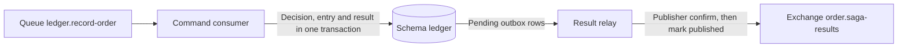

# Ledger architecture

[ShardShop](../ARCHITECTURE.md) › **Ledger** · [README](README.md) · [Runbook](RUNBOOK.md) · [Order saga](../shardshop-order/ARCHITECTURE.md) · [Implementation plan](../PLAN.md)

Ledger owns permanent financial decisions and entries, duplicate-command replay,
conflict quarantine and result publication in its dedicated database. It receives
immutable order snapshots and never queries the shared order/catalog databases or
generates IDs.

- **Runs as:** one pod with the command consumer, result relay and transport cleanup worker, and a
  separate single-instance PostgreSQL pod, `ledger-db`.
- **Owns:** schema `ledger` in database `ledger`. There is no sharding.
- **Status:** the command consumer and result relay are implemented in steps 4.5
  and 4.6; order reconciliation is step 5.1 and transport cleanup is step 5.2.
  Manual reset and restore tooling remain planned in milestones 5 and 6.

## Ledger: decisions, replay identities, and transport

`database/ledger/ledger/V1__ledger.sql` implements the ledger storage contract,
with grants in `R__ledger_grants.sql`. V2 adds the permanent `command_envelope` on
`ledger_result_ids`. V2 backfills from retained inboxes and stops if a legacy
binding has already lost its original command. This preserves same-transport-ID
payload and timestamp comparisons after disposable transport cleanup.

### Data model

| Table | Holds | Lifetime | Runtime may update or delete |
|---|---|---|---|
| `ledger_operations` | One immutable decision per order | Permanent | Nothing |
| `ledger_entries` | One immutable row per recorded order | Permanent | Nothing |
| `ledger_result_ids` | The binding of each command and result message ID to its operation and exact result envelope | Permanent | Update `publication_attempt` |
| `ledger_inbox` | Received commands, each referencing its saved command/result pair | Transport, cleanable | Delete |
| `ledger_outbox` | Pending and published result messages | Transport, cleanable | Update `publication_attempt` and `published_at`; delete |
| `conflicting_commands` | Commands that conflict with a permanent decision | Until an operator resolves them | Update `last_seen_at` and `delivery_count` |

`ledger_operations` keeps one permanent immutable decision per order, including
the buyer, unique logical saga/command IDs, fingerprint, snapshot, amount and
currency, outcome, rejection reason, and saved result data. Runtime cannot update
or delete a decision. `ledger_entries` has one immutable row per recorded order;
its composite foreign key requires the same amount, currency, timestamp, and
`RECORDED` outcome as the operation. A `REJECTED` operation cannot have an entry.
Java must write a successful decision and its entry atomically; SQL does not
require every recorded decision to have an entry.

`ledger_result_ids` permanently binds each order-reserved command `message_id`
and `result_message_id` to its operation and exact immutable result envelope,
including original timestamps. It retains a positive `publication_attempt`,
initially one, through inbox/outbox cleanup. `ledger_inbox` references the saved
command/result pair. `ledger_outbox.message_id` is the reserved result ID; the
publisher joins it to `ledger_result_ids.result_message_id` for the envelope.
The outbox's deferred composite foreign key requires its result ID and attempt
to match the permanent binding at commit. An index on unpublished outbox rows
supports the polling result relay; ledger has no CDC publication.

### Command processing

- The consumer validates envelopes and commits business decisions, replay requests
  or conflict quarantine before it acknowledges a command. Commands with invalid
  IDs are rejected without requeue.
- The runtime has no `UPDATE` privilege on decisions, so it cannot use `SELECT ...
  FOR UPDATE` or `FOR KEY SHARE` to serialize them. The consumer takes transaction
  advisory locks for the order, saga, command and both transport IDs in sorted
  order before reading and comparing saved decisions. This also serializes
  conflicting identity reuse across different orders while keeping decisions
  immutable.
- SQL checks positive attempts and their committed consistency; Java controls
  monotonic increments. The order saga design defines the
  [replay of a duplicate command](../shardshop-order/ARCHITECTURE.md#ledger-replay-of-a-duplicate-command)
  and the publisher confirmation of each attempt.

### Result publication

The polling result relay reads a bounded batch of pending outbox rows joined to
their permanent result envelopes, releases the database transaction, and publishes
each saved envelope with mandatory routing and persistent delivery. Only a positive
confirm without a return permits a separate transaction to set `published_at` where
both result ID and publication attempt match.

- The relay never increments attempts or changes saved envelopes.
- Failed or uncertain publications remain pending and retry with a fresh broker
  stream and capped backoff; process restart resumes pending rows. A stream that
  the broker closed while it was idle opens a new connection before the next
  publication.
- The relay uses the shared `ConfirmedPublisher` of common, as the order CDC relay
  does.
- Multiple publishers can deliver duplicates, but cannot clear a newer replay with
  a stale confirm.

### Conflict quarantine

`conflicting_commands` retains the received envelope and expected/received
identity snapshots without foreign keys that could obstruct quarantine. Its
primary key combines message ID with the SHA-256 fingerprint of the complete
canonical received payload, preserving distinct conflicts sharing a message ID.
Runtime may update only delivery time/count; snapshots are immutable and incident
resolution is an operator action. Conflicting commands must be committed before
acknowledgement without changing a permanent decision or emitting a rejection.

### Privileges

`ledger_writer` has schema `USAGE` and `SELECT` on these six tables.

- Inserts into the outbox omit `created_at` and `published_at`, so new/recreated
  rows use database time and start unpublished. Inserts into command quarantine
  omit `resolved_at` and `resolution`, so incidents start unresolved. Column-level
  `INSERT` grants enforce these omissions; other ledger tables retain table-level
  `INSERT`. The ordering stream applies the same insert restrictions to
  `order_outbox`, `orphan_results`, and `conflicting_results`, preserving the
  unresolved-orphan guard against order ID reuse.
- The ledger group's only updates are `ledger_result_ids.publication_attempt`,
  `ledger_outbox.publication_attempt`/`published_at`, and
  `conflicting_commands.last_seen_at`/`delivery_count`; its only deletes are inbox
  and outbox rows.
- It cannot delete permanent records or quarantine, resolve an existing incident,
  modify saved payloads, create schema objects or temporary tables, truncate
  tables, or read the Flyway history. There are no ID sequences, SQL functions, or
  triggers.

### Transport cleanup

The ledger process removes bounded batches of old inbox and confirmed outbox rows
using the existing runtime grants. Its default retention is 24 hours from
`received_at` or `published_at`, with a batch of 1,000 per table. A full batch
continues immediately; otherwise the worker waits 30 seconds. Each transaction
uses the existing pool and three-second database phase deadline.

The DELETE rechecks receipt/publication time and, for an outbox, its selected
publication attempt. Under `READ COMMITTED`, a concurrent replay either makes
the old delete ineligible or recreates a removed outbox as a new pending attempt.
Permanent bindings and exact envelopes remain available in both cases. The
[retention rules](../database/ARCHITECTURE.md#retention) define what may be removed;
DELETE privileges alone do not enforce the publication or age checks. Ledger V3
adds receipt-time and confirmed-publication indexes without changing grants.
