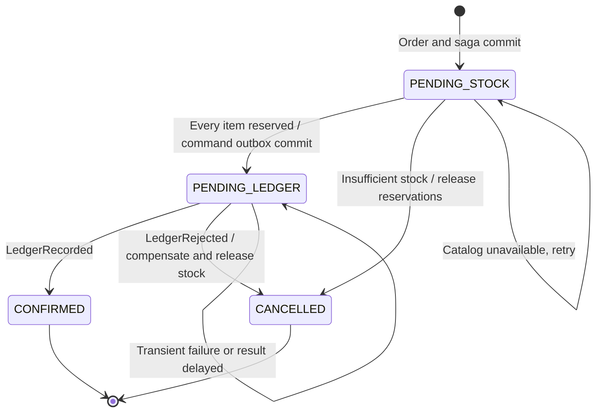
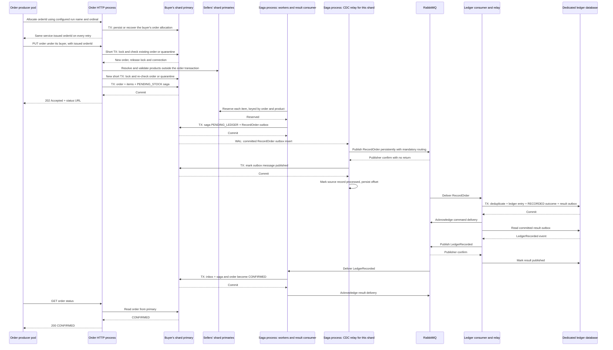
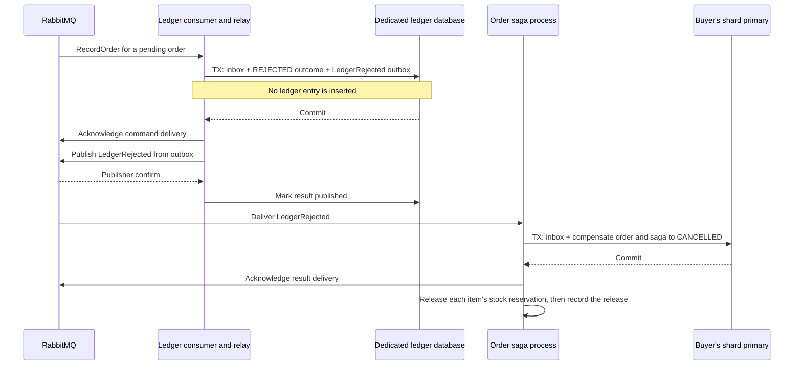
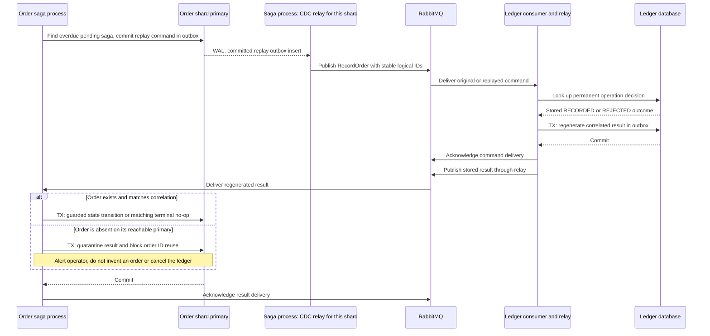

# Order architecture

[ShardShop](../ARCHITECTURE.md) › **Order** · [README](README.md) · [Runbook](RUNBOOK.md) · [OpenAPI contract](src/main/resources/contracts/openapi.yaml)

Order owns buyer and order creation, stock reservation and compensation, command
CDC, ledger-result application and durable reconciliation. Order is the saga
coordinator. The workflow uses local database transactions and asynchronous
commands and results. No transaction spans PostgreSQL, RabbitMQ and the ledger
database. Order never writes directly to the ledger database.

- **Runs as:** one image in two processes, the HTTP process and the saga process.
- **Owns:** buyers, order allocations, orders, items, saga state, inbox, outbox,
  quarantine and CDC offsets in schema `ordering` on each buyer's shard. It also
  writes stock reservations, product stock and seller profit in `catalog` on the
  seller shards.

## Processes

| Process | Deployment | Replicas | Strategy | Runs |
|---|---|---:|---|---|
| `http` (default) | `shardshop-order` | 2 | `RollingUpdate` | Buyer, allocation and order HTTP API, and the `/orders/` page |
| `saga` | `shardshop-order-saga` | 1 | `Recreate` | Stock, profit, reconciliation and transport cleanup workers, the CDC relay with one reader per shard, and the result consumer |

`shardshop.order.process` selects the process. The saga process serves only its
management listener: it answers `404` for `/api/v1/*` and `/orders/*`. Thus the
HTTP process runs no background saga loop, and its write latency does not compete
with that work. Every JVM reserves its own generator slot. The saga process has one
replica, because each shard's replication slot has one active reader. The
[runtime topology](../infra/ARCHITECTURE.md#runtime-topology) owns the deployment
details.

## Order creation and ledger saga

Buyers are created through order from workload-owned person definitions containing
first name, surname, email, phone, postal address and region.
Order generates the buyer ID routed to its requested home region. Buyers may
purchase from any region, while their home region determines order storage.
The producer obtains an order ID through the allocation API before constructing
the order request. Later buyer/order calls route by returned buyer ID.

| Endpoint | Purpose | Responses |
|---|---|---|
| `POST /api/v1/buyers` | Create an immutable buyer from an `Idempotency-Key` and an ID-free person/contact/address/region payload | `201` with the generated buyer ID; `200` for an identical persisted key/payload retry; `409` for conflicting key reuse; `400 INVALID_REQUEST` for a missing/unknown region |
| `GET /api/v1/buyers/{buyerId}` | Read the buyer | The buyer, or `404` |
| `POST /api/v1/buyers/{buyerId}/order-allocations` | Issue an order ID for a run name and request ordinal | See [allocations](#service-issued-order-allocations) |
| `PUT /api/v1/buyers/{buyerId}/orders/{orderId}` | Place an order with a stable order-service-issued Snowflake ID and immutable creation payload | `202 Accepted`, its ID, and a status URL; an identical retry returns `202` while pending or `200` with the existing terminal status; `409` for conflicting ID reuse |
| `GET /api/v1/buyers/{buyerId}/orders/{orderId}` | Read the current status | The status, or `404` |
| `GET /api/v1/orders` | List the orders of one buyer home region | See the [regional order page](#regional-order-page) |

- Buyer names and address text are nonblank; email uses the contract's ASCII form,
  and phone is `+` followed by 7–15 ASCII digits.
- Each order item names its `sellerId`, `productId` and the quantity the buyer
  wants. The first valid request commits a `PENDING_STOCK` order on the buyer's
  shard. Compare a persisted normalized request fingerprint. A retry never starts
  another saga.
- Accepting a request does not yet mean the ledger has recorded it.

### Service-issued order allocations

Before submitting a live order, the producer calls
`POST /api/v1/buyers/{buyerId}/order-allocations` with its configured run name and
request ordinal. These are retry coordinates, not application IDs. Order checks
the buyer and atomically stores a generated order ID under a unique
`(buyer_id, run_name, request_ordinal)` key on the buyer's shard before returning
it. Concurrent or retried calls return the same committed ID, including after a
lost response or process restart. Preserve this mapping for the retained dataset;
never recycle an allocation. Workload restarts reuse their configured run name
and ordinals; a new independent run gets a new name from deployment configuration.

Freeze dataset versions and workload settings for that run. Select the buyer,
items and quantities deterministically from the configured run name and ordinal
over the service-returned descriptors. Normal traffic uses the regional schedule;
only the explicit USD/EUR test mode uses the returned order ID for currency
selection. A restart therefore reconstructs the same buyer and creation payload
without generating IDs or keeping a local database.

An allocation alone creates no order, saga or outbox. It supplies the ID needed
for the following idempotent PUT and, in explicit test mode, currency selection.

| Allocation result | Response |
|---|---|
| New mapping | `201` |
| Retry of an existing mapping | `200`; existing allocations require no new ID generation |
| Absent buyer | `422 BUYER_NOT_FOUND` |
| Unavailable store or unknown commit | `503 ORDER_STORE_UNAVAILABLE` |
| A new ID cannot be generated | `503 ID_GENERATION_UNAVAILABLE` |

Seller/product/buyer POSTs contain no new entity ID. Services validate creation
payloads, creation retry keys, supported home regions and existing product parents.
Workloads cannot choose or derive a generated ID. Reads and order requests use
the IDs returned by services; order acceptance validates its durable allocation
and buyer binding, rejecting unissued/wrong-buyer order IDs with
`400 INVALID_REQUEST`. Service tests cover generation, persisted key/payload
conflicts and restart recovery; workload tests use arbitrary recorded response
IDs and assert unchanged forwarding.

### Validation and HTTP errors

| Condition | Response | Retry behavior |
|---|---|---|
| Noncanonical/out-of-range Snowflake ID, numeric JSON ID, malformed body, empty items, non-positive quantity, invalid currency code | `400 INVALID_REQUEST` | Correct the request |
| Order ID was not allocated by order or belongs to another buyer, also when the buyer does not exist; a creation region/key or payload is invalid | `400 INVALID_REQUEST` | Use service-returned IDs and the original valid creation key/payload |
| An order allocation names a buyer that does not exist on its reachable primary | `422 BUYER_NOT_FOUND` | Create the buyer first |
| A product is absent under its seller on the seller's reachable primary | `422 PRODUCT_NOT_FOUND` | Seed or correct the seller and product IDs |
| Items use different currencies | `422 MIXED_CURRENCIES` | Submit an order in one currency |
| Order currency differs from an item's product currency | `422 CURRENCY_MISMATCH` | Correct the order currency; no currency conversion |
| Any required product shard is unavailable or its query times out | `503 CATALOG_UNAVAILABLE` | Bounded backoff with the same order ID and payload |
| The order shard cannot be reached, including an unknown commit result | `503 ORDER_STORE_UNAVAILABLE` | Retry the same ID and payload; the existing order may already have committed |
| A new saga or logical command ID cannot be generated during order acceptance | `503 ID_GENERATION_UNAVAILABLE` | Retry the same order ID and payload; no partial order/saga commit |
| Existing order ID has a different normalized creation payload | `409 ORDER_ID_CONFLICT` | Do not reuse that ID for different data |
| Order ID is quarantined after detected data loss | `409 ORDER_RECONCILIATION_REQUIRED` | Operator reconciliation must resolve it |

Apply this precedence and transaction boundary, independent of lookup completion
order:

1. **Local checks.** Validate canonical decimal ID strings/ranges, body syntax, and
   local field constraints. Any failure returns `400 INVALID_REQUEST` before
   database access.
2. **First order-shard check.** Open a short transaction on the order primary, take
   the per-order advisory lock, and check unresolved orphan quarantine first:
   return `409 ORDER_RECONCILIATION_REQUIRED` if ID reuse is blocked. Otherwise
   check that the order allocation belongs to this buyer, then check the existing
   order: a different fingerprint returns `409 ORDER_ID_CONFLICT`, and an
   identical fingerprint returns its saved status without catalog access. Only an
   existing buyer has allocations, thus an unknown buyer gets `400 INVALID_REQUEST`
   from the allocation check. Failure to perform these checks returns
   `503 ORDER_STORE_UNAVAILABLE`. For a new order, release the transaction, lock,
   and connection before catalog IO.
3. **Catalog lookups.** Resolve all distinct seller and product pairs through their
   sellers' primaries, with bounded concurrency and a shared lookup deadline. No
   order-shard transaction, advisory lock, or borrowed order connection may be held
   during these queries. Collect outcomes rather than returning whichever lookup
   finishes first. Within catalog validation, any unavailable shard/timeout wins as
   `503 CATALOG_UNAVAILABLE`, then any missing product wins as
   `422 PRODUCT_NOT_FOUND`, then multiple product currencies win as
   `422 MIXED_CURRENCIES`, then a single product currency that differs from the
   order currency gives `422 CURRENCY_MISMATCH`. Thus a USD order with USD and EUR
   items is mixed, and a missing product plus an unavailable catalog shard is
   unavailable. Sort any reported product IDs canonically.
4. **Final order-shard transaction.** After catalog IO completes, open a new short
   order transaction, reacquire the same lock, and repeat step 2's
   quarantine/existing-order checks before acting on the catalog outcome. A
   concurrent creation or quarantine wins over the preliminary catalog result.
   Order-store failure here returns `503 ORDER_STORE_UNAVAILABLE`. If still new and
   validation failed, return the selected catalog error without writing state. If
   valid, atomically insert the order, snapshots, and a `PENDING_STOCK` saga; the
   command outbox follows the stock reservation below. Reuse the allocated order
   ID; generate saga and logical command IDs only for a new order. Generation
   failure gives `503 ID_GENERATION_UNAVAILABLE` without a partial commit.
   Existing-order retries do not need new IDs. Order generates transport/result IDs
   later, in the transaction inserting the outbox; failure leaves the saga pending
   for retry. Unique constraints remain the final guard.

Product details are immutable, so validated snapshots can be used after
reacquiring the order lock; stock is not part of the snapshot, and the reservation
step decides it. No catalog query occurs inside either order transaction. Bound
advisory-lock acquisition and the write transaction as well. Derive amounts from
catalog prices and requested quantities; never trust client totals. Ledger
currency support is a later business decision. Normal configuration accepts all
supported currencies; only explicitly scoped tests remove a currency temporarily
to verify rejection after successful HTTP validation.

### Saga states

### Stock reservation

After the order commits, the saga process reserves every item on its seller's
primary in a Java-managed transaction: insert a `catalog.stock_reservations` row
with `INSERT … ON CONFLICT (order_id, product_id) DO NOTHING`, and only for a new
row perform the conditional stock decrement. Roll back that transaction if the
stock update affects no row. Process a shard's items in product-ID order when
they share a transaction, including releases, to avoid inconsistent product lock
ordering. No order transaction or advisory lock is held during these writes.

- When every item is reserved, one transaction on the order shard moves the saga
  to `PENDING_LEDGER` and inserts the `RecordOrder` outbox envelope, so the ledger
  only ever sees orders whose stock is held.
- When a conditional decrement affects no row, the coordinator reports
  `OUT_OF_STOCK`, cancels the order, and then releases any earlier committed
  reservations. The ledger never receives it. No trigger-specific SQLSTATE is used.
- An unavailable catalog shard or an unknown outcome leaves the saga in
  `PENDING_STOCK`. The coordinator retries with bounded backoff; a retried insert
  of an existing reservation does nothing, so no second decrement occurs.
  Infrastructure failure never cancels an order.

Every cancellation after a reservation releases the order's reservations: the
coordinator commits `CANCELLED` first, then marks each active reservation released
and restores its quantity in the same transaction on the seller's shard. Only an
active-to-released transition restores stock. It records completion on the saga
when all reservations are released, retrying unfinished releases. Stock never goes
below zero: the conditional decrement refuses, and the table's check constraint
backs it up. The [catalog storage](../shardshop-product/ARCHITECTURE.md#stock-reservation-protocol)
defines the exact SQL of each reserve and release.

One worker at a time handles a saga's reservations and releases, for example under
a per-saga lease, so a stale reserve retry never lands after that saga's release.
The implementation uses a database-clock lease with a monotonically increasing
`stock_lease_version` and guarded transitions:

- Each short seller-shard phase is preceded by a lease renewal; no order
  transaction or advisory lock spans it.
- The catalog V3 `stock_reservation_guards` table adds a permanent per-order row
  locked before each reservation or release batch. Release permanently closes it,
  even when no reservation exists yet, preventing a paused former lease owner from
  reserving after compensation.
- Product locks are acquired in ascending ID order.
- The ordering V3 migration adds stock ownership, retry time and failure count;
  these retries back off from one to thirty seconds independently of the ledger's
  five-attempt reconciliation budget.
- Process restart resumes eligible durable work after lease expiry. The worker
  runs in the saga process, outside HTTP request threads. Each buyer shard has
  one non-overlapping scheduled scan; a bounded pool permits three concurrent
  shard scans by default, with sequential sagas within each batch. The configured
  limit is capped by shard count. `shard-concurrency=1` retains the original serial
  all-shards scan and polling delay. Shared database pools still bound IO, and
  different buyer shards can contend on the same seller. See the
  [performance figures](../ARCHITECTURE.md#4-performance) for the measured effect.

### Successful order

The ledger app inserts one `ledger_entries` row per successfully recorded order,
with a unique `order_id`, amount, currency, and recorded timestamp. It receives
the required immutable order snapshot in the command and never queries the shared
database.

### Business rejection and compensation

A definitive ledger business rejection, such as an unsupported currency, records
a durable `REJECTED` operation outcome without inserting a ledger entry. The
coordinator compensates the already committed order creation by marking the order
and saga `CANCELLED`, retaining their audit history, and then releases the
order's stock reservations as described above.

An infrastructure timeout is an unknown outcome, never proof of rejection. Retry
transient failures; leave the order pending while its outcome is unresolved.
Persist one immutable ledger operation outcome per order, so replay cannot turn
a rejected operation into a recorded one. Terminal saga transitions are guarded
against duplicates and conflicting results. Cancelling an already confirmed
order is outside this workflow; it would require a separate compensating ledger
entry and saga, not deletion of the original ledger row.

## Reconciliation and replayed outcomes

### Reconciliation schedule

The existing `reconciliation_attempts` and `next_reconciliation_at` columns on
`ordering.order_sagas` start at zero and creation time plus 60 seconds. A dedicated
saga-process worker scans each primary every 30 seconds by default for eligible
`PENDING_LEDGER` sagas. Each scan takes a bounded page; its saga-ID cursor advances
past unpublished or temporarily failing work so that one saga cannot starve the
rest. Each pass fixes its due-time cutoff at the first page, so newly overdue
sagas cannot extend that pass indefinitely. It starts a new pass after the last
page. HTTP replicas run no scanner.

Each candidate takes the same order advisory lock as the result consumer, then
the saga row lock. It rechecks both order and saga state, the persisted due time,
the five-attempt limit and unresolved orphan quarantine before allocating IDs.
The existing stock worker continues to retry `PENDING_STOCK` sagas and unfinished
releases with its own durable bounded backoff. Those retries consume no ledger
reconciliation attempts and do not need a second stock loop.

If there is already an unpublished command, its CDC reader resumes/retries that
captured insert without incrementing the reconciliation counter; a reader stopped
by slot, offset, or WAL loss must be recovered first. Otherwise atomically enqueue
another `RecordOrder` with new order-generated transport `messageId` and
`resultMessageId` but the same logical `commandId`, `sagaId`, `orderId`,
fingerprint, and immutable snapshot, increment the saga's counter, and persist its
next eligible time in the same transaction.

| Attempt | 1 | 2 | 3 | 4 | 5 |
|---|---:|---:|---:|---:|---:|
| Wait before the attempt | 60 s | 120 s | 240 s | 300 s | 300 s |

The five waits give approximately 17 minutes from creation through attempt five,
plus scan/IO delay. An unpublished outbox row can extend this schedule. After
attempt five, disable further automatic enqueueing and alert if the saga remains
pending.

Only a manual reconciliation reset gives the saga a new
budget. The reset sets `reconciliation_attempts` to zero and
`next_reconciliation_at` to the current time
for selected `PENDING_LEDGER` sagas. A repeated reset causes no duplicate ledger
effect, and a reset never changes a terminal saga. Transport cleanup, restarts, or
duplicate deliveries never reset the saga's counter or schedule. Keep this state
even after outbox rows are deleted, and retain it with the saga through
terminal-state retention and backups.

The operator runs the database-owned
[`reset-reconciliation.sql`](../database/operations/reset-reconciliation.sql)
through native `psql` with one explicit order/saga ID pair on its buyer shard.
The dedicated `ordering_operator` login inherits only `ordering_reconciler`:
selected identity/state reads and updates to those two retry fields. No service
receives that credential. The operation takes the same order advisory lock as
the workers, then the saga row lock, and rechecks that both order and saga are
`PENDING_LEDGER`. A terminal, missing or mismatched pair is a no-op. Only the two
retry fields change; no message is enqueued by the reset itself. A successful
commit reports the previous attempt count and new UTC eligibility time.
The [operator procedure](RUNBOOK.md#manual-reconciliation-reset) covers credential
provisioning, verified TLS, bounded lock waits and inspection after an uncertain
commit. The reset does not resolve quarantine or recover missing CDC state.

### Transport cleanup

The saga process runs one bounded cleanup worker across the primary shards; HTTP
replicas start none. Inbox rows age from `received_at`, and outbox rows from
`published_at`, with a 24-hour default retention window. A batch holds at most
1,000 message IDs. The worker uses the existing order pools and three-second
database phase deadlines, and a shard failure does not stop other shards.

For outboxes, the worker captures a WAL position after selecting old confirmed
rows and waits for a durable streaming checkpoint beyond that position. It uses
the saved connector identity and `lsn_commit` when available, falling back to
`lsn`, as the CDC restart check does. Only the captured IDs may be deleted, and
the DELETE rechecks publication and age. Losing the in-memory batch on restart
only delays cleanup. Inbox cleanup continues while an outbox batch waits for CDC.
The [database retention rules](../database/ARCHITECTURE.md#retention) define the
permanent records that remain; cleanup never resets reconciliation state.

### Ledger replay of a duplicate command

The ledger looks up the permanent operation decision before short-circuiting on
an inbox duplicate. For an identical command that already has a decision, it
**enqueues the stored `LedgerRecorded` or `LedgerRejected` outcome again** in a
local transaction, using the command's reserved `resultMessageId` as its
`messageId` and preserving the original correlation IDs. It does this even if
the command's transport `messageId` was seen before. Recreate a cleaned result
outbox row or mark the existing row pending again; ignoring an insert conflict
would suppress the replay.

- Load the immutable envelope from `ledger_result_ids` for that result ID,
  preserving its timestamps and payload fields. Atomically increment its durable
  `publication_attempt` and reset/recreate the outbox with that attempt; the
  deferred foreign key checks their consistency at commit.
- The publisher marks only the `(message_id, publication_attempt)` it sent, so an
  older in-flight confirm cannot erase a newer replay request.
- Neither a duplicate nor a replay generates an ID in ledger. Transport IDs,
  including `resultMessageId`, are excluded from the business fingerprint and
  permanent-decision conflict comparison.
- It never reevaluates ledger policy or inserts another entry. Persist a
  conflicting command snapshot/identity in `ledger.conflicting_commands`, commit,
  then acknowledge and alert. Preserve the original decision, without emitting a
  business rejection that could cancel an order already recorded.

This regeneration recovers results even when the original result outbox row has
been cleaned up.

### Result application and quarantine

Normal publishers in this diagram follow the confirm/mark-published protocol in
the success flow; the CDC publisher also checkpoints its source position only
after that protocol succeeds. Result consumers validate the command, saga, and
fingerprint; matching terminal outcomes are harmless. Persist conflicting
identities or outcomes in `ordering.conflicting_results` on the expected order
shard, commit, then acknowledge and alert while preserving the order and saga's
saved state.

The result consumer retains the first accepted decision envelope in
`order_sagas.ledger_result` and the accepted payload for each reserved message in
`order_result_ids.received_envelope`. These permanent records survive inbox/outbox
cleanup.

- A same-ID delivery must match its entire saved envelope, including timestamps; a
  newly reserved reconciliation result must match the original decision, including
  `decidedAt`. Inbox hits never bypass correlation or outcome checks.
- The consumer and stock coordinator serialize updates on the saga row. The
  consumer also takes the advisory lock of order creation for the same order ID.
  Thus, when that row is missing, creation and orphan quarantine cannot pass each
  other. Rejected results enable the existing durable stock-release work.
- Both conflict tables store the received envelope, transport/logical IDs,
  fingerprint, expected and received identities/outcomes, reason, and audit
  timestamps. Deduplicate repeated quarantine deliveries by message identity and
  payload fingerprint without hiding different conflicting payloads. Unresolved
  records survive transport cleanup and backups.
- If quarantine persistence fails, do not acknowledge: use the bounded retry/DLQ
  path in the [delivery policy](../infra/ARCHITECTURE.md#rabbitmq-and-delivery-reliability).
  Malformed unrouteable envelopes use the source queue's DLQ instead.

### Seller-profit posting

Confirmation creates durable per-item margin intents on the buyer's home shard.
ProfitWorker runs outside HTTP request threads, with one non-overlapping scan
per buyer shard and a bounded pool of three concurrent scans by default. Intents
within a shard remain sequential. `shardshop.order.profit.shard-concurrency=1`
preserves the original serial all-shards scan and delay; larger values use a
separate delay after each shard's scan. The configured limit is capped by shard
count and is independent of StockWorker's limit.

Each intent commits an idempotent seller credit and atomic balance increment
before marking completion in a separate home-shard transaction. No connection
or transaction spans those phases. Multiple buyer shards can target one seller,
so the permanent credit identity and database balance-row locking protect replay
and concurrent updates. Shared pools and hot seller rows can limit throughput;
the existing deadlines and durable retry handling remain in effect. Stage-only
measurements do not establish full-saga capacity.

## Orders lost by asynchronous failover or restore

A failover on the asynchronous profile or a restore from an older backup can lose
an accepted order. This section describes how order detects and handles that loss.

### Orphan results

A result for an order absent on a **reachable primary** is different from a
temporarily unavailable shard. Persist its envelope, logical IDs, fingerprint,
outcome, and audit metadata in `ordering.orphan_results` on the expected shard,
which the result's buyer ID selects, then acknowledge and alert. The quarantine
has no foreign key to `orders` and blocks new HTTP creation with that order ID.

If the shard is unavailable, use bounded broker retries, then DLQ parking and saga
reconciliation as specified in the [delivery policy](../infra/ARCHITECTURE.md#rabbitmq-and-delivery-reliability),
instead of declaring the order missing. A long failover can exceed the transport
retry window, especially if both standbys are lost and synchronous writes block
until one returns. For a surviving pending saga with attempts remaining,
reconciliation regenerates a result after recovery while the old delivery may
remain parked. An exhausted budget requires a manual reconciliation reset. A lost
order or saga requires the operator audit and the restore path below. The old
parked delivery is only a diagnostic copy.

Serialize order creation, result application, and quarantine changes by order ID
even before an order row exists, using a transaction-scoped advisory lock; check
quarantine while holding that lock so concurrent creation cannot bypass it.
Catalog lookups occur before the final creation transaction and lock, followed by
the re-check described in the validation sequence above.

### Operator audit

The [recovery runbook](../shardshop-testing/RUNBOOK.md#older-backup-audit-and-selected-repair)
defines the explicit immutable inputs, the frozen owned targets and the private
review-only outputs. The audit tooling makes no source connection or write and
authorizes no production traffic.

Missing orders cannot be discovered by scanning pending sagas alone. After every
asynchronous-loss drill or shard restore, pause order writes and run an operator
audit. The audit compares an exported snapshot of permanent ledger decisions with
the orders on all primaries by ID and fingerprint.

- After a restore from an older backup, the audit also finds ledger entries whose
  results were acknowledged before the order was lost.
- After an asynchronous-loss drill it should find none: CDC publishes no command
  for WAL the standbys lack ([replication contract](../database/ARCHITECTURE.md#sharding-and-replication)),
  so a lost order leaves no ledger entry.
- It persists missing or mismatched pairs in the same quarantine and reports them.
  It is privileged operational tooling, not cross-database access in either
  service's runtime.
- It also lists stock reservations whose order is missing. They are released only
  after the fate of that order is decided.

### Restore recovery

The repair restores one verified original order and saga in a fresh isolated
target. Missing original history or costs, conflicts and unproved catalog effects
stay unresolved. Authentic pending outcomes are applied only when the existing
catalog effects provably agree. Review dumps keep the quarantine and repair state
with `trafficAuthorized: false` before the target is deleted. The optional
physical asynchronous-loss drill is not qualified.

Restore the order and the original saga identity from a verified backup or a
retained creation record. For an authentic pending saga, the repair verifies the
permanent ledger result and the existing catalog effects. It then applies that
outcome and resets the reconciliation metadata in the buyer-shard transaction.
Missing catalog effects stay unresolved. Replay uses the original command and
result identities. Clear the quarantine only after the identities and the outcome
agree.

If the original order cannot be recovered, keep the ledger entry and the
unresolved incident for an explicit business decision. Never silently delete a
ledger row, fabricate a confirmed order or treat absence as cancellation.
Automatic reconciliation repairs missing messages. It cannot recover lost
database history. These limits apply to shard restores and to the deliberate
asynchronous-loss profile, not to the synchronous durability criteria.

## CDC from shard writes to the ledger

Use the **transactional outbox with log-based CDC** pattern. Each accepted order
progresses through stock reservation, then inserts one `RecordOrder` envelope into
`ordering.order_outbox` in the same transaction as its `PENDING_LEDGER` transition
and permanent command/result message binding. That committed insert is the
captured change. Rollbacks emit no command, and the HTTP handler never publishes
to RabbitMQ. Capture only this table for the ledger command flow: product seeding,
raw order/item changes, and saga status updates are not separate ledger commands.
The outbox supplies a complete business snapshot without downstream joins or
cross-shard transaction assembly.

### Relay contract

- **Connectors.** Run one Debezium PostgreSQL connector per shard against its
  `-rw` Service, using `pgoutput`, `wal_level=logical`, a dedicated publication for
  `ordering.order_outbox`, and distinct connector, slot, and offset identities.
  Size replication slots and WAL senders for both physical replication and CDC.
  Provision publications administratively and disable connector auto-creation.
- **Credentials.** The CDC login has replication permission and only the SQL
  privileges needed to connect and snapshot that table; it is separate from
  `order_app` and has no business-table DML or DDL privileges. The relay uses
  `order_app` for its publication-status update and its offset writes. These SQL
  privileges do not restrict logical decoding: a replication login can use another
  installed output plugin, such as `test_decoding`, to read changes outside the
  publication. Treat the shared `ordering-cdc` Secret as highly privileged across
  all shards and expose it only to the trusted CDC runtime and operators. The
  outbox publication configures the intended stream; it is not an authorization
  boundary. See [PostgreSQL logical replication security](https://www.postgresql.org/docs/18/logical-replication-security.html).
- **Embedding.** Embed the connectors through
  [Debezium Engine](https://debezium.io/documentation/reference/stable/development/engine.html)
  in the IO layer of the order saga process, with bounded buffers and a batch
  consumer that explicitly controls record completion. Keep one active reader per
  shard: PostgreSQL allows only one active consumer per replication slot, and the
  single saga pod uses `Recreate`. Scaling saga pods requires explicit per-shard
  ownership, such as a Kubernetes Lease; the offsets are already shared through
  each shard's database.
- **Snapshot and stream.** On first start, take a consistent snapshot of retained
  outbox rows and then stream WAL; on restart, resume the saved offsets. Handle
  snapshot (`r`) and insert (`c`) records as commands, skipping snapshot rows
  already marked published. Ignore publication-status updates, cleanup deletes,
  tombstones, and connector control records as business messages. Keep the outbox
  envelope immutable; only publication metadata may change. Reconciliation inserts
  a new envelope rather than updating the original payload.
- **Publication.** Extract the stored envelope, preserving `messageId`, logical
  IDs, fingerprint, schema version, and all ID fields as canonical decimal JSON
  strings. Publish it persistently to `ledger.commands` with routing key
  `ledger.record-order`. Do not send the raw Debezium row-change envelope to the
  ledger consumer. Preserve source order within each shard; there is no global
  order across shards, and redelivery still requires the existing idempotency
  checks.
- **Checkpoint.** After a publisher confirm with no mandatory return, mark that
  outbox row published in its shard using the existing service role. Only after
  that local transaction commits may the batch consumer mark the source record
  processed and allow its offset to be flushed. Never advance past a failed
  publication or status update. Use finite publish/SQL timeouts and bounded
  backoff; on exhaustion, fail that reader.
- **Supervision.** A per-shard supervisor restarts a failed reader from its durable
  position with capped exponential backoff, indefinitely, without affecting other
  shards or the pod's liveness; alert when a reader stays down or lags past a
  threshold. A crash before the durable offset checkpoint can redeliver the same
  `messageId`; it must never generate a new logical command.

### Implementation

The saga process embeds Debezium and serializes each shard's reader
with an application-role session advisory lock. The connector, topic and slot
identity is `shardshop_order_<shard_name>` with hyphens replaced by underscores.

- Ordering V4 adds permanent `cdc_reader_state` history, written in the same JDBC
  transaction as the first offset checkpoint. The runtime may insert that marker
  but cannot update or delete it. It detects simultaneous slot/offset loss even
  after outbox cleanup; recovery requires an explicit reconciliation decision.
- Each reader sends a Debezium heartbeat every 10 seconds. Its action emits a
  transactional logical decoding message with `pg_logical_emit_message`, which
  PostgreSQL permits for every login and which writes no table. Thus an empty first
  snapshot saves its first offset and reader history, and an idle outbox still
  confirms the WAL of other writes.
- Before each start, the reader decides from its offset rows, reader history and
  slot, never from error text. It also stops when the slot is ahead of the stored
  resume position, the condition that `trust_offset` rejects.
- A slot without an offset and without reader history belongs to a first start
  that failed before its first checkpoint. The reader drops that slot with the
  replication login, because Debezium cannot take an exported snapshot from an
  existing slot. The new exported snapshot skips rows that the failed start
  already published.

### Slots, offsets and failover

Retain the logical slots on shutdown. Store each reader's offsets with
Debezium's JDBC offset store in a table of its own shard database, so offsets
replicate, fail over, and are backed up with that shard. Configure and verify
failover-capable logical slots and their synchronization to both standbys before
promotion; reconnecting to `-rw` alone does not preserve CDC progress.

In both durability profiles, logical decoding must not advance beyond WAL the
standbys have flushed (`synchronized_standby_slots`, which CloudNativePG manages
once slot synchronization is enabled), so no command is published for a change a
promoted standby could lack. CloudNativePG lists every standby's slot there, so
CDC pauses while either standby is unavailable, even though quorum writes
continue; alert on its lag. See the
[PostgreSQL connector](https://debezium.io/documentation/reference/stable/connectors/postgresql.html)
and [PostgreSQL logical-slot failover requirements](https://www.postgresql.org/docs/current/logicaldecoding-explanation.html#LOGICALDECODING-REPLICATION-SLOTS-SYNCHRONIZATION).

If a slot, offset, or required WAL is lost, stop and reconcile retained outbox
and permanent saga/ledger state before an explicit resnapshot; never silently
start at the current WAL position. Detect this by failing on a slot/offset
mismatch (Debezium's `offset.mismatch.strategy=trust_offset`, never
`trust_slot`) and on a slot without offsets; the supervisor never restarts a
reader stopped this way. Before an upgrade of the relay, qualify Debezium with
PostgreSQL, the application runtime and RabbitMQ under [VERSIONS.md](../VERSIONS.md).

## Regional order page

Order serves a read-only `/orders/` page and `GET /api/v1/orders`.

**Query.** The required `region` (`US`, `EU`, or `ASIA`) selects the buyer's home
region and all of its shards, including orders outside workload datasets.
Optional `productId` matches an exact item ID; optional `productName` matches a
case-insensitive literal substring of an immutable item name. These filters are
mutually exclusive; names allow 1–200 Unicode characters after trimming. Both
match regardless of the seller's region and return each order once with its
complete item list. No catalog lookup is needed to filter orders or display saved
product names.

**Order and paging.** The API sorts by `ordering.orders.created_at`, then numeric
order ID in the same direction. `sort` accepts `ASC` or `DESC` and defaults to
`DESC`; `limit` defaults to 25 and is bounded to 1–100. Continuation supplies both
`afterCreatedAt` and `afterOrderId` from the nullable `nextAfter` object. UTC
timestamps retain PostgreSQL microsecond precision, while IDs and money remain
decimal strings. Each shard selects at most the page size plus one orders before
joining item rows. The service merges those candidates into one globally ordered
page. Ordering V6 adds date/ID and product/ID indexes without modifying stored
orders or widening runtime privileges.

**Failures.** All selected primaries share one three-second database phase budget.
An unavailable shard fails the entire page with `503 ORDER_STORE_UNAVAILABLE`;
there is no partial regional result. Separate requests and shards do not form a
snapshot, so current statuses may change between reads.

**Page.** The page shows order IDs, buyer full names, creation time in UTC, current
status and cancellation reason, total/currency and product names/quantities. The
API returns `buyerName` and item `productName` alongside IDs.

- Hover, focus or click on a name opens details with separate name/ID copy actions.
- The Created column header toggles the sort direction and exposes it through
  `aria-sort`; newest orders appear first by default.
- Region, product search and Refresh controls align in the toolbar. Pagination
  follows the product page: First, Previous, Page N, Next and Last.
- The URL preserves `region`, `productId` or `productName`, `sort` and `page` for
  copied links, reloads and browser history. Changing a filter or sort resets
  page 1; restoring a numbered page or jumping to Last resolves cursors within one
  eight-second loading deadline.
- Loading, empty and error states clear stale results. The packaged HTML,
  stylesheet and script use `Cache-Control: no-store`.
