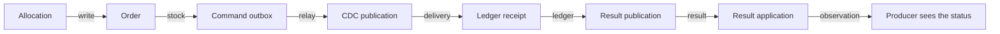

# Verification architecture

[ShardShop](../ARCHITECTURE.md) › **Verification** · [README](README.md) · [Runbook](RUNBOOK.md) · [Database guarantees](../database/ARCHITECTURE.md) · [Infrastructure lifecycle and delivery](../infra/ARCHITECTURE.md)

This document holds the eleven acceptance scenarios of ShardShop, the drills that
cover them and the protocol for capacity measurement. `shardshop-testing` is
test-only: it has no main classes, it is never deployed, and it runs only in Maven
builds.

- **Runs as:** Cucumber integration scenarios with `-Pintegration`, and opt-in
  cluster suites that observe the kind lab or EKS ([packages](README.md#2-packages)). The
  [infrastructure design](../infra/ARCHITECTURE.md#verification-gates-and-drills)
  describes the cluster profile and the drills.

## Contents
1. [Acceptance scenarios](#1-acceptance-scenarios)
2. [Acceptance commands and evidence](#2-acceptance-commands-and-evidence)
3. [AWS deployment acceptance](#3-aws-deployment-acceptance)
4. [Coordinated backup and isolated restore](#4-coordinated-backup-and-isolated-restore)
5. [Older-backup audit and selected repair](#5-older-backup-audit-and-selected-repair)
6. [Synchronous failover drill](#6-synchronous-failover-drill)
7. [Strict replica-read drill](#7-strict-replica-read-drill)
8. [Test levels](#8-test-levels)
9. [Capacity measurement](#9-capacity-measurement)

## 1. Acceptance scenarios
[Back to Contents](#contents)

These are the eleven acceptance requirements, with stable scenario IDs. The [consistency and failure boundaries](../database/ARCHITECTURE.md#6-consistency-and-failure-boundaries)
explain the durability assumptions behind these scenarios.

| Scenario | Topic | Current coverage |
|---:|---|---|
| [1](#scenario-1) | Seeding gate and product traffic | Integration features and the release gates of `up.sh` |
| [2](#scenario-2) | Regional placement, routing, schemas and roles | Integration features, routing vectors and the `cluster-topology` gate |
| [3](#scenario-3) | Primary and replica reads | Integration features and the opt-in strict replica-read drill |
| [4](#scenario-4) | Confirmed order effects | Integration features and the `cluster-saga` gate |
| [5](#scenario-5) | Ledger rejection, compensation and replay | Integration features and the saga drill |
| [6](#scenario-6) | Crash recovery and CDC | Integration features for relay and crash recovery, the observability gate, the saga drill and the synchronous failover drill |
| [7](#scenario-7) | Broker retries, dead letters and reconciliation | Integration features for broker policies, reconciliation, manual reset and transport cleanup. The retry drill covers shard outage and DLQ pressure (see the [drill runbook](RUNBOOK.md#4-retry-and-dlq-capacity-drills)) |
| [8](#scenario-8) | Standby loss, promotion, restore and audit | Database, replica-read and failover drills, coordinated backup and isolated restore, and older-backup audit and repair. The optional asynchronous-loss drill is not covered |
| [9](#scenario-9) | HTTP validation and transaction boundaries | Integration features and unit tests |
| [10](#scenario-10) | ID generation and service-issued identity | Unit tests, integration features, the allocator gates and the backup and restore drills |
| [11](#scenario-11) | Concurrent stock reservation | Integration feature and the saga drill |

The [commands and evidence](#2-acceptance-commands-and-evidence) section gives the
tests of each scenario.

### Scenario 1

Verify the seeder Job succeeds before either load Deployment starts; failed or
partially completed seeding must block startup. Keep workloads free of SQL
credentials/tables. With up to 16 connections and the 30-second connection
lifetime, observe positive request-counter deltas on both ready product pods
within 120 seconds. Then replace one pod and repeat the check.

### Scenario 2

Verify `shard-a=US`, `shard-b=EU`, and `shard-c=ASIA` in inventory, runtime
routing and Kubernetes labels, with unchanged version-2 ID routes. Reject
malformed regions, misaligned configuration, and reassignment of a published
shard region; reject missing version hashes in either ConfigMap. Verify seller
and buyer immutable regions: reject unsupported requested regions with HTTP
400 and generate IDs whose routes match accepted home regions.
Each seller's products and reservations stay on its home shard, and each
buyer's orders on its home shard. Reject wrong-shard seller IDs or regions and
foreign-region product creation at the database boundary. Exercise buyers in
every region buying from each other region, with same-currency orders under
the seller country policy, including a US buyer purchasing Japanese JPY products. Physical
replication remains within each shard. Create schemas through `Database`
resources and migrate the catalog and ordering streams without history
collisions on all primaries. Assert the role matrix: `order_app` can select
sellers and products, write stock reservations without `TRUNCATE`, and update
only the `stock` column of products. No other catalog writes or DDL are allowed,
except the profit-credit writes.
`product_app` cannot touch reservations or
ordering tables; Flyway creates no custom functions or triggers, and no login
role owns an object.
Verify fresh V1 creates all regional constraints and comments, rejects
misplaced sellers, and reaches identical migration state on standbys. A matching
rerun must apply no migrations. After a partial migration, reject changed
region/index/count parameters using the saved topology before first routing
publication, including a run with no pending versioned migrations. Preserve
the reservation after publication failure and reuse it on a matching rerun.
Run the version-2 routing vectors in `shardshop-core/sharding`, including values above
2^53 and signed-long boundary checks, and verify that both services route through
it. Run the Maven `cluster-topology` scenarios to compare the same golden fixtures
with SQL hashing and the deployed seller and buyer placement constraints on
every primary.

### Scenario 3

Exercise heavy product reads, primary read-after-write behavior, and explicitly
stale replica reads under controlled lag.

### Scenario 4

Verify an accepted order reaches `CONFIRMED` with exactly one ledger row, one
reservation per item, and stock reduced exactly once. Each item credits its
margin once to its seller's balance in the order currency. Duplicate HTTP
requests and duplicate messages create no additional records or credits.

### Scenario 5

Use the order IDs that the allocation API returns, and EUR-only products
from a valid EU seller under an explicitly scoped EUR-excluding ledger policy. Verify `202` becomes `CANCELLED`
with no ledger entry and no seller profit, and that its reservations are
released and stock restored. Change the ledger allowlist to include EUR, and
clean transport inbox/outbox rows. Then a test harness publishes the original
`RecordOrder` envelope again, which it saved before the cleanup. This is fault
injection, not an operator tool. The permanent rejected decision must still
win. Test conflicting payloads separately from identical retries.

### Scenario 6

Inject crashes before/after database commit, broker confirmation, and consumer
acknowledgement; verify replay completes the saga without duplicate effects.
On each shard, verify a committed order/outbox insert reaches the ledger through
WAL capture while a rollback emits nothing. Restart CDC before/after publication
marking and offset flush; verify the same message identity and one ledger entry.
Cover snapshot-to-stream handoff, ignored metadata updates/deletes, missing
command bindings (mandatory return without offset advancement), and failover
with synchronized logical slots. Slot/offset/WAL loss must stop capture for
explicit recovery; ordinary reconnects must resume without losing a command.
The crash tests use test-only debugger barriers in disposable packaged JVMs followed
by forced process death. SQL visibility and broker settlement checks establish
each crash boundary before replay assertions run. The kind rollout uses bounded
continuous HTTP traffic and checks unchanged saga ownership. Cached application
metrics and native broker/database observations expose backlog, quarantine,
checkpoint, queue and pool pressure; stale sampling is visible separately from
a healthy zero. [Commands and limits](RUNBOOK.md#12-crash-recovery-and-observability).

### Scenario 7

Measure same-queue rejection counts and redelivery timestamps on the pinned
broker, assert its effective delayed-retry/delivery-limit behavior, and record
total time to DLQ parking. Hold a shard unavailable beyond that window, for
example with both standbys down so synchronous writes block, and verify DLQ
plus reconciliation is the recovery path. In separate capacity drills, temporarily unbind a DLQ
and then test a full DLQ: verify retained source messages reach its limits,
negative publisher confirms leave outboxes unpublished, and broker-wide alarms
remain clear. Keep the broker/source running; a single-broker shutdown cannot
isolate the DLQ. Restore the binding or remove the parked messages, and verify
progress.
Drop a result and verify replay regenerates the immutable outcome. Delete each
confirmed-published and CDC-checkpointed replay outbox row between reconciliation
attempts, restart the coordinator, and use an injected clock to prove no sixth
automatic attempt is enqueued. Recover through a manual reconciliation reset
without duplicate ledger effects or changes to terminal decisions. Verify conflicting command/result
quarantine commits precede acknowledgements and survive transport cleanup.

### Scenario 8

Remove one standby: replica-profile reads continue through the other, writes
continue, and CDC pauses until it returns. Remove both: replica-profile reads
must return the documented `503` within the four-second server budget and
observed before the reader's five-second deadline, without primary fallback,
while unaffected shards continue. Restore the standbys and verify reads resume
through `-ro`. Test a hung standby query as well as absent endpoints; bound the
complete database phase to three seconds and assert an HTTP response rather
than a client timeout. Test primary promotion separately, including any
interval with no `-ro` endpoints.
In the optional asynchronous-loss drill, verify that lost acknowledged orders leave no
ledger records and that the audit finds none. After restoring a shard from an
older backup, verify both late results and the operator audit detect orphan
ledger records and block ID reuse; restoring the original order must allow
reconciliation. Under the default synchronous profile, verify that writes
continue with one standby unavailable and block when both are, that promotion
preserves acknowledged saga commits, and that losing the primary together with
one standby triggers no automatic promotion when the survivor cannot be
confirmed current.

### Scenario 9

Assert the HTTP validation table: malformed input, unknown buyers (400 for an
order, 422 for an allocation), missing products, mixed or
mismatched currencies, unavailable catalog shards, ID conflicts, and unknown
commit outcomes. Validation failures create no saga/outbox rows; identical
retries of an existing order still work with its product shard unavailable.
Combine failures and reverse lookup completion order: mixed currencies beat
order/product mismatch, and catalog unavailability beats a missing product.
Hang catalog IO and prove no order-shard transaction, advisory lock, or borrowed
order connection spans it. Race that lookup with order creation or quarantine
and verify the final locked re-check takes precedence over its catalog result.

### Scenario 10

Verify product/order library generation under concurrent callers, sequence
exhaustion, clock failure, and epoch/timestamp boundaries using a controlled `TimeSource`.
Concurrent JVM starts, rolling replacements, and container restarts must obtain
distinct generator allocations. Test lost CAS responses, stale/missing registry,
and allocation exhaustion without emitting duplicates. Verify registry retention
during backup/restore. Rerun workload definitions and creation requests with
the same keys/payloads; durable service state must return identical entity
IDs and home regions. Verify conflicting key reuse, concurrent creation and
unknown commit recovery, plus read-only lookup of persisted catalog IDs.
Workloads
obtain IDs only from APIs, have no generator dependency or allocator access,
and preserve returned IDs on retries. Lost allocation responses, concurrent
requests, and producer restarts return the same order ID; unissued IDs and
allocations for another buyer are rejected. Ledger only uses order-reserved
result IDs, including duplicate/reconciliation replay after outbox cleanup.
Round-trip large IDs exactly through HTTP, messages, JDBC, and the routing
vectors;
reject numeric JSON IDs, noncanonical text including LF/CRLF/TAB, and
out-of-range values before conversion or hashing, with HTTP 400 for invalid IDs.

### Scenario 11

Race concurrent orders for the same product and verify stock never goes below
zero and never oversells. An order that exceeds the remaining stock becomes
`CANCELLED` with reason `OUT_OF_STOCK` and never reaches the ledger, and its
partial reservations are released. Retried reservations and releases, and a
catalog shard outage during reservation, change stock at most once per order
and product. Inject failures between the Java reservation and stock writes to
prove both roll back together. The Java API exposes no reservation quantity
changes, reactivation or deletion, and database `TRUNCATE` is refused. After
every supported reserve/release run, each product's `stock` equals its
`initial_stock` minus its active reserved quantities.

## 2. Acceptance commands and evidence
[Back to Contents](#contents)

Two commands run every scenario. The [CHANGELOG](../CHANGELOG.md#step-69--complete-demo-and-acceptance-run) gives the
results of the last complete run.

- **Integration suite:** the [Testcontainers suite](RUNBOOK.md#2-integration-tests-with-testcontainers)
  runs the unit and provider tests of all modules, the packaged startup tests and
  the Cucumber features in the table.
- **Lab run:** the [acceptance run on a disposable lab](RUNBOOK.md#13-acceptance-run-on-a-disposable-lab)
  runs the lifecycle scripts and the cluster tags in the table.

| Scenario | Integration suite | Lab run |
|---:|---|---|
| [1](#scenario-1) | `ProductSeeder`, `ProductReader` and `WorkloadControl` features | Release gates of both `up.sh` runs and `cluster-deployment`: seeded catalog and reads on both product pods. `cluster-workload-drill`: repeated seeding and a new product JVM |
| [2](#scenario-2) | `CatalogMigration`, `LedgerMigration`, `ProductApi`, `OrderApi` and `StockReservation` features; routing vectors in `ShardRouterTest` | `cluster-topology` in the release gates; `cluster-migration-reservation`, `cluster-migrations-idle` and `cluster-publications` |
| [3](#scenario-3) | `ProductApi` (replica read profile), `ProductReader` and `ProductTransport` features | `cluster-deployment`: clean primary reads. `cluster-replica-read-drill` on `shard-b`: lag, standby loss and hung queries |
| [4](#scenario-4) | `OrderApi`, `OrderResults`, `LedgerConsumer`, `LedgerPublisher` and `CdcRelay` features | `cluster-saga` in the release gates: USD and EUR orders with ledger, stock and profit effects. `cluster-saga-drill`: duplicate envelopes |
| [5](#scenario-5) | `LedgerConsumer`, `OrderResults` and `TransportCleanup` features: a rejected decision stays after cleanup and a policy change | `cluster-saga-drill`: duplicate envelopes keep their decisions |
| [6](#scenario-6) | `CdcRelay`, `LedgerPublisher`, `LedgerConsumer` and `OrderResults` features: crash boundaries and replay | `cluster-saga-drill`: CDC relocation and a rolling update under HTTP writes. `cluster-observability` in the release gates. `cluster-failover-drill` on `shard-b` |
| [7](#scenario-7) | `RabbitMq`, `Reconciliation`, `ManualReconciliationReset`, `ManualReconciliationResetSql`, `TransportCleanup` and `TransportCleanupMigration` features | `cluster-retry-drill`: a shard outage, and an unbound and a full DLQ on both publishers |
| [8](#scenario-8) | — | `cluster-database-drill`, `cluster-replica-read-drill` and `cluster-failover-drill` on `shard-b`; `cluster-backup`, `cluster-restore`, `cluster-recovery-schema` and `cluster-recovery-drill`. The optional asynchronous-loss drill stays outside qualification |
| [9](#scenario-9) | `OrderApi` and `ProductApi` features, and the order and product unit tests | — |
| [10](#scenario-10) | `shardshop-core/idgen` unit tests (lost CAS, exhaustion, `TimeSource`), `IdParserTest`, `JsonFieldsTest`, `CatalogInputTest` and `OrderInputTest`; `GeneratorAllocation` on k3s; `ProductApi` and `OrderProducer` features | `cluster-admission-bootstrap` in `cluster-create.sh`, `cluster-allocator`, the rollouts of both `up.sh` runs, `cluster-workload-drill`, `cluster-backup`, `cluster-restore` and `cluster-backup-allocator`. One registry UID stays the same in all steps |
| [11](#scenario-11) | `StockReservation` feature | `cluster-saga-drill`: two orders for the same stock never oversell |

## 3. AWS deployment acceptance
[Back to Contents](#contents)

The [AWS runbook](../infra/terraform/README.md#run-the-drills) runs the same
scenarios on EKS. Argo CD hook Jobs run the gates of each sync. Drill Jobs in the
cluster run the drills and the lifecycle checks, because a slow internet connection
can stop a drill ([decision](../DECISIONS.md#drills-as-jobs-in-the-cluster)). This
computer runs the backup, restore, recovery and allocator checks with the context
`kind-shardshop-test-eks`, because they need the local Docker and private files. The
[CHANGELOG](../CHANGELOG.md#step-77--cloud-acceptance) gives the results of the last run.

| Scenario | Checks on EKS |
|---:|---|
| [1](#scenario-1) | `eks-release` and `cluster-deployment` in the PostSync gate. `cluster-workload-drill` |
| [2](#scenario-2) | `cluster-migration-reservation`, `cluster-migrations-idle` and `cluster-publications` in the PreSync gates. `cluster-topology` |
| [3](#scenario-3) | `cluster-deployment`. `cluster-replica-read-drill` on `shard-b` |
| [4](#scenario-4) | `cluster-saga` in the PostSync gate. `cluster-saga-drill` |
| [5](#scenario-5) | `cluster-saga-drill` |
| [6](#scenario-6) | `cluster-saga-drill`, `cluster-observability` in the PostSync gate and `cluster-failover-drill` on `shard-b` |
| [7](#scenario-7) | `cluster-retry-drill` with three brokers. It checks each broker for restarts and the cluster for alarms |
| [8](#scenario-8) | `cluster-database-drill`, `cluster-replica-read-drill` and `cluster-failover-drill` on `shard-b`. `eks-backup` and `eks-pitr-drill` for the S3 backups. `cluster-backup`, `cluster-restore`, `cluster-recovery-schema` and `cluster-recovery-drill` with a logical bundle from EKS |
| [9](#scenario-9) | None. The integration suite and the unit tests check the HTTP validation of the same code without a cluster |
| [10](#scenario-10) | `cluster-admission-bootstrap` before the registry creation, `cluster-allocator` in the PreSync gate, the rollouts of each sync, `cluster-workload-drill`, `cluster-backup`, `cluster-restore` and `cluster-backup-allocator`. One registry UID stays the same in all steps |
| [11](#scenario-11) | `cluster-saga-drill` |

The public webpages of the AWS deployment have their own checks. `Webpages.feature` of
the integration suite checks the rendered resources against the Envoy Gateway CRDs on a
k3s API server. `eks-webpages` and `eks-webpages-replacement` send requests through
CloudFront from this computer ([runbook](../infra/terraform/README.md#open-the-webpages)).

The S3 backups are the restore path of the AWS deployment. The logical bundle
checks the audit and recovery tools with the data of EKS, and its isolated restore
runs in Docker on this computer. The integration suite needs no cluster, thus it
runs only on this computer.

These checks of the local deployment do not run on EKS:

| Check | Reason | On EKS |
|---|---|---|
| `kind-config` and `kind-nodes` | They compare the kind node containers with `infra/kind.yaml`. | Terraform creates the nodes, and the [foundation check](../infra/terraform/README.md#check-the-foundation) reads them. |
| `kind-dns` | It starts probe pods on the named kind nodes before the first release. | The gates and the applications on all nodes use the CoreDNS add-on. A DNS failure stops a gate. |
| `kind-retention` | It compares the infrastructure with the Helm release of `cluster-create.sh`. | Argo CD applies the infrastructure without a Helm release, and `eks-delivery` checks each layer. |
| `kind-release` | It reads the image store of the kind nodes. | `eks-release` |
| Stop and resume | The AWS deployment has no stop and resume. Each run creates and destroys it. | — |

## 4. Coordinated backup and isolated restore
[Back to Contents](#contents)

The opt-in `cluster-backup` and `cluster-restore` tags implement the coordinated baseline.
Neither belongs to `cluster-drill` or the default suite. The
[runbook](RUNBOOK.md#8-coordinated-backup-and-isolated-restore) defines the explicit
source, the external artifact, the independent allocator history and the fresh
target parameters.

The standalone opt-in `cluster-backup-allocator` export refreshes independent latest
allocator history after ready source JVM restarts, under the host lifecycle lock
and deployment/saga readiness checks. Run it after final source gates before
stopping; any subsequent generator restart requires another refresh before
ID-producing restore use. Target qualification keeps every ID-producing path
disabled.

Backup holds both host lifecycle and Kubernetes drill locks. It saves/pauses
producer, reader and interactive-seeder controls, scales writers down, and lets
saga/ledger drain before stopping them. Every application-vhost queue, including
DLQs, must be empty: retained dead letters refuse this baseline rather than being
silently omitted. Four full logical dumps retain all three shards and ledger,
actual broker definitions, roles, database ACLs, routing/schema/identity metadata
and complete table fingerprints. Source replicas, controls, topology, identities
and invariants must recover before the immutable backup is sealed.

Restore validates inventory/schema/Snowflake compatibility, checksums and the
separate latest allocator lineage/high-water mark before creating a fresh owned
loopback-only TLS PostgreSQL container with four databases. It verifies complete
row fingerprints, ownership/ACLs, saga relationships and global consistency.
Restored CDC first must refuse saved offsets without logical slots. Explicit
target-only reset/resnapshot then replays original command/result identities and
proves subsequent streaming with a fresh broker and ledger worker, without any
ID-producing traffic. The source allocator is never rewound and the owned target
is removed after verification. Artifacts contain full seed data and broker
credential hashes, thus they need private permissions and must stay out of commits.
Point-in-time recovery and production cutover are outside this baseline.

## 5. Older-backup audit and selected repair
[Back to Contents](#contents)

Four operator and drill tags export original records, audit, repair one selected order,
and run the causal older-dump drill. A fifth focused tag, `cluster-recovery-schema`,
checks native repeated schema restore, namespace grants, publication membership
and all database fingerprints without applications or a broker. They are excluded from `cluster-drill`. Verified 6.3
bundles and independent latest allocator history create only fresh owned isolated
targets; no source connection or source write is made. Audit/repair replace the
older ledger database with a same-or-later verified ledger bundle. Targets remain
frozen with application traffic absent except the explicit isolated replay probes.

The drill selects three acknowledged witnesses, constructs an older ordering
dump, restores the later state to establish their existence, then actually applies
the older dump losing two orders and introduces a third fingerprint mismatch.
An exported permanent-ledger audit must quarantine all three before late delivery
and report orphan reservations. Late acknowledgement and HTTP `409` preserve
blocking incidents; conflicting or absent original records refuse repair. One
verified original order/saga is recovered and replayed with unchanged IDs, while
whole-catalog fingerprints and ledger entry cardinality stay unchanged. Missing
history/costs, conflicting target state or unproved catalog effects remain
unresolved. Authentic pending outcomes apply only when existing catalog effects
provably agree.

Audit/repair retain reports, quarantine and repaired rows in full database review
dumps before target removal. Bundles carry `purpose: recovery-review-only` and
`trafficAuthorized: false`; they authorize no production cutover. The optional
physical asynchronous-loss drill is outside qualification, and the default
synchronous profile is unchanged. See the
[operational workflow](RUNBOOK.md#9-older-backup-audit-and-selected-repair).

## 6. Synchronous failover drill
[Back to Contents](#contents)

The opt-in `cluster-failover-drill`, also selected by `cluster-drill`, implements the
promotion portions of scenarios 6 and 8. The
[runbook](RUNBOOK.md#10-synchronous-failover-drill) describes invocation and recovery.

The shared guard saves, pauses and drains producer, reader and interactive-seeder
controls. Real HTTP orders establish a confirmed anchor and original pending
commands. Each standby's absence must pause CDC for ten seconds while quorum
writes still commit. Planned switchover and primary failure must preserve the
acknowledged orders, immutable snapshots and command/result identities, then
complete their single stock, ledger and profit effects. Synchronized logical
slots must cover the saved resume position; permanent reader history and offset
partition identity must survive, and durable streaming offsets must advance.

After a promotion, guarded reconciliation may retire only an obsolete logical
slot on a known former primary. It requires stable authoritative-primary roles,
the original database lineage, matching slot name/database/plugin and confirmed
LSNs bounded by the captured and authoritative positions. Unknown, active,
temporary, invalidated or already synchronized copies are not retirement targets.
The conditional SQL rechecks the standby role and observed slot properties before
retirement; native slot synchronization must recreate valid synchronized copies
before healthy-topology checks and switchback. An invocation-owned failover slot,
publication and probe schema exercise this branch, with exact cleanup before the
final business-slot switchback. If its recreated copy is missing, temporary or
lacks a confirmed LSN, only this owned probe is primed while the required source
LSN remains fixed. The business slot is never consumed by probe priming.

Owned-probe priming first requires both physical slots active/streaming and an
exact `synchronized_standby_slots` readiness barrier. Its verbose decode permits
at most three attempts for only the exact SQLSTATE `55000` warning about a missing
`active_pid` on an expected physical slot, with exit zero and numeric count.
Final success must be warning-free; other or mixed warnings and nonzero exits
are terminal. The existing convergence deadline is shared, reserving thirty
seconds per read/mutation and bounding decode explicitly to twenty seconds.
These checks never consume the business slot or weaken required slot properties.

Fence updates allow at most three conditional attempts within forty seconds.
Each reread verifies the original cluster UID and owned fence state. The patch
tests that UID and the exact observed fence value rather than the global resource
version. An absent fence key is protected by the observed annotations map; a
missing annotations map uses a protected metadata fallback. Unrelated annotations
are preserved. An observed
target state accepts a lost successful response; retry requires an observed
resource-version change. Unchanged failures, foreign fence edits and cluster
replacement stop the update. These bounds do not establish a concurrency root
cause for an unclassified command failure.

HTTP witness retries run synchronously on the guard thread with a separate
180-second recovery budget for allocation POST and for order PUT; this is not an
overall acceptance-time bound. Observing the committed outbox has an additional
60-second bound.
An allocation keeps its original run/ordinal and an order PUT keeps the same ID
and body. Only `503` and selected transient transport failures permit retry;
permanent errors fail immediately. Initial success requires allocation `201` and
PUT `202`; replay `200` is accepted only after an uncertain request.

Workload-control restoration opens a fresh tunnel per attempt and verifies the
exact saved rate and paused state by readback. Each workload allows at most three
attempts within one shared 180-second budget, retrying only `503` or classified
transient transport failures. Other responses and readback mismatches terminate
restoration.

Failure injection holds deleted pods with invocation-owned finalizers until
PostgreSQL termination is observed. A separate failover-quorum check establishes
an acknowledged witness absent from one survivor, then removes the primary and
aligned standby. For the bounded 180–240 second observation, that survivor must
remain read-only, receive no writable-service endpoint and never be nominated.
Recovery removes only owned finalizers, restores fences, original primary and
workload controls, and verifies exact PVC/backing-volume identities, database
lineage, streaming roles and the final deployment/invariant gates. No data volumes
are deleted; ordinary HTTP fixture business history remains. Recovery failure
retains the shared lock.

## 7. Strict replica-read drill
[Back to Contents](#contents)

The opt-in `cluster-replica-read-drill` scenario, also selected by `cluster-drill`,
covers the deployed read portions of scenarios 3 and 8. The runbook documents
[invocation and recovery](RUNBOOK.md#7-strict-replica-read-drill). The failover drill
above covers promotion.

The shared guard registers exact restoration of product/routing ConfigMap data
and the full product Deployment template before switching every literal profile
source, including environment and JVM command/argument overrides. Primary checks
reject indirect/external sources; conditional patches reject concurrent edits.
Fresh 200/s reader observations establish clean traffic before and after the
fault phases. Controlled replay lag must yield a stale `404` for an acknowledged
write, followed by success after replay resumes. One fenced standby must preserve
reads and writes; both fenced standbys and a replayed `ACCESS EXCLUSIVE` query
block must yield per-product-pod `503` responses in less than four seconds.
Peer reads must continue, and fresh reader reports must distinguish replica
unavailability without deadline or transport failures.

Recovery restores database state and the exact profile, waits for primary
configuration on the Deployment and every ready product pod, removes invocation-owned
fixtures, restores workload controls and runs the primary deployment gate before
unlocking. Failed restoration retains the shared lock.

## 8. Test levels
[Back to Contents](#contents)

| Level | Use it for |
|---|---|
| Unit and contract tests | Routing, validation, duplicate handling, stored outcome replay, and injected-clock reconciliation schedules |
| PostgreSQL and RabbitMQ integration tests | Transaction boundaries, privileges, CDC capture and checkpoint recovery, and delivery policies |
| Bounded Kubernetes drills | Seeding, traffic, and failover |

The [verification runbook](RUNBOOK.md) and the [build runbook](../RUNBOOK.md#3-dependency-and-test-validation)
contain the module-scoped build and drill commands.

## 9. Capacity measurement
[Back to Contents](#contents)

Report capacity as a qualified observation of a specific deployment. A configured
rate cap, an allocation-only HTTP burst and an accepted order are different
quantities. The root [performance summary](../ARCHITECTURE.md#4-performance)
contains current operating points; dated measurements belong in
[CHANGELOG](../CHANGELOG.md#step-415--architecture-overview-module-design-documents-and-sustainable-capacity), and executable commands belong in the
[capacity runbook](RUNBOOK.md#14-capacity-measurement).

### Full-order writes

Measure the default deployment: two order HTTP replicas, one saga process, four
producer submission workers, two observers and a 100-order outstanding bound. Warm up for 20 seconds, then sample counters
and aggregate database backlogs about every ten seconds. Observe a target for at
least 90 seconds; use counter deltas for **new** accepted, confirmed, cancelled
and terminal rates, excluding recovered historical orders. Record concurrent
product reads, finite stock and any temporary producers separately.

A passing operating point must:

- keep the final warmed write p95 below 100 ms;
- avoid write errors or a deadline failure;
- keep pending orders, unapplied profit intents and unpublished command outboxes
  bounded without persistent growth.

Track stock reservations and terminal/cancellation progress as well as
confirmation: stock exhaustion skips ledger work, and confirmation may precede
seller-profit posting. A full outstanding window, backpressure or rising saga
latency rejects a higher target even if some writes are still fast. A hold of
90 to 130 seconds establishes a bounded operating point, not an endurance result.

Producer latency uses the last 1,024 new orders; per-endpoint HTTP metrics use the
last 4,096 requests **per JVM** and can include earlier phases or replay. Record
which window is reported; do not present a final rolling p95 as a percentile of
an entire observation interval.

Capture producer counters after warmup and require at least 1,024 additional
`writeLatency.samples` before assessing its warmed p95. Predetermine a 120-second
observation at 10/s; the 90-second minimum remains sufficient at 30/s only if the
sample requirement is met. Measure elapsed time with a monotonic clock from
receipt of the baseline counters to the start of the final counter request.
An integral-second schedule or the end of later diagnostic collection does not
prove this duration. A short window or insufficient samples invalidates the
measurement; do not extend it until latency happens to pass.

The `cluster-order-capacity` scenario does this protocol at 30 orders/s
([runbook](RUNBOOK.md#14-capacity-measurement)). A restarted producer first replays
the earlier ordinals of its run name, thus the warmup starts after the replay. The
scenario fails when the producer backlog
reaches its bound, when the pending sagas or the unpublished commands exceed that
bound, when a backlog does not drain within 180 seconds after the pause, or when a
database backlog grows: the mean of its last three samples is more than 100 above the
mean of its first three samples. It also
splits the saga of each order allocated in the window at the database timestamps:

Each database sets a time at the start of its transaction, thus a phase includes the
wait before the next transaction. The observation is the producer saga mean minus the
database saga mean.

The standard producer rotates buyer regions equally, so dividing its accepted
rate by three gives a **derived buyer-home rate**, not measured per-shard SQL
load. Allocation and submission are two HTTP writes per new order. Reservation,
CDC bookkeeping, saga updates, ledger operations and seller-profit posting add
writes elsewhere; no disk IOPS or SQL-write capacity is inferred from order rate.

### Product reads

Use the deployed primary-read profile, two product replicas and the existing
reader with 16 workers and at most 16 HTTP connections. Pause the order producer
and bound the wait for in-flight submissions and non-terminal backlog to drain;
leave the interactive seeder idle. This isolates read capacity from new orders.
Record remaining background activity and the actual workload settings. A separate
mixed-load test is needed before combining the peak read and write operating
points.

For each target, allow at least 30 seconds of warmup and collect three complete,
non-overlapping 30-second reader reports. Because reports are not aligned with a
rate update, ignore reports ending less than 60 seconds after the update. Bound
each phase to 150 seconds. All three windows must:

- report only `OK` outcomes, with no timeout, HTTP error or invalid response;
- deliver at least 95% of the requested rate;
- keep client-observed read p95 strictly below 100 ms.

Start at 500 reads/s, then try 1,000, 2,000, 4,000, 8,000 and the configured
10,000/s upper bound. Stop at the first failing phase; when the previous passing
point is at least 500/s lower, test the midpoint once. If the first phase fails,
verify the default 200/s. Preserve all failed windows rather than discarding them.
This bounded search qualifies an operating point. When the generator undersupplies
the target without read errors or high latency, it does **not** establish a
product/database saturation limit. More independent load generation and host
headroom would be needed to establish that maximum.

Use the reader's interval counts, actual reported seconds and region counters;
its latency includes connection acquisition and retries, rounded up to milliseconds.
Uniform selection among the 201 catalog products implies unequal regional load:
50 US, 100 EU and 51 ASIA products. Compute each observed shard rate from that
region's requests divided by the same observation duration, not total/three.
Pool statistics are snapshots at report time, not peak occupancy.

### Recording and restoration

Record host/Docker resources, current pod inventory, rate/concurrency, warmup and
observation durations, errors, latency, region counts and limitations. Restore
saved rates and pause states even on failure, stop temporary tunnels/load generators,
and return the lab to its prior running or stopped state. No capacity measurement
changes runtime defaults or migrates or resets data.
