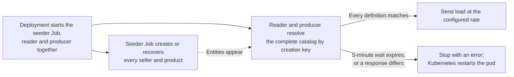

# Workload architecture

[ShardShop](../ARCHITECTURE.md) › **Workloads** · [README](README.md) · [Runbook](RUNBOOK.md) · [Live traffic control](../shardshop-core/workload-control/ARCHITECTURE.md)

The workload aggregator contains exactly three independently runnable submodules.
They are clients of the public product and order APIs: they create, read and order
through HTTP only.

| Submodule | Workload | Deployment |
|---|---|---|
| [`shardshop-product-seeder`](shardshop-product-seeder/ARCHITECTURE.md) | Seed a fixed dataset of sellers and their products through product over HTTP | Its own Job pod; exits when seeding completes. The same image also runs as one interactive Deployment pod that seeds only on operator request |
| [`shardshop-product-reader`](shardshop-product-reader/ARCHITECTURE.md) | Generate many concurrent product reads through product to load the database | Its own Deployment with one pod |
| [`shardshop-order-producer`](shardshop-order-producer/ARCHITECTURE.md) | Create its buyers, generate their orders, submit them to order over HTTP, and observe their status | Its own Deployment with one pod |

The pure [`shardshop-datasets`](shardshop-datasets/ARCHITECTURE.md) library under
`shardshop-workload` contains all dataset definitions. It fixes payloads and
creation retry keys, never entity IDs. Only workload applications depend on it;
service/core modules contain no datasets.

## Shared rules

- Each workload app uses local ID-free dataset definitions, IDs returned by
  product/order APIs, and bounded in-memory business state.
- Workloads have no ID generator, Snowflake dependency, generator allocation or
  allocator permissions.
- They have no direct SQL connections or persistent tables, including inbox/outbox
  tables.
- Each has its own request rate, concurrency limit, and resource budget; the
  [workload control](../shardshop-core/workload-control/ARCHITECTURE.md) makes the
  rate a live setting of each process.
- A retry repeats the original creation key/payload and recovers the same
  service-issued ID. Readers resolve persisted IDs by creation key through ordinary
  resource lookups; no runtime manifest is shared between applications.

See the [product creation contract](../shardshop-product/ARCHITECTURE.md#creation-keys-and-seller-placement)
and the [order allocation contract](../shardshop-order/ARCHITECTURE.md#service-issued-order-allocations).

## Workload lifecycle

1. Start the infrastructure and product, order, and ledger services. Start the
   seeder Job and the reader and order producer Deployments together. Each
   workload application decides in Java when it sends load.
2. Run the finite seeder according to its [seeding contract](shardshop-product-seeder/ARCHITECTURE.md#finite-seeding-and-verification).
3. The reader and the order producer own their start condition. They see the
   catalog only through product's HTTP API, without database credentials or a
   Kubernetes API token. They send load only after their startup lookups resolve
   every seller and product of the configured dataset and match its definitions.
   While an entity is missing or product is unavailable, slow or not reachable,
   they repeat the lookups with exponential backoff from 1 to 15 seconds, for at
   most 5 minutes. Then they stop with an error, and Kubernetes restarts the pod. A
   response that differs from its definition stops startup at once. Thus they never
   start load against a partially seeded dataset. The same wait covers a `404`
   that replica lag causes in the replica profile.
4. The baseline performs **no continuous seller or product creation after
   seeding**; orders change only stock, through reservations. The Job
   stays completed rather than being restarted as a Deployment. Reader and order
   producer run until the scenario controller scales them to zero. Each new run
   gets a new Helm-revision seeder Job on each deployment invocation while
   startup replaces workload pods even when their build is unchanged. Explicit
   temporary seeder runs remain available through Maven workload drills and through
   the interactive seeder's [control page](../shardshop-core/workload-control/ARCHITECTURE.md#seeder-modes).
   If the dataset is already complete, a workload can continue its load before
   the Job of its run completes, because the seeder sends the same keys and
   payloads again. Workloads do not generate run IDs.

## Catalog resolution

Reader and order producer load the same local definitions and resolve persisted
catalog IDs through `GET /api/v1/sellers/by-key/{creationKey}?region=US` and
`GET /api/v1/sellers/{sellerId}/products/by-key/{creationKey}`. These are ordinary
entity lookups, returning `404` when absent; they do not publish fixture definitions
or create data. Each application owns its response models, validates the response
against the requested definition, and preserves returned canonical string IDs.
A workload starts its load only after these reads succeed. The
[workload lifecycle](#workload-lifecycle) defines the bounded wait, which also
covers a `404` of replica lag.
