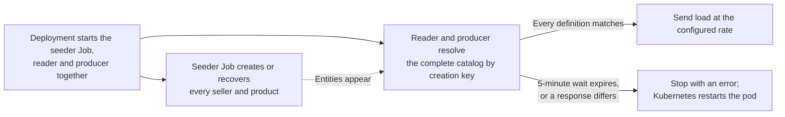

# shardshop-workload

[ShardShop](../README.md) › **Workloads**

The workload aggregator contains exactly three independently runnable submodules and the `shardshop-datasets`
library. The applications are clients of the public product and order APIs. They create, read and order
through HTTP only. `up.sh` starts all three with each release, as the [lab start](../README.md#start-the-lab)
shows.

| Submodule | Workload | Deployment |
|---|---|---|
| [`shardshop-product-seeder`](shardshop-product-seeder/README.md) | Seed a fixed dataset of sellers and their products through product over HTTP | Its own Job pod for each release, which exits when seeding completes. The same image also runs as the interactive Deployment `shardshop-product-seeder-control`, which seeds only on operator request |
| [`shardshop-product-reader`](shardshop-product-reader/README.md) | Generate many concurrent product reads through product to load the database | Deployment `shardshop-product-reader`, one pod |
| [`shardshop-order-producer`](shardshop-order-producer/README.md) | Create its buyers, generate their orders, submit them to order over HTTP and observe their status | Deployment `shardshop-order-producer`, one pod |

The pure [`shardshop-datasets`](shardshop-datasets/README.md) library contains all dataset definitions. It fixes
payloads and creation retry keys, never entity IDs. Only workload applications depend on it, and service and
core modules contain no datasets.

## Design

### Shared rules

- Each workload application uses local ID-free dataset definitions, IDs returned by the product and order APIs,
  and bounded in-memory business state.
- Workloads have no ID generator, Snowflake dependency, generator allocation or allocator permissions.
- They have no direct SQL connections and no persistent tables, including inbox and outbox tables.
- Each has its own request rate, concurrency limit and resource budget. The
  [workload control](../shardshop-core/workload-control/README.md) makes the rate a live setting of each process.
- A retry repeats the original creation key and payload and recovers the same service-issued ID. Readers
  resolve persisted IDs by creation key through ordinary resource lookups. No runtime manifest is shared
  between applications.

See the [product creation contract](../shardshop-product/ARCHITECTURE.md#creation-keys-and-seller-placement) and
the [order allocation contract](../shardshop-order/ARCHITECTURE.md#service-issued-order-allocations).

### Workload lifecycle



1. Start the infrastructure and the product, order and ledger services. Start the seeder Job and the reader and
   order producer Deployments together. Each workload application decides in Java when it sends load.
2. The finite seeder runs according to its
   [seeding contract](shardshop-product-seeder/README.md#finite-seeding-and-verification).
3. The reader and the order producer own their start condition. They see the catalog only through the HTTP API
   of product, without database credentials or a Kubernetes API token. They send load only after their startup
   lookups resolve every seller and product of the configured dataset and match its definitions. While an
   entity is missing, or product is unavailable, slow or not reachable, they repeat the lookups with
   exponential backoff from 1 to 15 seconds, for at most 5 minutes. Then they stop with an error, and
   Kubernetes restarts the pod. A response that differs from its definition stops the startup at once. Thus they
   never start load against a partially seeded dataset. The same wait covers a `404` that replica lag causes in
   the replica profile.
4. After seeding, the baseline creates no more sellers or products. Orders change only stock, through
   reservations. The Job stays completed and is not restarted as a Deployment. The reader and the order
   producer run until the scenario controller scales them to zero.
5. Each deployment invocation creates a new Helm-revision seeder Job, and startup replaces the workload pods
   also when their build is unchanged. Explicit temporary seeder runs are available through Maven workload
   drills and through the [control page](../shardshop-core/workload-control/README.md#seeder-modes) of the
   interactive seeder. If the dataset is already complete, a workload can continue its load before the Job of
   its run completes, because the seeder sends the same keys and payloads again. Workloads do not generate run IDs.

### Catalog resolution

The reader and the order producer load the same local definitions. They resolve persisted catalog IDs through
`GET /api/v1/sellers/by-key/{creationKey}?region=US` and
`GET /api/v1/sellers/{sellerId}/products/by-key/{creationKey}`. These are ordinary entity lookups that return
`404` when the entity is absent. They do not publish fixture definitions or create data. Each application owns
its response models, validates the response against the requested definition and keeps the returned canonical
string IDs. A workload starts its load only after these reads succeed. The
[workload lifecycle](#workload-lifecycle) defines the bounded wait, which also covers a `404` of replica lag.

## Operation

The [workload control pages](../shardshop-core/workload-control/README.md) show the state, rate and backend
traffic of each workload. Each workload application has its own operation section:
[datasets](shardshop-datasets/README.md#operation), [seeder](shardshop-product-seeder/README.md#operation),
[reader](shardshop-product-reader/README.md#operation) and [producer](shardshop-order-producer/README.md#operation).
Inspect the automatic release:

```bash
kubectl --context kind-shardshop -n shardshop get jobs -l app.kubernetes.io/name=shardshop-product-seeder
kubectl --context kind-shardshop -n shardshop logs deployment/shardshop-product-reader
```

### Seeding gate

The reader owns its start condition, as the [workload lifecycle](#workload-lifecycle) defines. At startup it
looks up the 151 sellers and 201 products of `catalog-v2` by creation key through the HTTP API of product. It
sends load only after all lookups succeed and match the dataset:

- While an entity is missing, or product is unavailable, slow or not reachable, SmallRye Fault Tolerance repeats
  the lookups with exponential backoff from 1 to 15 seconds. Each repeat logs one INFO line that names the
  failed lookup. The reader sets the Apache `HttpRequestRetryExec` logger to WARN, so a refused connection adds
  no line for each repeated request.
- After 5 minutes, the reader stops with exit code 1, and Kubernetes restarts the pod.
- A response that differs from the dataset stops the startup at once.

The MicroProfile Fault Tolerance keys
`dev.nklip.javacraft.shardshop.workload.reader.config.CatalogWait/resolve/Retry/maxDuration`,
`.../Retry/delay` and `.../ExponentialBackoff/maxDelay` change these bounds, in milliseconds.

`shardshop-application` owns routing, the product and order ConfigMaps and Services, the ledger ConfigMap and
all five application Deployments. Each Helm revision runs a new `post-install` and `post-upgrade` seeder Job
named `shardshop-application-seeder-<revision>`. The seeder needs no user run name. The order producer uses the
separate durable `orderProducer.runName` setting. The Job has `restartPolicy: Never`, `backoffLimit: 3` and
`activeDeadlineSeconds: 300`. Helmfile uses a bounded 600-second release timeout, and Helm waits for the hook
result.

An unchanged invocation still validates migrations and seeds idempotently, and each startup rolls all
application Deployment pods. Product also rolls when its image, resources or configuration change. Its pod
checksum is the SHA-256 of the complete rendered `application.properties`, which uses the same named template as
the mounted file, including static defaults. The reader image, HTTP settings, resources and dataset version are
direct template inputs. Helm revision numbers stay outside the application pod templates, and the startup
restart token controls the rollout. The `shardshop.javacraft/seeder-job` annotations of the reader and
order-producer Deployments name the latest seeder Job without replacement of their pods. Standalone reader
verification prefers that annotation and keeps the old pod run-label fallback for manual legacy deployments.

Seeder Jobs, successful or failed, keep their logs for 24 hours before the Kubernetes TTL cleanup. After that
evidence expires, run `up.sh` again before a standalone workload verification. Each seeding attempt recovers the
same catalog IDs. If the catalog is already complete, the reader can continue load while seeding repeats.

### Workload pods

The seeder and the reader get only the product URL `http://shardshop-product.shardshop.svc:8080` in
`SHARDSHOP_SEEDER_PRODUCT_URL` and `SHARDSHOP_READER_PRODUCT_URL`. They have no API token, Secret, database
setting or Service variables. The reader Deployment uses the `Recreate` strategy, so a maximum of one reader
runs. The reader, the order producer and the interactive seeder Deployment `shardshop-product-seeder-control`
open port 8080 for their [control pages](../shardshop-core/workload-control/README.md). A ClusterIP Service with
the same name as each Deployment selects its pod, and a TCP readiness probe reports the open port. The
interactive seeder uses the seeder budget below. The bootstrap Job serves no HTTP.

At 200 reads/s, each product pod uses approximately 10% to 23% of one core and 268 to 310 MiB of anonymous
memory for its JVM, and the reader uses 7% of one core and 148 MiB. With the control HTTP server, the container
working sets are 207 MiB for the reader, 179 MiB for the order producer and 163 MiB for the interactive seeder,
inside their limits. With a 1-CPU limit, the JVM starts were throttled for many seconds and the startup lookups
of the reader failed. Thus each container has a 2-CPU limit.

| Container | CPU request | CPU limit | Memory request | Memory limit |
|---|---|---|---|---|
| Product | 250m | 2 | 384Mi | 512Mi |
| Seeder | 100m | 2 | 192Mi | 256Mi |
| Reader | 100m | 2 | 192Mi | 384Mi |

After a product rollout, the new product JVMs are cold. The 16 concurrent startup lookups of the reader can
then receive `503`, because product allows one second to open or lease a database connection. The reader waits
and repeats the lookups, as the [seeding gate](#seeding-gate) defines. Against warm product pods, the lookups
take less than one second.
