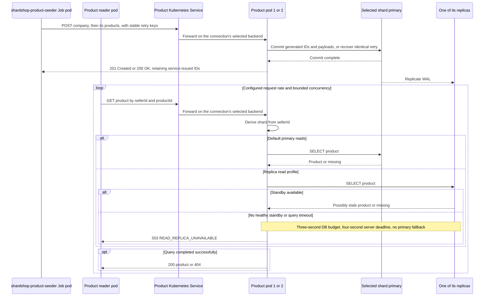

# Product reader architecture

[ShardShop](../../ARCHITECTURE.md) › [Workloads](../ARCHITECTURE.md) › **Product reader** · [README](README.md) · [Runbook](RUNBOOK.md)

The product reader sends concurrent product reads at a configured rate through the
product Service. It loads the database and measures request rate, latency,
outcomes, the seller-region distribution and its connection pool.

- **Runs as:** one Deployment pod.
- **Starts:** only after the [shared catalog gate](../ARCHITECTURE.md#workload-lifecycle)
  resolves the complete dataset.
- **Paced by:** [traffic control](../../shardshop-core/workload-control/ARCHITECTURE.md),
  which sets its live rate.

## HTTP connection policy

| Setting | Value |
|---|---|
| Protocol | HTTP/1.1 for the load profile |
| Connection pool | Up to 16 connections per reader pod to the product Service |
| Workers | At least as many concurrent workers as connections |
| Maximum connection lifetime | 30 seconds |
| Idle timeout | 10 seconds |
| Connect timeout | Two seconds |
| Overall request deadline | Five seconds; retries stay inside that deadline |
| Product Service | `sessionAffinity: None` |

Saturation tests can increase both the pool and the workers. Warm up the pool with
concurrent requests. After the first lifetime, the number of open connections
follows the load: request rate multiplied by latency. Retire aged connections after
their current request and discard failed connections immediately.

### Client

The reader uses the Apache HttpClient 5 classic pool, which the Quarkus platform
manages: a strict connection limit, a time to live checked when a connection is
leased, and an idle-connection evictor. The JDK HTTP client has no connection
limit or lifetime setting. The reader's concurrent startup lookups by creation key
open the pool. A missing entity or an unavailable product makes the reader wait,
as the [workload lifecycle](../ARCHITECTURE.md#workload-lifecycle) defines; another
failed lookup stops the reader before the load starts.

### Retries and deadlines

- A scheduled cancel ends each read at the deadline, including the wait for a
  connection and all attempts.
- The reader sends a request again only after a failure without an HTTP response,
  at a fixed interval.
- An HTTP status, including `503`, is a measured outcome, because product already
  limits and repeats its own database work.
- The reader rejects a deadline shorter than five seconds, so that product's `503`
  within its four-second server deadline stays measurable.

The reader reports request rate, latency percentiles, outcomes, seller-region
distribution and the pool state as one log line for each interval, and a total
line at shutdown.

## Load distribution across product pods

Kubernetes selects a backend for a TCP connection; repeated HTTP requests on
that connection stay on that backend. Pool size and connection rotation create
new selection opportunities, including after a pod restart, but do not guarantee
an exact 50/50 split. See [Kubernetes Service proxies](https://kubernetes.io/docs/reference/networking/virtual-ips/).

Expose request counters by pod identity. Under sustained load, verify positive
counter deltas for both ready product pods within a 120-second observation window,
and repeat after replacing one pod. Fail the check with per-pod counts and pool
metrics if either receives no traffic; do not assume that replica count proves
traffic distribution.

## Seeding and read path

The diagram illustrates replica visibility. The default synchronous durability
profile waits for a durable WAL acknowledgement from any one of the shard's two
standbys before reporting commit; replica query visibility still waits for WAL
replay, so a read can reach the standby that has not yet replayed it. The
separate asynchronous profile omits that commit acknowledgement requirement.

The product service queries PostgreSQL for every load-test read; caching is
disabled so the reader exercises the database. Measure request rate, latency,
errors, pool saturation, shard distribution, and replica lag. Configure finite
HTTP/SQL timeouts, bounded concurrency, and bounded retries with backoff. The
[product read profile](../../shardshop-product/ARCHITECTURE.md#read-profiles-tls-and-deadlines)
defines the server budgets.
