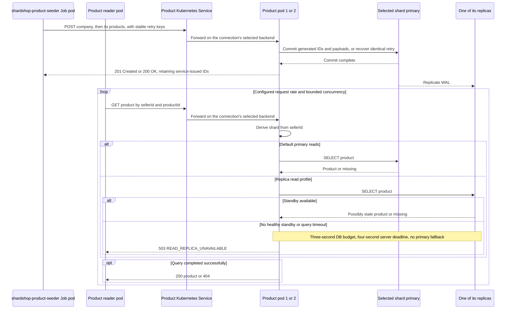

# shardshop-product-reader

[ShardShop](../../README.md) › [Workloads](../README.md) › **Product reader**

`shardshop-product-reader` sends concurrent product reads at a configured rate through the product Service. It
loads the database and reports request rate, latency percentiles, outcomes, the seller-region distribution and
its connection pool.

- **Runs as:** the Deployment `shardshop-product-reader`, one pod.
- **Starts:** only after the [shared catalog gate](../README.md#workload-lifecycle) resolves the complete dataset.
- **Paced by:** [workload control](../../shardshop-core/workload-control/README.md), which sets its live rate.

## Design

### HTTP connection policy

| Setting | Value |
|---|---|
| Protocol | HTTP/1.1 for the load profile |
| Connection pool | Up to 16 connections per reader pod to the product Service |
| Workers | At least as many concurrent workers as connections |
| Maximum connection lifetime | 30 seconds |
| Idle timeout | 10 seconds |
| Connect timeout | Two seconds |
| Overall request deadline | Five seconds. Retries stay inside that deadline |
| Product Service | `sessionAffinity: None` |

Saturation tests can increase both the pool and the workers. Warm up the pool with concurrent requests. After
the first lifetime, the number of open connections follows the load: request rate multiplied by latency. Retire
aged connections after their current request, and discard failed connections at once.

#### Client

The reader uses the Apache HttpClient 5 classic pool, which the Quarkus platform manages. It has a strict
connection limit, a time to live that is checked when a connection is leased, and an idle-connection evictor.
The JDK HTTP client has no setting for a connection limit or a connection lifetime. The concurrent startup
lookups by creation key open the pool. A missing entity or an unavailable product makes the reader wait, as the
[workload lifecycle](../README.md#workload-lifecycle) defines. Another failed lookup stops the reader before
the load starts.

| Item | Reader behavior |
|---|---|
| Pool | A strict pool of up to 16 HTTP/1.1 connections. Apache opens a connection only when no free connection exists, and uses free connections in FIFO order |
| Warm-up | 16 workers send the 450 startup lookups at the same time, so all 16 connections open before the load starts |
| Rotation | Apache's time to live of 30 s: the pool closes an older connection when it would lease it again, thus after its current request. The replacement connection gives the Service a new backend selection |
| Idle connection | Apache's idle-connection evictor checks each second and closes a connection that is not used for 10 s |
| Failed connection | Apache closes a connection after a failure or a cancel |
| Response body | A body larger than 2 MiB is an invalid response. The reader reads at most 2 MiB plus one byte |

#### Retries and deadlines

- A scheduled cancel ends each read at the deadline, including the wait for a connection and all attempts.
- The reader sends a request again only after a failure without an HTTP response (for example a refused, reset
  or closed connection), at a fixed interval, for a maximum of 3 attempts 100 ms apart. It does not repeat
  timeouts.
- An HTTP status, including `503`, is a measured outcome, because product already limits and repeats its own
  database work.
- The reader rejects a deadline shorter than five seconds, so the `503` of product within its four-second
  server deadline stays measurable.

### Load distribution across product pods

Kubernetes selects a backend for a TCP connection, and repeated HTTP requests on that connection stay on that
backend. The pool size and the connection rotation create new selection opportunities, also after a pod
restart, but they do not guarantee an exact 50/50 split. See
[Kubernetes Service proxies](https://kubernetes.io/docs/reference/networking/virtual-ips/).

Expose request counters by pod identity. Under sustained load, verify positive counter deltas for both ready
product pods within a 120-second observation window, and repeat after you replace one pod. If either pod
receives no traffic, fail the check with the per-pod counts and pool metrics. The replica count alone does not
prove the traffic distribution.

### Seeding and read path



The diagram shows replica visibility. The default synchronous durability profile waits for a durable WAL
acknowledgement from any one of the two standbys of the shard before it reports commit. Replica query
visibility still waits for WAL replay, so a read can reach a standby that has not yet replayed it. The
asynchronous profile omits the commit acknowledgement requirement.

The product service queries PostgreSQL for every load-test read. Caching is disabled, so the reader exercises
the database. Measure request rate, latency, errors, pool saturation, shard distribution and replica lag.
Configure finite HTTP and SQL timeouts, bounded concurrency, and bounded retries with backoff. The
[product read profile](../../shardshop-product/ARCHITECTURE.md#read-profiles-tls-and-deadlines) defines the
server budgets.

## Operation

### Start

In the lab, `up.sh` deploys the reader as the Deployment `shardshop-product-reader` with one pod. Outside
Kubernetes, start the packaged reader with the product URL. `--check-startup` validates the configuration,
including the URL and the timeouts, and exits without HTTP requests:

```bash
java -Dshardshop.reader.product-url=http://localhost:8080 \
  -jar microservices/shardshop/shardshop-workload/shardshop-product-reader/target/quarkus-app/quarkus-run.jar
```

At startup, the reader looks up each `catalog-v2` seller by its creation key and region. Then it looks up each
product by its creation key under the returned seller ID. Each response must agree with the dataset payload.
The reader keeps the returned IDs and never generates or derives an ID. Then it logs one line:

```text
Resolved catalog-v2 [US 50 sellers, 50 products; EU 50 sellers, 100 products; ASIA 51 sellers, 51 products], key-to-ID SHA-256 <hex>
```

The digest uses the same lines as the [seeder digest](../shardshop-product-seeder/README.md#monitoring). Equal
digests show that the reader found the IDs that the seeder verified. While an entity is missing or product is
unavailable, the reader waits and repeats the lookups, as the [seeding gate](../README.md#seeding-gate)
defines. Another failed lookup, or the end of the wait, logs one error line, and the reader exits with code 1
before the load starts.

After the lookups, the workers read randomly selected products with
`GET /api/v1/sellers/{sellerId}/products/{productId}`. One shared schedule gives the request starts one total
rate. After a stall, the reader does not send the missed requests later. The
[reader control page](../../shardshop-core/workload-control/README.md) changes this rate, and pauses and resumes
the reads, while the reader runs. Each response must keep the issued IDs and the dataset payload. Only the
stock can change.

### Monitoring

```bash
kubectl --context kind-shardshop -n shardshop logs deployment/shardshop-product-reader
```

The reader logs one metric line for each report interval:

```text
Product reads, interval 30.0 s: 6000 requests, 200.0/s, outcomes {OK=6000}, latency ms {p50=2, p95=4, p99=7, max=15}, regions {ASIA=1996, EU=2009, US=1995}, pool {leased=3, pending=0, available=13, max=16}, catalog-v2 key-to-ID SHA-256 <hex>
```

Each interval and total report repeats the digest of the resolved catalog. Live verification reads at most 100
recent lines and 64 KiB, so it can compare the reader and seeder digests after the startup summary has rotated
away.

The latency percentiles are in whole milliseconds, rounded up. They include the wait for a connection and all
attempts. `regions` counts reads by seller home region. `pool` is the state of the Apache pool when the line is
written: `leased` connections are in use, `pending` reads wait for a connection, and `available` connections
are open and free. The level is INFO when all reads are `OK`, and WARN when they are not. At SIGTERM, the
reader stops its workers and writes one `Product reads, total` line as the last report. The deadline of each
read limits this stop. Log lines contain no response payloads. An unexpected worker failure logs one error line
and stops the reader with exit code 1.

An HTTP status is a result and not a reason to send the request again. Each read has one of these outcomes:

| Outcome | Meaning |
|---|---|
| `OK` | `200` with the issued IDs and the dataset payload |
| `NOT_FOUND` | `404`, for example a product that a standby has not replayed yet |
| `REPLICA_UNAVAILABLE` | `503 READ_REPLICA_UNAVAILABLE` |
| `UNAVAILABLE` | Another `503`, for example `CATALOG_UNAVAILABLE` |
| `HTTP_ERROR` | A different status |
| `INVALID_RESPONSE` | A body that is too large or not valid JSON, or that has a different ID or payload |
| `DEADLINE` | No result in 5 s |
| `TRANSPORT` | No HTTP response after the permitted attempts, for example a refused connection |

The reader serves its [control page](../../shardshop-core/workload-control/README.md#monitoring) and API on port
8080 with Quarkus REST (local port 18083). It shows the state, the effective target and the achieved rate.

### Configuration

| Property | Default | Purpose |
|---|---|---|
| `shardshop.reader.product-url` | None. Startup fails without it | Base URL of the product Service |
| `shardshop.reader.catalog-version` | `catalog-v2` | Dataset version. Other versions fail before HTTP |
| `shardshop.reader.request-rate` | `200` | Initial request starts per second for all workers, 0-10000 with at most three decimals. The control page changes the live rate |
| `shardshop.reader.workers` | `16` | Concurrent workers, from the number of connections to 256 |
| `shardshop.reader.connections` | `16` | HTTP/1.1 connections, 1-64 |
| `shardshop.reader.connect-timeout` | `2s` | Connection deadline. It cannot be longer than the request deadline |
| `shardshop.reader.request-deadline` | `5s` | Complete deadline of one read. Startup fails below 5 s, because product returns `503` within its 4-second server deadline |
| `shardshop.reader.max-attempts` | `3` | Attempts after failures without an HTTP response, 1-5 |
| `shardshop.reader.retry-interval` | `100ms` | Fixed delay before a new attempt |
| `shardshop.reader.max-connection-lifetime` | `30s` | Apache time to live of a connection |
| `shardshop.reader.idle-timeout` | `10s` | Time before an unused connection closes |
| `shardshop.reader.report-interval` | `30s` | Time between metric lines, at least 1 s |
| `shardshop.reader.diagnostics.enabled` | `false` | Append bounded scheduling diagnostics to the interval reports |

Environment variables such as `SHARDSHOP_READER_PRODUCT_URL` also set these properties. The
[workload README](../README.md#operation) describes the Deployment, its resource budget and the
[seeding gate](../README.md#seeding-gate).

For a diagnostic run, set `SHARDSHOP_READER_DIAGNOSTICS_ENABLED="true"` under `productReader.configuration`. The
existing report and catalog digest keep their positions. A `scheduling us` suffix adds count, mean, p50, p95,
p99 and maximum:

- `wake`: from the granted pacing slot to the observed permit, including the reacquisition of the condition and
  lock. The intentional pacing wait is excluded.
- `lateArrival`: the arrival under the pacer lock beyond the previous next slot. Startup, pause and rate
  changes, and unpaced starts have no valid baseline and are excluded. This combines worker availability and
  stalls, not pure OS latency.
- `dispatch`: from the observed permit to the timestamp immediately before the HTTP call.

Samples are recorded with the completed read results. Each interval also includes
`window={sequence,startNanos,endNanos}` from the monotonic clock of the reader JVM. Use their difference for
the exact duration, and the sequence and bounds for non-overlap. Do not compare these timestamps with the
monotonic clock of the host. The histograms use fixed storage (approximately 192 KiB in total for interval and
cumulative diagnostics), ceiling-microsecond percentile bounds with approximately 1.6% bucket width above 127
microseconds, and nanosecond-derived means and maxima. Diagnostics do not change pacing, rate limits,
missed-start or pause semantics.

For a saturation test, increase `request-rate`, and increase `workers` and `connections` together. One pod
sends at most `workers` divided by the latency: 16 workers at 3 ms send approximately 5,300 requests/s. When
product saturates, the reader does not send the missed requests later, so the reported rate is the accepted rate.

### Tests

`ProductReader.feature` of the [integration tests](../../shardshop-testing/RUNBOOK.md#integration-tests-with-testcontainers)
runs the packaged reader with its default policy and 5-second reports against the packaged product, and seeds
the catalog with the packaged seeder. It does not connect to the kind lab. It checks:

1. The reader starts before the seeder. It must wait for the catalog and must not start its load. After the
   seeder run, it must start its load, and its resolution digest must equal the seeder digest.
2. Three report intervals must have only `OK` reads at 180-201 requests/s, with all three regions, the 16 open
   connections of the warm-up and no read that waits for a connection.
3. While product stops, then starts without replicas, and then starts with primaries, the reader must record
   `TRANSPORT` and `REPLICA_UNAVAILABLE` outcomes, continue to run and recover. No read takes longer than 5.1
   seconds.
4. After SIGTERM, the total line must be the last report. The stored rows must not change.
5. Against product without read replicas, a reader with a 10-second maximum wait must exit with code 1 and one
   `REPLICA_UNAVAILABLE` lookup error, before the load starts.

The connection rotation after the 30-second lifetime and the 5-second read deadline are client behavior.
`ProductRequestsTest` and `ProductReaderTest` check them against a loopback server. `ReaderConfigurationTest`
checks that the packaged defaults are the time limits of the [HTTP connection policy](#http-connection-policy).

```bash
mvn -B -ntp -f microservices/shardshop/pom.xml -pl shardshop-testing -am -Pintegration clean verify
```
